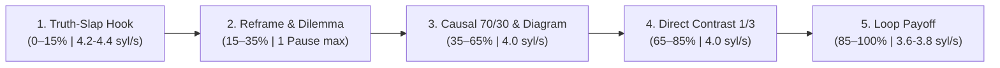

# Cẩm nang Chuyển thể Video Nguyên bản, Nhịp Độ Khán Giả Lạnh & Phễu 3 Tầng Học Thuật (Original Adaptation Playbook)

Tài liệu này hướng dẫn cách chuyển hóa các quy luật kể chuyện và hình ảnh rút ra từ phân tích video mẫu tham chiếu (như `@Inkexplainer96` và Top 12 Video Thịnh Hành của kênh) thành **kịch bản và sản phẩm video hoàn toàn nguyên bản (Mode B)** trong Video Pilot, được tối ưu hóa đặc biệt cho **khán giả lạnh (Cold Audience)** và ngách **"Tư Duy Nhận Thức, Phương Pháp Luận & Bản Chất Tri Thức"**.

> [!IMPORTANT]
> **Nguyên tắc chuyển thể độc lập (Mode B) & Cold-Audience Pacing:**
> 1. Kế thừa *cấu trúc tư duy* (nghịch lý nhận thức, sơ đồ hệ thống, chuỗi nhân quả, vòng lặp kết thúc) chứ **tuyệt đối không sao chép** câu chữ, tình huống hay hình vẽ của kênh tham chiếu.
> 2. **Cấm bắt chước nhịp mở bài chậm của kênh triệu sub:** Các kênh lớn đã có uy tín thương hiệu nên có thể dẫn chuyện thong thả trong 30 giây đầu; ngược lại, kênh mới (hoặc khi tiếp cận tệp khán giả lạnh trên TikTok/YouTube) **bắt buộc phải đảo kết luận/nghịch lý gay cấn nhất lên 2.5–3 giây đầu tiên** (`Counter-Intuitive Hook <= 18 âm tiết`, `0 pause` ở `SC01`, tốc độ `4.2–4.4` âm tiết/s, đổi nhịp hình `1.2s–1.8s`).

---

## 1. Nguyên Tắc Thích Nghi Cho Kênh Mới (`Cold-Audience Pacing` vs. `Big-Channel Pacing`)

| Tiêu chí | Kênh Lớn Triệu Sub (Không được bắt chước máy móc) | Quy Chuẩn Cold-Audience Pacing Trong Video Pilot (Bắt buộc) |
|:---|:---|:---|
| **3 giây đầu (`SC01` Câu 1)** | Dẫn nhập chậm rãi kiểu *"Hãy nghĩ về một buổi sáng..."*, *"Hãy tưởng tượng..."* | **Counter-Intuitive / Truth-Slap Hook ($\le 18$ âm tiết):** Đập thẳng vào nghịch lý nhận thức (*"Đọc lại giáo trình năm lần chỉ đang ru ngủ não bạn."*). |
| **Khoảng ngắt 15s đầu (`SC01`)** | Có thể ngắt nghỉ 0.8s–1.0s giữa các câu đầu để tạo chất thơ | **Zero Pause in First 15s (`OPENING_SCENE_PAUSE_FORBIDDEN`):** Tuyệt đối 0 thẻ `[pause:...]` trong `SC01`. |
| **Tốc độ 30s đầu (`SC01–SC02`)** | Đọc đều ~3.8–4.0 âm tiết/giây từ đầu đến cuối | **Dynamic Pacing `4.2 – 4.4` âm tiết/giây** (`VietNarrator` `speed: 1.0`) để tạo lực cuốn tức thì, sau đó mới hạ về `4.0` syl/s ở thân bài. |
| **Mật độ thị giác mở đầu** | Giữ 1 khung hình tĩnh 3.5s–5.0s | Khi lời thoại hỗ trợ, hướng tới 8–9 ảnh scene toàn khung trong 12–12,5 giây đầu, khoảng 4 ảnh trong 5 giây đầu. Neo cut vào cụm từ cụ thể và kiểm tra theo WAV. |
| **Bối cảnh văn hóa 60s đầu** | Dùng ngay bối cảnh Âu Mỹ hoặc cổ đại xa lạ (*Sumer, Edubba, Phổ*) | **Việt hóa 100% trong 60 giây đầu (`Vietnamese Cultural Localization`):** Ôn thi đêm, highlight giáo trình, mở Word làm khóa luận, 120s trước hội đồng bảo vệ; chỉ đưa dẫn chứng ngoại vào từ Chương 3 trở đi. |

---

## 2. Quy Hoạch Ngách "Tư Duy Nhận Thức, Phương Pháp Luận & Bản Chất Tri Thức" Theo Phễu 3 Tầng

Vận hành nội dung theo phễu 3 tầng mở rộng không gian sáng tạo đề tài, tập trung vào nguyên lý và cơ chế nhân quả:

1. **Tầng 1 — Phễu Rộng (`tier_1_broad`): "Tư Duy Nhận Thức, Nghịch Lý Nhận Thức & Ảo Giác Tri Thức"**
   - *Trọng tâm:* Nhận diện và giải phẫu các điểm mù tư duy, bẫy tâm lý nhận thức và ảo giác hiểu biết (Cognitive Biases, Mental Models, Illusion of Explanatory Depth).
   - *Điểm chạm:* Tập trung vào cơ chế nhận thức đằng sau các nghịch lý tư duy, lý giải nguyên nhân gốc rễ bằng khoa học nhận thức.
2. **Tầng 2 — Phễu Giữa (`tier_2_mid`): "Phương Pháp Luận, Giải Phẫu Nhân Quả & Bản Chất Gốc Rễ"**
   - *Trọng tâm:* Truy vết nguyên lý đệ nhất (First-Principles Thinking), giải phẫu chuỗi nhân quả và tư duy hệ thống (Systems Thinking, Causal Inquiry).
   - *Điểm chạm:* Cung cấp các mô hình tư duy phân tích đa chiều, bóc tách cấu trúc tri thức phức tạp thành các liên kết nhân quả mạch lạc.
3. **Tầng 3 — Phễu Chuyển Đổi (`tier_3_conversion`): "Khung Tư Duy Đào Sâu Tri Thức & Hệ Thống Hóa"**
   - *Trọng tâm:* Các công cụ tư duy bậc cao, phương pháp phản biện đối đầu và hệ thống hóa tri thức sâu (Deep Intellectual Tooling, Adversarial Thinking).
   - *Quy tắc:* Tuyệt đối cấm mẹo vặt văn phòng hời hợt (Excel, slide, mẹo học vẹt). Mọi nội dung công cụ đều phải phục vụ việc nâng tầm tư duy phân tích và giải quyết bài toán phức tạp.

---

## 3. Khung Kể Chuyện 5 Phần Cho Video Nguyên Bản Mới (5-Part Storytelling Framework)

- **Phần 1 — Counter-Intuitive Hook & Empathy (0–15%):** Câu đầu tiên $\le 18$ âm tiết lật tẩy ảo giác học thuật + bối cảnh Việt hóa sát sườn, `0 pause`, nhịp cắt thị giác `1.2s–1.8s`.
- **Phần 2 — Reframe & Dilemma (15–35%):** Đặt niềm tin sai lầm của số đông đối diện với luật ngầm học thuật Q1 / phát hiện thần kinh học; tối đa 1 thẻ `[pause:900ms]` trước câu tiết lộ.
- **Phần 3 — Causal Evidence & Academic Diagram (35–65%):** Tỷ lệ 70/30 — 70% dẫn dắt qua **Sơ đồ Tháp học thuật / Flowchart trong ảnh toàn khung** với nhân vật/đạo cụ tương tác trong cùng bố cục + 30% dữ kiện văn nói $\le 20$ âm tiết.
- **Phần 4 — Direct Contrast (65–85%):** Đặt hai phương pháp đối lập tại tọa độ **Quy tắc 1/3 (`x = 0.35` và `x = 0.64`)** (ví dụ: *Mở Word gõ ngay* vs. *Xây dựng Research Gap Matrix*).
- **Phần 5 — Philosophical Payoff & Loop Closure (85–100%):** Quay lại hình ảnh ở giây đầu tiên với tâm thế làm chủ tri thức, hạ tốc độ xuống `3.6–3.8` âm tiết/s, $P_{\text{tail}} = 0.35\text{s}$.

---

## 4. Quy Chuẩn Tách Tầng Kịch Bản, Âm Thanh & Spin-off Ngắn

1. **Phụ đề an toàn (`sys/format_profiles.py`):**
   - Tối đa 2 dòng/cue; $\le 42$ ký tự/dòng (`84` ký tự/cue) cho `long_16x9` và $\le 28$ ký tự/dòng (`54` ký tự/cue) cho `short_9x16`, đồng bộ nhảy chữ theo `word_timestamps` âm học.
2. **Chuyển thể Long-to-Short Spin-off (`short_9x16`):**
   - Tuyệt đối không cắt ngang giữa video `16:9` đem đăng TikTok. Phải rút trích các nghịch lý đắt giá nhất thành các kịch bản `short_9x16` độc lập (thời lượng động theo kịch bản và audio, `subtitles: true`, `voice: "VietNarrator"`, `speed: 1.0`) có câu mở đầu Truth-Slap Hook $\le 18$ âm tiết riêng.
3. **Âm thanh & Foley:**
   - Khóa từ neo (*semantic anchors*) với Micro-SFX (`pop`, `whoosh`, tiếng lật trang giấy, tiếng đồng hồ) và Sidechain Ducking BGM (`-20dB` khi có thoại, `-14dB` khi nghỉ).

---

## 5. Danh Mục Kiểm Tra Chuyển Thể Hoàn Tất (Adaptation QC Checklist)

- [ ] **Đúng ngách & Phễu 3 Tầng:** Thuộc ngách *"Tư Duy Nhận Thức, Phương Pháp Luận & Bản Chất Tri Thức"*, 0 từ khóa mẹo văn phòng (Excel/Slide/hacks ngắn hạn).
- [ ] **Đóng gói CTR chuẩn (`brief.json`):** `youtube_title <= 55` ký tự (từ khóa tò mò trong 5 chữ đầu, không tự trả lời), `thumbnail_spec` có `text_overlay` 2–4 từ in hoa.
- [ ] **Cold-Audience Hook & Việt hóa 60s đầu:** Câu đầu `SC01 <= 18` âm tiết, `0` thẻ pause ở `SC01`, bối cảnh Việt Nam 100% trong 60s đầu, không có mẫu câu cấm *"Hãy nghĩ về..."*.
- [ ] **Mật độ thị giác cold open:** Đảm bảo nhịp thị giác tương xứng với tốc độ dẫn thoại mở màn; nhân vật, sơ đồ và đạo cụ cùng trong ảnh scene toàn khung.
