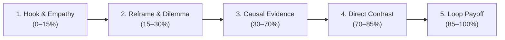

# Cẩm nang Chuyển thể Video Nguyên bản Mới (Original Adaptation Playbook)

Tài liệu này hướng dẫn cách chuyển hóa các quy luật kể chuyện và hình ảnh rút ra từ phân tích video mẫu tham chiếu thành một **kịch bản và sản phẩm video hoàn toàn nguyên bản (Mode B)** trong Video Pilot.

> [!IMPORTANT]
> **Nguyên tắc chuyển thể độc lập (Mode B):**
> Kế thừa *chức năng kể chuyện* (câu hỏi gợi mở, tương phản nhận thức, chuỗi nhân quả, vòng lặp kết thúc) chứ **tuyệt đối không sao chép** câu chữ, tình huống cụ thể, nhân vật, hình vẽ, âm nhạc hay cấu trúc câu thoại nguyên văn của kênh tham chiếu.

---

## 1. Khung Kể chuyện 5 Phần cho Video Nguyên bản Mới (5-Part Storytelling Framework)

Dành cho video giải thích ngắn (thời lượng 45s – 90s hoặc các macro-chapter của video dài 8–11 phút):

### Phần 1: Mở đầu & Trải nghiệm Đồng cảm (Hook & Empathy - 0–15% thời lượng)
- **Mục tiêu tâm lý:** Kéo người xem thoát khỏi trạng thái lướt vô thức bằng một hiện tượng đời thường quen thuộc mà họ trực tiếp trải qua.
- **Quy tắc biên kịch:**
  - Không mở bài bằng định nghĩa từ điển hay giọng điệu giảng bài lý thuyết khô khan.
  - Neo vào một hình ảnh cụ thể: tiếng chuông báo thức 6:00 sáng, chiếc cốc cà phê thứ ba trong ngày, sự kiệt sức nơi công sở.
  - Tốc độ đọc: Nhanh, dồn dập (~4.2 âm tiết/s tiếng Việt hoặc ~145–150 wpm tiếng Anh).
- **Hành động thị giác:** 1 hành động rõ nét, dễ nhận biết (nhân vật que ngồi bật dậy, nhìn đồng hồ cát hoặc đồ vật quen thuộc).

### Phần 2: Tái định hình & Lật lại Định kiến (Reframe & Dilemma - 15–30% thời lượng)
- **Mục tiêu tâm lý:** Tạo xung đột nhận thức (*cognitive dissonance*) bằng cách chỉ ra lỗ hổng trong những niềm tin mặc định.
- **Quy tắc biên kịch:**
  - Cấu trúc: *"Chúng ta luôn tin rằng [Định kiến A]... nhưng sự thật có phải như vậy?"*
  - Đặt ra câu hỏi tu từ lôi kéo tư duy: *"Ai mới thực sự là người phải làm việc nhiều hơn?"*
  - Ngắt nhịp: Chèn khoảng ngắt kịch tính `[pause:900ms]` trước khi lật ngược vấn đề.
- **Hành động thị giác:** Dấu gạch chéo định kiến cũ, biểu tượng đồng hồ quay ngược thời gian, hoặc sticker người que ôm đầu thắc mắc.

### Phần 3: Dẫn chứng Nhân quả & Cơ chế Khoa học (Causal Evidence & Mechanism - 30–70% thời lượng)
- **Mục tiêu tâm lý:** Cung cấp câu trả lời thỏa đáng, dựa trên bằng chứng khoa học vững chắc nhưng dễ hiểu.
- **Quy tắc biên kịch:**
  - Chia nhỏ thành chuỗi nhân quả 2–3 mắt xích logic liên tiếp. Mỗi mắt xích chỉ mang một thông điệp cốt lõi.
  - **Tỷ lệ 70/30:** 70% lời dẫn khơi gợi sự thú vị, 30% dành cho các dữ liệu/số liệu đắt giá (ví dụ: *nghiên cứu năm 2014*, *17 giờ mỗi tuần*, *hài cốt thoái hóa*).
  - Tốc độ đọc: Cân bằng, mạch lạc (~4.0 âm tiết/s).
- **Hành động thị giác:** Sơ đồ dòng thời gian, bảng phân loại dữ liệu, thước đo so sánh. Sử dụng **Visual Beats (`beats[]`)** mỗi 2.5s – 3.5s để đổi đạo cụ mà không cắt vụn audio.

### Phần 4: Tương phản Trực diện & Đúc kết Nghịch lý (Direct Contrast & Synthesis - 70–85% thời lượng)
- **Mục tiêu tâm lý:** Đưa mâu thuẫn lên đỉnh điểm để người xem tự rút ra kết luận logic.
- **Quy tắc biên kịch:**
  - Đặt hai thực tại đối lập cạnh nhau:
    - Tiện nghi công nghệ vs Kiệt sức thời gian.
    - Công cụ thô sơ vs Tự do sinh hoạt.
  - Nhấn trọng âm ngữ nghĩa (*semantic stress*) vào các từ đối lập: *thực sự*, *ngược lại*, *cái bẫy*.
- **Hành động thị giác:** Tuân thủ **Editorial Graphic Visuals (`ERR-20261011-03`)**: đặt hai nhân vật que/đạo cụ ở hai tọa độ **Quy tắc 1/3** (`x = 0.35` và `x = 0.64`) hoặc cắt cảnh đối xứng liên tiếp (tuyệt đối không dùng chia đôi màn hình `split-screen comparisons`).

### Phần 5: Đúc kết Triết lý & Khép vòng Lặp (Philosophical Payoff & Loop Closure - 85–100% thời lượng)
- **Mục tiêu tâm lý:** Mang lại cảm giác thỏa mãn trọn vẹn và tạo dư âm suy ngẫm sâu sắc cho người xem sau khi video kết thúc.
- **Quy tắc biên kịch:**
  - **Khép vòng lặp hoàn hảo (Loop Closure):** Câu kết luận phải quay trở lại hình ảnh hoặc câu hỏi ở giây đầu tiên (chiếc đồng hồ báo thức, buổi sáng thức dậy).
  - Tốc độ đọc: Chậm rãi, sâu lắng (~3.6–3.8 âm tiết/s).
  - Sử dụng hằng số đuôi âm học kết thúc $P_{\text{tail}} = 0.35\text{s}$ để video đóng dứt khoát.
- **Hành động thị giác:** Giữ khung hình tĩnh đủ lâu (hold beat) để người xem kịp đọc và thẩm thấu thông điệp cuối cùng.

---

## 2. Quy chuẩn Tách Tầng Kịch bản & Âm thanh

Xử lý phụ đề, âm thanh và chuyển động thành các track độc lập trong bản mô tả sản xuất (production brief):
1. **Phụ đề an toàn (`sys/format_profiles.py`):**
   - Tối đa 2 dòng/cue; $\le 42$ ký tự/dòng (`84` ký tự/cue) cho `long_16x9` và $\le 28$ ký tự/dòng (`54` ký tự/cue) cho `short_9x16`. Cắt dòng cân bằng ở vị trí giữa câu (`len(words) // 2`).
2. **Âm thanh & Foley:**
   - Khóa các từ neo (*semantic anchors*) trong kịch bản thoại với các tệp âm thanh hiệu ứng CC0 tương ứng (ví dụ: *"chuông báo thức"* $\longrightarrow$ `sfx_alarm_bell`).
   - Nhạc nền (BGM) ducking xuống **-20dB** trong suốt lời dẫn thoại và nâng lên **-14dB** ở khoảng nghỉ kịch tính.

---

## 3. Liên kết Tài liệu Tham chiếu Kỹ năng

Để triển khai chi tiết từng công đoạn kỹ thuật trong Video Pilot, tham khảo các tài liệu chuyên biệt:
- **[Ma trận ra quyết định kỹ thuật](decision-framework.md):** Bảng tra cứu khi nào dùng Mode A/B, khi nào tách Scene vs dùng Visual Beats, và cách chọn Voice Model phù hợp.
- **[Quy chuẩn lời văn, giọng đọc và ngắt nhịp](voice-cadence-pacing.md):** Công thức tính âm tiết mục tiêu $\text{Syllables} = (D - P_{\text{tail}}) \times 4.0$, bảng kiểm chứng sai số thực nghiệm $\le 0.30\text{s}$, và dải tốc độ động học.
- **[Quy trình tích hợp Video Pilot](video-pilot-integration.md):** Hướng dẫn đóng gói brief, ủy quyền grant, sinh sticker phân tầng và render qua Remotion.

---

## 4. Danh mục Kiểm tra Chuyển thể Hoàn tất (Adaptation QC Checklist)

Trước khi chuyển giao kịch bản sang quy trình sản xuất của `vp-production`, xác nhận các tiêu chí sau:

- [ ] **Độc lập bản quyền 100%:** Đề tài, số liệu nghiên cứu, câu từ kịch bản, và hình ảnh hoàn toàn mới mẻ, không sao chép nguyên văn kênh mẫu.
- [ ] **Tuân thủ khung 5 phần:** Đủ 5 giai đoạn: Hook $\rightarrow$ Reframe $\rightarrow$ Causal Evidence $\rightarrow$ Direct Contrast $\rightarrow$ Loop Payoff.
- [ ] **Khớp dung sai thời lượng $\pm 0.5\text{s}$:** Số âm tiết kịch bản đã được đo đạc theo công thức triệt tiêu dead-air trong [voice-cadence-pacing.md](voice-cadence-pacing.md).
- [ ] **Visual Beats đồng bộ:** Mỗi phân cảnh dài $\ge 8\text{s}$ đều có các nhịp `beats[]` xuất hiện so le để chống hiện tượng đơ hình (Scene Hold Stagnation).
