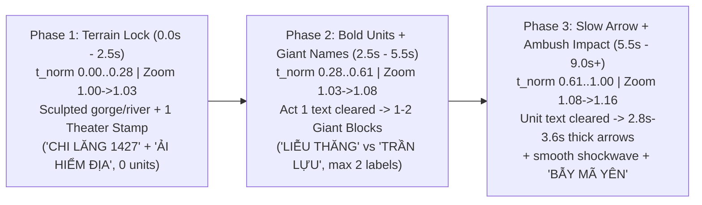

# V12 Tactical Map Forensics & `tactical_battle_map_v9.py` Specification (Thread 1C)

**Owner:** `@map-pacing-lab`  
**Target Module:** `sys/fx_warehouse/tactical_battle_map_v9.py` (with drop-in default upgrade for [tactical_battle_map_v8.py](file:///home/hongphuoc6104/Desktop/vp-agent-core/sys/fx_warehouse/tactical_battle_map_v8.py))  
**Companion JSON:** [03_tactical_map_v9_slow_giant_spec.json](file:///home/hongphuoc6104/Desktop/vp-agent-core/sys/channels/su_ke_lai/v12_cinema_research/03_tactical_map_v9_slow_giant_spec.json)

---

## 1. Forensic Autopsy of V8 Defect Screenshot (`media_1795577641961_154afc27.jpg`)

> **User Critique:** *"cái bản đồ xong diễn chiến thuật cái nhịp nó hơi nhanh chưa kịp xem cái gì hết, và chữ quá nhỏ quá nhiều, chữ càng ít càng to, nhịp chậm lại một chút mới xem kịp."*

Direct inspection of the uploaded `9:16` Chi Lăng 1427 screenshot and [tactical_battle_map_v8.py](file:///home/hongphuoc6104/Desktop/vp-agent-core/sys/fx_warehouse/tactical_battle_map_v8.py) exposes **5 compounding engineering failures**:

1. **23 Simultaneous Microscopic Text Strings (~94 Words on Screen at Once):**
   - **Top 3-line header stack (`L2327–L2364`):** `10/10/1427 • QUỶ MÔN QUAN → NÚI MÃ YÊN` + `ĐẠI PHÁ ẢI CHI LĂNG – MÃ YÊN 1427` + 15-word subheader `PHA I • TRẦN LỰU 5 LẦN GIẢ BẠI NHỬ KỴ BINH QUA QUỶ MÔN QUAN` + top-right compass rose.
   - **9 map-center text clusters (`L569–L622`):** 4 two-line callout pins (`QUỶ MÔN QUAN / CỬA ẢI PHÍA BẮC`, `VÁCH ĐÁ CAI KINH / NÚI ĐÁ DỰNG ĐỨNG`, `ẢI CHI LĂNG / THUNG LŨNG HẸP`, `NÚI MÃ YÊN / ĐẦM LẦY PHỤC KÍCH` = 8 lines + crisscrossing leader lines) + 5 multi-word unit badges (`9 VẠN ĐẠI QUÂN MINH`, `1 VẠN KỴ • LIỄU THĂNG`, `TRẦN LỰU • NHỬ ĐỊCH`, `LÊ SÁT • PHỤC BINH`, `LƯU NHÂN CHÚ`).
   - **Left gorge/tide gauge (`L2371–L2425`):** 4 tiny strings (`ĐỘ SÂU LỌT ẢI CHI LĂNG`, `CỬA ẢI BẮC`, `-0.6m`, `KHÓA HẺM NÚI`).
   - **Bottom troop force-ratio bar (`L2426–L2459`):** 4 tiny strings (`ĐẠI VIỆT (LAM SƠN) / 3 VẠN PHỤC BINH` vs `VIỆN BINH NHÀ MINH / 10 VẠN • LIỄU THĂNG`).
2. **Sub-1.3% Font Heights (Unreadable Smears on Phone & Preview):**
   - Because `ui_scale = width / 1080 = 1.333` on `1440x2560` (`L1532`), V8 rendered unit badges at **`29px` (`1.13%` of height)**, callout titles at **`32px` (`1.25%` H)**, callout sublines at **`23px` (`0.90%` H)**, phase subheaders shrunk via `_fit_font` to **`21px` (`0.82%` H)**, and side gauge text at **`19px` (`0.74%` H)**.
3. **Head-On Subtitle Band Collision (`y = 1760..2110px`):**
   - [audio_epic.py](file:///home/hongphuoc6104/Desktop/vp-agent-core/sys/short_engine/audio_epic.py#L906) burns `132px` kinetic subtitles at `MarginV=470` (`y = 1760..2090px`, `68.8%..81.6%` H). V8 set `bot_safe = 0.815*H` (`2086px`, `L2187`), placing `NÚI MÃ YÊN / ĐẦM LẦY PHỤC KÍCH` (`uv=(0.52, 0.73)`) directly behind `"hẻm núi đá vôi dài"`.
4. **`4.8s` Rush Pacing & Simultaneous `t=0.0s` Dump:**
   - Default `duration_sec = 4.8` (`L1466, L2498, L2568`) minus `0.5s` `map_camera_zoom_match` left **`~2.4s` effective maneuver time** while dumping terrain, headers, 4 callouts, 3 units, and 4 arrows simultaneously from `t_norm = 0.00..0.12`.
5. **Premature Header Dimming & Sine Jitter:**
   - `hud_opacity = _clamp(1.0 - u_zm * 1.45)` (`L1494`) dimmed headers to muddy gray, while `sin(elapsed * 18.0)` (`L1920`) and `sin(t_norm * 20.0)` (`L2067`) made engagements buzz frantically.

---

## 2. Empirical `1fps` Frame Forensics Across 4 World-Class Channels (16 Videos Inspected)

Real `1fps` map sequences were extracted via `yt-dlp` + `ffmpeg` into `/tmp/v12_maps/` (all raw `.mp4`/`.ts` deleted immediately after extraction) and visually audited frame-by-frame:

| Channel | Videos Audited (`1fps` Windows) | Persistent Chrome / Bars | Active Labels per Frame | Label Size & Length | Maneuver Pacing & Staging Law |
| :--- | :--- | :--- | :--- | :--- | :--- |
| **The Operations Room** | `bJ5IeOR0A2M` (*Reichstag 1945*), `HhVaI38dvco` (*Guadalcanal*), `UoynTOzLD28` (*Bulge Pt.1*), `79F_Mu4-oQk` (*Philippine Sea*) | **ZERO** top header, **ZERO** side gauge, **ZERO** bottom troop bar | **`0–2` labels** (`1ST MF` / `5TH FLEET`; `SOLOMON ISLANDERS`; `MOLTKE BRIDGE`) | **`1–3` words**, crisp uppercase, zero 2nd-line subcaption; bold `99 XX / 03 XX` shields | **`3–6s` bare terrain/river lock** (`0` labels) -> **`10–18s` slow single-axis push** across bridge/river/sea |
| **Kings and Generals** | `rn85RHrShrI` (*Manzikert 1071*), `TrqlSSA2xUc` (*Hong Kong 1941*), `FHtJgiMrm64` (*Shiloh 1862*) | Corner year only (`1071` or `1940-1941`); **ZERO** phase sentence or bars | **`1–2` labels** (`ROMANOS`, `ALP ARSLAN`, `Castle Peak Road`) | Giant formation title **`9.5%` H** (`23rd Army`); **`1–2` word** commander surnames | **Strict Temporal Separation:** `23rd Army` holds **`6.0s`** (`+00..+06s`), **fades out completely at `+09s`**, THEN `1` thick crimson arrow advances slowly for **`12.0s`** (`+12..+24s`) |
| **Epic History TV** | `dCt7NYI4_00` (*Waterloo*), `gqIXlEhXmrg` (*Medway Raid 1667*), `JhVc-bbn2p0` (*First Crusade*) | Corner clock (`12:30`) or **ZERO** chrome | **`1` focal label** (`HOUGOUMONT`, `Royal Charles`, `Rhineland`) | **`1–2` words**; chapter cards **`8.2%` H** (`3` words max) | **`9–15s` hold** per tactical focal point; uses **35–55% peripheral spotlight vignette** instead of leader-line clutter |
| **Johnny Harris** | `czQrU0OPIR8` (*Bosnian War Mapped*, 11.3M), `WpQQOQ__1ok` (*China New Map / LAC*, 4.3M), `x-XdOaZPhBw` (*Taiwan / Acheson*, 4.5M) | **ZERO** bars, **ZERO** gauges, **ZERO** multi-line headers | **`1–3` labels** (`BOSNIAN WAR`, `VIET MINH`, `TRUMAN`, `LINE OF ACTUAL CONTROL`) | Giant theater stamps **`8.0%–9.2%` H** (`2` uppercase words); `>= 72%` calm negative space | **`6–10s` smooth continuous camera glide** along high-contrast color-blocked corridor/border |
| **Bonus `9:16` Short (`@HistoryMarche`)** | `wFIjDbrd5RM` (*Edessa 260 AD*, 1.1M views, `720x1280`) | **ZERO** side/bottom HUD chrome | **`1–2` banners** (`SHAPUR I`, `VALERIAN`) | Bold crest + `1–2` word name | Places 100% of tactical action inside **`y_norm = [0.22..0.66]`**, keeping bottom `32%` clear of captions & Shorts UI |

### Forensic Proof Contact Sheets (Saved in `<appDataDir>/brain/5b098b0c-1bb1-48f6-aa72-0b14d30c6cb9/`)
- [map_forensics_01_4channel_benchmarks.png](file:///home/hongphuoc6104/.gemini/antigravity/brain/5b098b0c-1bb1-48f6-aa72-0b14d30c6cb9/map_forensics_01_4channel_benchmarks.png) — 16 real `1fps` frames across The Operations Room, Kings and Generals, Epic History TV, and Johnny Harris.
- [map_forensics_02_v8_defect_vs_v9_9x16.png](file:///home/hongphuoc6104/.gemini/antigravity/brain/5b098b0c-1bb1-48f6-aa72-0b14d30c6cb9/map_forensics_02_v8_defect_vs_v9_9x16.png) — Direct `9:16` side-by-side: User V8 defect (`23` strings, `0.9%H`) vs `@HistoryMarche` `9:16` vs rendered V9 3-Act prototype (`132–148px`, `<= 2` labels, safe-zone verified).
- [map_forensics_03_v9_3act_dual_format.png](file:///home/hongphuoc6104/.gemini/antigravity/brain/5b098b0c-1bb1-48f6-aa72-0b14d30c6cb9/map_forensics_03_v9_3act_dual_format.png) — Rendered `16:9` (`1920x1080`) 3-Act slow choreography across `chi_lang_1427` (`imperial_parchment`) and `bach_dang_1288` (`obsidian_war_room`).

---

## 3. Exact Engineering Specification for `tactical_battle_map_v9.py`

### 3.1. 100% Chrome Abolition & Minimalism Budget

| V8 Element | V9 Status | Exact Rule |
| :--- | :--- | :--- |
| Top `date_stamp` + `title_vi` + 15-word `phases[].label` + Compass | **100% REMOVED** | Replaced by Act-1 Giant Theater Stamp (`"CHI LĂNG 1427"`, `<= 3` words) that **fades out cleanly at `2.5s`** before troops move |
| Left/Right `tide_bar` / Gorge Depth Gauge (`-0.6m`) | **100% REMOVED** | Show tidal drop & ironwood stakes **visually inside the river shoals** (`_composite_water_and_ripples` + `_draw_stake_beds`), zero sidebar thermometer |
| Bottom `factions` Force-Ratio Progress Bar | **100% REMOVED** | Show force superiority via bold block/arrow geometry on the map itself |
| 2nd-line `callouts[].sub` & Dotted Leader Hairlines | **100% REMOVED** | Every label is strictly **1 single line** (`\n` forbidden) |
| **Max Words per Label** | **`1–3` words** | Hard cap `<= 3` words, `<= 16` characters (`"LIỄU THĂNG"`, `"TRẦN LỰU"`, `"BẪY MÃ YÊN"`, `"SẬP BẪY CỌC"`) |
| **Max Simultaneous Labels (Any Frame)** | **`1–2` max** | Enforced by strict 3-Act temporal staging (`Act 1` labels clear before `Act 2` labels appear; `Act 2` labels clear before `Act 3` arrows & impact stamp) |
| **Zero-Box & Zero-Smoke Lock (`ERR-20261122-01`)** | **100% ENFORCED** | Bare `BeVietnamPro-ExtraBold.ttf` uppercase with thick dark stroke + feathered Gaussian optical scrim (`0` rectangles/pills/stripes, `0` procedural smoke) |

### 3.2. Giant Typography & Tactical Glyph Scale (`9:16` & `16:9`)

> **Hard Gate Compliance:** Every text element in V9 renders **`>= 5.0%` of canvas height** (`0/100 AUTO-FAIL` in V12 Rubric if `< 5.0%` height). `_fit_font` is **forbidden** from shrinking below the `5.0%` floor; over-length strings fail `validate_v9_minimalist_map_spec()` at build time.

| Visual Element | `9:16` Portrait (`1440 x 2560`) | `16:9` Landscape (`1920 x 1080`) | Isotropic Formula (Any Resolution) |
| :--- | :--- | :--- | :--- |
| **Tier 1 — Act 1 Theater / Act 3 Impact Stamp** (`"CHI LĂNG 1427"`, `"BẪY MÃ YÊN"`) | **`148 px`** (`5.78%` H · `10.28%` W), `10px` stroke, centered at `y = 332px` (`13.0%` H) | **`90 px`** (`8.33%` H · `4.69%` W), `6px` stroke, centered at `y = 146px` (`13.5%` H) | Portrait: `round(H * 0.0578)` Landscape: `round(H * 0.0833)` |
| **Tier 2 — Giant Unit / Landmark Label** (`"LIỄU THĂNG"`, `"TRẦN LỰU"`, `"ẢI HIỂM ĐỊA"`) | **`132 px`** (`5.16%` H · `9.17%` W), `9px` stroke | **`68 px`** (`6.30%` H · `3.54%` W), `5px` stroke | Portrait: `round(H * 0.0516)` Landscape: `round(H * 0.0630)` |
| **Hard Minimum Font Floor** | **`128 px`** (`5.00%` H · `8.89%` W) | **`56 px`** (`5.19%` H · `2.92%` W) | `ceil(H * 0.050)` |
| **Rotated Faction Unit Block (`bw x bh`)** | **`136 x 84 px`** (`9.44%` W · `3.28%` H, `6px` border — **4.4x V8 area**) | **`110 x 68 px`** (`5.73%` W · `6.30%` H, `5px` border — **2.6x V8 size**) | Portrait: `W * 0.0944` Landscape: `W * 0.0573` |
| **Sculpted Maneuver Arrow (`shaft / head`)** | **`38 px` shaft / `86 px` head** (**2.2x V8 width**) | **`31 px` shaft / `70 px` head** (**2.2x V8 width**) | Portrait: `W * 0.0264` Landscape: `H * 0.0287` |

### 3.3. Safe-Zone Geometry & Viewport Projection

- **`9:16` Portrait (`1440 x 2560`):**
  - **Projector Center Shift:** Move `proj.cy` from V8's `0.495*H` (`1267px`) **up to `0.415*H` (`1062px`)**, `proj.cx = 0.48*W` (`691px`), `proj.base_px = min(W * 0.92, H * 0.54)`.
  - **Allowed Label Safe Box:** `x in [64 .. 1210]` (`4.4% .. 84.0%` W), `y in [150 .. 1700]` (`5.9% .. 66.4%` H).
  - **Guaranteed Clearances:**
    - `y = 1740..2120px` (`68.0%..82.8%` H): **100% clear** of `132px` burned-in ASS subtitles (`MarginV=470`).
    - `x = 1215..1440px, y = 1180..2320px`: **100% clear** of YouTube Shorts right engagement rail.
    - `x = 1254..1404px, y = 2374..2524px`: **100% clear** of mandatory `W-w-36:H-h-36` `150x150` channel logo + Shorts bottom metadata.
- **`16:9` Landscape (`1920 x 1080`):**
  - **Projector Center:** `proj.cx = 0.50*W` (`960px`), `proj.cy = 0.47*H` (`508px`), `proj.base_px = min(W * 0.68, H * 0.82)`.
  - **Allowed Label Safe Box:** `x in [96 .. 1740]` (`5.0% .. 90.6%` W), `y in [72 .. 830]` (`6.7% .. 76.9%` H).
  - **Southern Unit Label Rule:** Whenever a unit block sits at `sy > 0.60*H` (`> 648px`), anchor its Tier-2 label **above (`sy - bh*1.25`) or laterally (`sx ± (bw*0.75 + tw*0.5 + 28px)`)**, never below, keeping `y = 860..1040px` subtitles and `[1748..1920, 908..1080]` (`W-w-36:H-h-36`) 100% untouched.

### 3.4. Slow Deliberate 3-Act Choreography (`6.0s – 12.0s`)

| Phase | Canonical Window (`9.0s` Default) | Normalized `t_norm` | Motion & Typography Choreography |
| :--- | :--- | :--- | :--- |
| **Phase 1 — Terrain Lock** | **`0.0s – 2.5s`** (`2.5s`) | `0.00 – 0.28` | Calm overhead relief + flowing river ripples (`zoom 1.00 -> 1.03`) + `18%` peripheral spotlight vignette. **Zero units, zero arrows.** Tier-1 Theater Stamp (`"CHI LĂNG 1427"`) + optional 1 focal terrain pin (`"ẢI HIỂM ĐỊA"`) fade in (`0.22s`), hold at **100% opacity for `2.0s`**, and fade out cleanly (`2.25s..2.55s`). |
| **Phase 2 — Bold Unit Block + Giant Name** | **`2.5s – 5.5s`** (`3.0s`) | `0.28 – 0.61` | Theater stamp is **100% cleared**. `1–2` giant faction blocks (`136x84px` on `9:16`, `110x68px` on `16:9`) settle onto terrain (`0.25s`) and glide slowly along approach waypoints. **Only `1–2` Tier-2 Giant Names** (`"LIỄU THĂNG"`, `"TRẦN LỰU"`) hold at 100% contrast (`2.70s..5.30s`) and fade out (`5.30s..5.60s`) before arrows launch. |
| **Phase 3 — Slow Maneuver Arrow + Pincer Impact** | **`5.5s – 9.0s`** (`3.5s`–`6.5s` on `12s` Long) | `0.61 – 1.00` | Unit labels are **100% cleared**. Thick sculpted arrows (`38px`/`31px` shaft) advance smoothly via `_ease_in_out_cubic` over **`2.8s–3.6s`** (`t_norm 0.61..0.91`). At `t_norm = 0.78` (`~7.0s`), 2 calm concentric crimson/gold shockwave rings expand (zero sine jitter) while **1 Tier-1 Giant Impact Verdict** (`"BẪY MÃ YÊN"` / `"SẬP BẪY CỌC"`) holds at 100% opacity (`>= 3.0s`) to the end (or fades cleanly in final `0.35s` if `map_camera_zoom_match=True`). |

### 3.5. `sys/visual_pacing.py` Seamless Integration Pattern

- **Long `16:9` (`L01..L10`):** `sys/visual_pacing.py` allows `body_max = 11.50s` (`L54`), so a single `8.5s–11.4s` V9 tactical map clip drops directly into any Long campaign chapter (or spans 2–3 narration beats seamlessly).
- **Short `9:16` (`S01..S10`):** `sys/visual_pacing.py` enforces `body_max = 6.80s` per beat (`L46`). Support both:
  1. **Single-Beat Short Mode (`6.4s–6.75s`):** Meets `>= 6.0s` V12 rubric gate and `<= 6.80s` `visual_pacing` gate in one beat.
  2. **Two-Beat Continuous Split Mode (`8.4s–10.0s`, Recommended for `S03`):** Bake one `9.0s` `30fps` V9 MP4 (`270` frames) and slice losslessly at the narration boundary (`frames [0..k]` for `B_map_1`, `frames [k..270]` for `B_map_2`) joined with `hard_impact` / `0.0s` overlap so the viewer sees one uninterrupted `9.0s` slow 3-act maneuver while each beat measures `4.2s–4.8s`.

---

## 4. Wave-2 Surgical Upgrade & QC Verification Checklist

1. **Create `sys/fx_warehouse/tactical_battle_map_v9.py`:** Import terrain/water/stake/fortress primitives from `tactical_battle_map_v8.py` (or share core cartography helpers) and implement `render_tactical_map_frame`, `bake_tactical_map_mp4`, `validate_v9_minimalist_map_spec`, and the 5 rewritten V9 presets (`bach_dang_1288`, `chi_lang_1427`, `ngoc_hoi_dong_da_1789`, `ung_chau_nhu_nguyet_1075_1077`, `rach_gam_xoai_mut_1785`) defined in [03_tactical_map_v9_slow_giant_spec.json](file:///home/hongphuoc6104/Desktop/vp-agent-core/sys/channels/su_ke_lai/v12_cinema_research/03_tactical_map_v9_slow_giant_spec.json).
2. **Wire `historical_visual_qc.py` Hard Gates:** Enforce `duration_sec >= 6.0`, `font_px >= ceil(0.05 * H)`, `words <= 3`, `simultaneous_labels <= 2`, `show_tide_bar == False`, `show_force_ratio_bar == False`, and zero safe-zone intersection (`y <= 1700` on `1440x2560`; `y <= 830` on `1920x1080`).
3. **Update Tests:** Update [test_tactical_battle_map_v8.py](file:///home/hongphuoc6104/Desktop/vp-agent-core/sys/tests/test_tactical_battle_map_v8.py) (`L50`, `L121–L131`) and add `sys/tests/test_tactical_battle_map_v9.py` testing all 5 presets across `1440x2560` and `1920x1080`.
