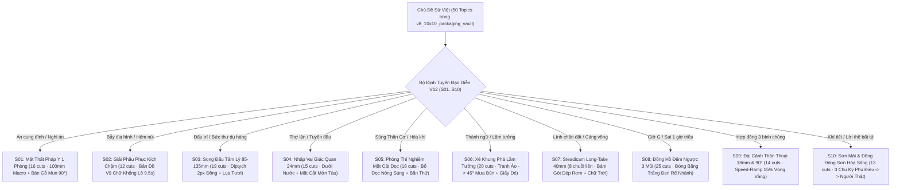

# V12 Cinema Research (`06`) — 10 Ngữ Pháp Điện Ảnh Short `9:16` Độc Bản (`S01..S10`)

> **Phạm vi (`Thread 2B` — `@style-grammar-short`)**: Thiết kế lại từ gốc hệ thống `S01..S10` (`1440x2560 @ 30fps`, `48s–60s`) cho kênh **Sử Kể Lại (`@SuKeLaiVN`)**, xóa bỏ hoàn toàn tình trạng *"10 video chỉ khác cốt truyện còn cách quay, dựng cảnh, hộp chữ đè lên và giọng bình luận giống hệt nhau"*. **100% Zero Dark HUD Boxes (`0` thẻ đen bo góc, `0` bảng `VS`, `0` thanh máu/nhịp tim giả)**.

---

## 1. Giải Phẫu Gốc Rễ: Vì Sao 10 Short `V8/V10` Cũ Trông Giống Hệt Nhau?

Đối chiếu trực tiếp mã nguồn `sys/fx_warehouse/history_styles_10x10.py`, `sys/short_engine/archetype_packs.py`, `sys/short_engine/render_single_pass.py` và 4 ảnh lỗi thực tế người dùng chỉ ra:

- **`RC_01_SHARED_FILM_LOCK_CLONING`** (`sys/fx_warehouse/history_styles_10x10.py:107-113 & 2143`):
  - *Nguyên nhân cũ*: CLEAR_AIR_FILM_LOCK_9X16 was appended verbatim to 100% of beats across all S01..S10, forcing identical lighting, film grain, and medium front-facing 35mm warrior compositions.
  - *Kiến trúc V12 mới*: **Abolish universal prompt suffix cloning; each style owns an isolated optical/spatial/lighting lock (e.g., 8:1 locked indoor chamber in S01 vs 24mm submerged splash-housing in S04 vs 45°-shutter rain realism in S06).**
- **`RC_02_MODULO_5_CAMERA_LOOP`** (`sys/fx_warehouse/history_styles_10x10.py:2042 (cam = cam_rot[i % len(cam_rot)])`):
  - *Nguyên nhân cũ*: All 10 styles cycled mechanically through 5 generic 24mm-85mm slots with uniform sub_cut_ratio=0.46..0.52 and focus_zoom=1.26..1.35.
  - *Kiến trúc V12 mới*: **Replace modulo slot cycling with 10 explicit, story-driven 20-beat director's camera scripts (B00..B19) enforcing >=45% non-portrait tactile/OTS/overhead/mud/submerged coverage.**
- **`RC_03_DARK_ROUNDED_RECTANGLE_HUD_SLABS`** (`sys/fx_warehouse/history_styles_10x10.py:1742-1967, 2786-3133 & sys/short_engine/render_single_pass.py:450-560`):
  - *Nguyên nhân cũ*: Every Short pasted the exact same dark obsidian rounded_rectangle (fill=(10,14,22,226), gold outline, left stripe) at B00 (v7_hook_headline), mid-video, and B_end (v7_stat_versus 'VS' plaque).
  - *Kiến trúc V12 mới*: **100% ABOLISH all 12 boxed V7/V8 HUD stamp kinds. Replace overlays with 10 physical/cartographic/optical stage cutaways.**
- **`RC_04_FLAT_3_5S_METRONOME_CADENCE`** (`sys/fx_warehouse/history_styles_10x10.py:1682-1718 & 2025`):
  - *Nguyên nhân cũ*: Default 16 beats had uniform duration_sec = target_duration / 16 (~3.5s flat), hardcoded silence_idx at 62% on every Short, and rotated the same 5 whip/flash transitions.
  - *Kiến trúc V12 mới*: **Spread effective editorial cuts across 10 unique cadences (8 unbroken Steadicam chains in S07 -> 12 slow-map cuts in S02 -> 25 rapid parallel ticking cuts in S08) with nonlinear act curves.**
- **`RC_05_UNIFORM_TRAILER_NARRATOR_VOICE`** (`sys/fx_warehouse/history_styles_10x10.py:430-970 & archetype_packs.py:356-367`):
  - *Nguyên nhân cũ*: Speaking rate clustered tightly around 1.28-1.34x with identical generic announcer phrasing across all 10 styles.
  - *Kiến trúc V12 mới*: **Establish 10 distinct Vietnamese editorial personas spanning 1.16x (144 WPM humanist micro-historian) to 1.35x (184 WPM realtime countdown dispatcher).**

---

## 2. Ma Trận Trực Giao 10 Ngữ Pháp Điện Ảnh Short (`10/10` Khác Nhau Tuyệt Đối)

| Mã | Tên Ngữ Pháp V12 (Thay thế V8) | Thời lượng | Số Cắt Thực (`20` Beats) | ASL Thực | Ống Kính Chủ Đạo | Sân Khấu Phân Tích Độc Bản (Zero-Box!) | Giọng Bình Luận Tiếng Việt (`Speed / WPM`) |
| :--- | :--- | :---: | :---: | :---: | :--- | :--- | :--- |
| **`S01`** | **Giải Phẫu Hiện Trường Mật Thất Đóng Kín** *(thay `S04_FORENSIC_MYSTERY_DOSSIER`)* | `56.0s` | **`16 cuts`** (`4` Frame-Link) | `3.5s` | `100mm f/2.8 Macro Prime (2cm shallow DoF)` | `topdown_ironwood_evidence_desk_v12` | **Pháp Y Sử Học Lạnh Lùng** (`1.18x` · `148 WPM`) |
| **`S02`** | **Giải Phẫu Tử Địa Phục Kích Bản Đồ Chữ Khổng Lồ Chậm** *(thay `S03_TACTICAL_MAP_BLITZ`)* | `58.0s` | **`12 cuts`** (`8` Frame-Link) | `4.83s` | `24mm Aerial/Cliff-Edge Wide (60° look-down)` | `tactical_battle_map_v9_slow_giant` | **Chuyên Gia Địa Hình Thực Địa** (`1.2x` · `152 WPM`) |
| **`S03`** | **Song Đấu Tâm Lý Góc Cận Cực Hạn 85mm–135mm** *(thay `S07_COMMANDER_PSYCHOLOGY_DUEL`)* | `54.0s` | **`19 cuts`** (`1` Frame-Link) | `2.84s` | `85mm T1.4 Portrait Prime` | `bronze_2px_cinema_diptych_and_silk_brush_v12` | **Bậc Thầy Đọc Vị Tâm Lý** (`1.24x` · `160 WPM`) |
| **`S04`** | **Nhập Vai Giác Quan Thứ Nhất Dưới Nước & Bùn Lầy 24mm** *(thay `S02_POV_TIME_TRAVEL_SURVIVAL`)* | `52.0s` | **`15 cuts`** (`5` Frame-Link) | `3.47s` | `24mm Spherical Underwater/Splash-Housing POV Lens` | `diegetic_waterline_keel_cross_section_v12` | **Người Trong Cuộc Ngôi Thứ Hai ('Bạn')** (`1.28x` · `166 WPM`) |
| **`S05`** | **Giải Phẫu Mặt Cắt Vật Lý & Luyện Kim Quân Giới Cổ** *(thay `S06_ANCIENT_TECH_WEAPON_LAB`)* | `53.0s` | **`18 cuts`** (`2` Frame-Link) | `2.94s` | `100mm f/2.8 Macro Probe Lens` | `longitudinal_weapon_cross_section_rig_v12` | **Kỹ Sư Quân Giới Phân Tích Cơ Học** (`1.29x` · `172 WPM`) |
| **`S06`** | **Đối Chiếu Phá Vỡ Lầm Tưởng & Mộc Bản Chính Sử** *(thay `S05_MYTH_VS_CHRONICLE_SPLIT`)* | `50.0s` | **`20 cuts`** (`0` Frame-Link) | `2.5s` | `50mm Pro-Mist Diffusion Tableau Lens (B00-B01 Myth only)` | `woodblock_do_paper_redline_span_v12` | **Nhà Phê Bình Sử Liệu Sắc Sảo** (`1.32x` · `178 WPM`) |
| **`S07`** | **Ống Kính Dài Steadicam Bám Gót Người Lính Vô Danh** *(thay `S08_MICRO_HISTORY_ORDINARY_EYES`)* | `57.0s` | **`8 cuts`** (`12` Frame-Link) | `7.12s` | `40mm T2.0 Spherical Steadicam Prime (signature human-eye perspective)` | `steadicam_sky_tracked_human_math_v12` | **Người Kể Chuyện Đời Thường Trầm Ấm** (`1.16x` · `144 WPM`) |
| **`S08`** | **Đồng Hồ Đếm Ngược Giờ G & Điểm Gãy Cánh Bướm** *(thay `S09_DOMINO_BUTTERFLY_WHAT_IF`)* | `55.0s` | **`25 cuts`** (`0` Frame-Link) | `2.2s` | `28mm Wide Kinetic Estuary Lens` | `optical_freeze_frame_trajectory_fork_v12` | **Điều Phối Viên Giờ G Nghẹt Thở** (`1.35x` · `184 WPM`) |
| **`S09`** | **Đại Cảnh Hợp Đồng Binh Chủng Góc Nhìn Thần Thoại 18mm & 90°** *(thay `S01_PRESTIGE_BATTLE_CINEMA`)* | `59.0s` | **`14 cuts`** (`6` Frame-Link) | `4.21s` | `18mm Rectilinear Worm's-Eye Monumental Lens` | `live_action_speedramp_formation_rings_v12` | **Tổng Công Trình Sư Trận Đồ** (`1.26x` · `164 WPM`) |
| **`S10`** | **Phù Điêu Đồng Đông Sơn & Sơn Mài Thếp Vàng Hóa Điện Ảnh Sống** *(thay `S10_EASTERN_INK_TO_35MM_LEGEND`)* | `57.5s` | **`13 cuts`** (`7` Frame-Link) | `4.42s` | `65mm Large-Format Sculptural Tableau Prime` | `carved_bluestone_and_son_mai_oath_stele_v12` | **Người Giữ Sử Đền Thiêng** (`1.19x` · `146 WPM`) |

> [!IMPORTANT]
> **5 Luật Cứng Chống Trùng Lặp & Xóa Sạch Thẻ AI (`V12 Short Purity Gate`)**:
> 1. **Cấm 100% Thẻ Đen & Bảng `VS`**: Xóa vĩnh viễn 12 preset hộp chữ cũ (`v7_hook_headline`, `v7_stat_versus`, `prestige_dateline`, `pov_survival_gauge`, `forensic_evidence_stamp`, `myth_vs_chronicle_split`, `weapon_engineering_spec`, `commander_duel_1v1`, `counterfactual_branch_stamp`...).
> 2. **Cắt Cảnh Phân Tích Phải Đổi Không Gian Vật Lý**: Muốn phân tích chứng cứ phải cắt sang bàn gỗ mun 90° (`S01`); muốn phân tích địa hình phải giữ bản đồ chữ khổng lồ `9.3s–9.6s` không cắt (`S02`); muốn mổ xẻ súng phải bổ dọc buồng thuốc (`S05`); muốn đối chiếu niên đại phải trải toàn màn hình mộc bản giấy Dó (`S06`).
> 3. **Luật Chống Đè Phụ Đề (`Collision-Free Subtitles`)**: Phụ đề tối đa `1–3` chữ không hộp nền ở `y=1880..2040`, **tự động tắt hoặc dời lên `y=280..420`** trong mọi nhịp bản đồ `S02`, bàn chứng cứ `S01`, giấy Dó `S06`, đóng băng `S08` và bia đá sơn mài `S10`.
> 4. **Đa Dạng Góc Quay Vật Lý (`>= 45%` Non-Portrait Inserts)**: Mọi kịch bản `20` beat bắt buộc xen kẽ cận cảnh bàn tay/đạo cụ (`0` mặt người), góc qua vai (`Dirty OTS`), góc sát bùn/mặt nước `0.2m`, hoặc góc thẳng đứng `90°` — cấm đặt 2 khung trung cảnh nhìn thẳng cạnh nhau.
> 5. **Hạ Tầng Chuẩn `AGENTS.md`**: Chỉ chạy `veo_3_1_lite` (`10c` Seam) + `macaron_cookie` (Omni 1.2 Flash Frame-Link) + `BELUGA` 2K multi-angle (`0c`), render trên Colab T4 `FFmpeg h264_nvenc`, giọng `VietNarrator_su_ke_lai` (`-11.0 LUFS / -1.0 dBTP`), logo ghim cứng `W-w-36:H-h-36`.

---

## 3. Đặc Tả Chi Tiết Từng Phong Cách `S01..S10` (Đầy Đủ 4 Trụ Cột & Bảng 20 Nhịp Quay)

### `S01` — `S01_CLAUSTROPHOBIC_CRIME_SCENE_AUTOPSY`: Giải Phẫu Hiện Trường Mật Thất Đóng Kín

- **Tham chiếu điện ảnh quốc tế**: David Fincher (Zodiac / Mindhunter single-room forensic blocking), @Fern-tv (architectural crime-scene spatial autopsy), @LEMMiNO (cold timeline anomaly dissection)
- **Ánh xạ kho chủ đề `v8_10x10_packaging_vault.json`**: Thay thế `S04_FORENSIC_MYSTERY_DOSSIER` · Gồm các mã `S04_01, S04_02, S04_03, S04_04, S04_05` · Ví dụ mẫu bên dưới: *S04_01 — Giải Mã Cái Chết Đột Ngột Của Vua Lê Thái Tông Tại Lệ Chi Viên (1442)*
- **Quy luật không gian & dàn dựng**: 100% CLAUSTROPHOBIC SINGLE-CHAMBER LOCK: The camera NEVER exits the sealed room, royal pavilion, or night interrogation hall into open-air battlefields. Tension comes from confined timber walls, locked lattice doors, physical forensic traces on the floor, and silent witnesses trapped in shadow.
- **Ánh sáng & Bộ ống kính**: 8:1 Caravaggio practical chiaroscuro — single warm flickering beeswax candle (2400K) slicing against cold slate-blue moonlight (5600K) leaking through bamboo blinds; deep crushed obsidian corners, crisp specular rim on porcelain/ink/bronze. | Lens: `100mm f/2.8 Macro Prime (2cm shallow DoF), 50mm T1.5 Dirty OTS Prime, 24mm 90-Degree Plumb-Line Zenital Overhead`

#### (a) Nhịp Độ & Cấu Trúc Cắt Dựng Độc Bản (`56.0s` · `16` Cắt Thực)
- **Tổng số beat chuẩn**: `20` (`B00..B19`) | **Số mối nối liền mạch `Frame-Link`**: `4` | **Số nhát cắt biên tập thực tế**: **`16 cuts`** (`ASL thực = 3.5s`, dải `1.8s – 5.2s`).
  - `Act_1_Crime_Scene_Drop_B00_B03`: Crisp 1.8s-2.4s macro physical clue snaps (cup -> cold hand -> extinguished wick) hooking curiosity immediately.
  - `Act_2_Spatial_Blocking_B04_B08`: Slow creeping 3.2s-3.8s dirty OTS & plumb-line room geometry establishing who stood where.
  - `Act_3_Tabletop_Autopsy_B09_B12`: Deliberate 5.2s-3.4s 90-degree overhead dark-ironwood evidence tabletop reconstruction.
  - `Act_4_Timeline_Contradiction_B13_B16`: Sharp 1.9s-2.3s hard J-cut cross-examinations + 0.55s dead-silent candle snuff vacuum at B14.
  - `Act_5_Sealed_Verdict_Outro_B17_B19`:  lingering 3.2s-3.6s slow pull-back through closing palace doors into the 2-choice jury verdict.
- **Điểm lặng chân không (`Silence Vacuum`)**: Đặt tại `B14` (`t = 40.2s`, ngắt `550ms`) — *Single beeswax candle flame snuffed out in total room silence before cinnabar execution seal thud.*

#### (c) Sân Khấu Phân Tích Thị Giác Không Hộp Đen (`topdown_ironwood_evidence_desk_v12`)
- **Beat kích hoạt**: `B09, B10, B15`
- **Ý đồ đạo diễn**: 90-Degree Top-Down Oiled Dark-Ironwood (Gỗ Mun) Coroner's Evidence Desk — camera cuts completely away from narrative actors to look straight down at physical historical exhibits laid on dark grained wood under a single warm raking sidelight.
- **Chất liệu khung hình**: Photorealistic dark oiled ironwood tabletop (#14110E) with three physical items arranged with >=55% clean wood negative space: (1) open aged Dó-paper folio of Đại Việt Sử Ký Toàn Thư, (2) brass water-clock tally / porcelain shard, (3) live animated wet cinnabar-red (#B82921) brush circling the exact date anomaly directly on the paper.
- **Quy chuẩn chữ lớn dễ đọc**: Font `BarlowCondensed-ExtraBold.ttf + DejaVuSerif-Bold.ttf` · Cỡ chữ chính **`136px`** (`5.31%` chiều cao `2560px`) · Tối đa `3` từ/nhãn · Tối đa `2` nhãn cùng lúc · Ví dụ: `04/08 BĂNG HÀ, 16/08 TRU DI`.
- **Chuyển động & Chống đè sub**: 5.2s + 3.4s continuous 2-beat overhead hold (8.6s total): 0.0-2.2s slow 1.00x->1.05x zenital push onto open Dó folio -> 2.2-5.2s wet cinnabar brush stroke draws red circle & timeline arrow across '10 NGÀY KẾT ÁN' -> 5.2-8.6s brass seal slides into frame locking the contradiction. | *Suppress standard y=1920 subtitles on B09-B10 or pin 2-word caption to upper wood margin y=280 so tabletop artifacts stay 100% unobstructed.*
- **Thực thi Colab T4 NVENC**: Generate clean 1440x2560 BELUGA top-down ironwood+Dó-paper plate (allowed_text=None), composite high-res PIL RGBA brush-stroke mask animated via frame-indexed alpha wipe at 30fps, feed into NVENC segment encoder.

#### (d) Giọng Bình Luận Phân Tích Tiếng Việt: *Pháp Y Sử Học Lạnh Lùng* (`1.18x` · `148 WPM`)
- Open immediately on a physical clue or timeline impossibility inside the room (never 'Hôm nay chúng ta tìm hiểu vụ án...').
- Dissect travel speed, witness silence, and procedural haste (e.g., 48 hours of news blackout + 10 days from royal funeral to 3-clan execution).
- Strictly quarantine folklore ('rắn báo oán') from verified Bản Kỷ Q.11 & Q.12 court records.
- **Mẫu lời thoại chuẩn 4 cổng Linter**:
  - `B00 Hook` (`15` âm tiết `<= 18`, `0` pause): *"Đêm mùng bốn tháng tám, vua Lê Thái Tông tắt thở ngay trong hành cung."*
  - `Phân tích Cutaway`: *"Nhìn tờ lịch trình trên bàn gỗ này. Đoàn thuyền mất hai ngày đưa thi hài về kinh, nhưng chỉ mười ngày sau cả ba họ Nguyễn Trãi đã bị chém."*
  - `Outro Tranh luận + Cầu nối kênh` (`13 + 11 = 24` âm tiết `<= 38`): *"Án Lệ Chi Viên là mưu sát thật hay thanh trừng phe phái? Xem trọn hồ sơ pháp y Lệ Chi Viên trên @SuKeLaiVN!"*

#### (b) Bảng Phân Cảnh 20 Nhịp Góc Quay Đạo Diễn (`B00..B19` — `S01`)

| Beat | Cửa Sổ (`s`) | Miền Cảnh | Lớp Góc Quay (`shot_class`) | Độ Cao Góc Máy & Tiêu Cự | Chuyển Động & Nối Cảnh | Dàn Dựng Chi Tiết Trên Màn Ảnh |
| :---: | :---: | :---: | :--- | :--- | :--- | :--- |
| `B00` *(Hồi 1)* | `0.0–2.0` (`2.0s`) | `live_cinema` | **`Extreme_Macro_Tactile`** | `100mm` · Table-level 5° raking macro, 15cm from object | `static_locked_focus_pull` ➔ `hard_cut_j_cut` | Cracked celadon teacup tipping in slow motion on dark lacquered mat; amber tea pooling toward candle base (zero faces). |
| `B01` *(Hồi 1)* | `2.0–3.8` (`1.8s`) | `live_cinema` | **`Extreme_Macro_Tactile`** | `100mm` · Floor-level 0.2m macro on silk sleeve | `push_in` ➔ `hard_cut_j_cut` | Motionless imperial yellow dragon-embroidered cuff resting beside cold bronze incense burner inside dim Lệ Chi Viên chamber. |
| `B02` *(Hồi 1)* | `3.8–6.2` (`2.4s`) | `live_cinema` | **`Plumb_Line_90_Overhead`** | `24mm` · 90° vertical ceiling-down zenital view (4m height) | `pull_back` ➔ `hard_cut_j_cut` | God's-eye vertical shot of the sealed wooden pavilion room: one lone flickering candle surrounded by four silent kneeling eunuchs. |
| `B03` *(Hồi 1)* | `6.2–8.8` (`2.6s`) | `live_cinema` | **`Dirty_OTS`** | `50mm` · Shoulder-height 1.4m dirty OTS behind palace guard | `push_in` ➔ `frame_link_unbroken` | Over dark iron-armored shoulder looking past sliding wooden lattice doors as two officials bolt the chamber from inside. |
| `B04` *(Hồi 2)* | `8.8–12.0` (`3.2s`) | `live_cinema` | **`Reaction_Micro_Acting`** | `85mm` · Eye-level tight profile in 8:1 split candlelight | `frame_link_drift` ➔ `hard_cut_j_cut` | Continuous Frame-Link from B03: bead of sweat rolling down court eunuch's temple; finger pressed to sealed lips. |
| `B05` *(Hồi 2)* | `12.0–14.8` (`2.8s`) | `live_cinema` | **`Low_Angle_Architectural`** | `35mm` · Floor-level 0.3m looking up at locked palace beam | `truck_lateral` ➔ `hard_cut_j_cut` | Heavy iron padlock sliding shut across Lệ Chi Viên pavilion doors while night rain streaks dark timber eaves. |
| `B06` *(Hồi 2)* | `14.8–18.2` (`3.4s`) | `live_cinema` | **`Dirty_OTS`** | `50mm` · Seated 1.0m OTS behind closed imperial palanquin | `tracking_alongside` ➔ `hard_cut_j_cut` | Inside cramped royal barge cabin at midnight: veiled dragon curtains swaying while attendants fan an already-deceased monarch to hide the news. |
| `B07` *(Hồi 2)* | `18.2–20.8` (`2.6s`) | `live_cinema` | **`Extreme_Macro_Tactile`** | `100mm` · 30° close-up on wet inkbrush & bamboo slip | `push_in` ➔ `hard_cut_j_cut` | Trembling scribe hand blotting out a night-watch log entry with thick black pine-soot ink. |
| `B08` *(Hồi 2)* | `20.8–23.8` (`3.0s`) | `live_cinema` | **`Medium_Shadow_Silhouette`** | `50mm` · 1.2m doorway frame-within-frame | `pull_back` ➔ `hard_cut_j_cut` | Nguyễn Thị Lộ kneeling alone in dark interrogation room corridor, framed tightly between two heavy ironwood pillars. |
| `B09` *(Hồi 3)* | `23.8–29.0` (`5.2s`) | `analytical_cutaway` | **`Archival_Tabletop_90`** | `35mm-Ortho` · 90° perpendicular overhead coroner desk rig (0.9m) | `slow_zenital_push` ➔ `frame_link_unbroken` | BESPOKE CUTAWAY PART 1: Oiled dark-ironwood tabletop with aged Dó-paper Bản Kỷ Q.11 folio; wet cinnabar brush circles '04/08 BĂNG HÀ'. |
| `B10` *(Hồi 3)* | `29.0–32.4` (`3.4s`) | `analytical_cutaway` | **`Archival_Tabletop_90`** | `50mm-Ortho` · 90° perpendicular overhead coroner desk rig (0.7m) | `lateral_table_pan` ➔ `hard_cut_j_cut` | BESPOKE CUTAWAY PART 2: Camera glides 20cm right across wood grain to heavy bronze execution tally & brush arrow '16/08 TRU DI' (10-day rush). |
| `B11` *(Hồi 3)* | `32.4–35.0` (`2.6s`) | `live_cinema` | **`Extreme_Macro_Tactile`** | `100mm` · 15° low table-edge macro on iron chains | `push_in` ➔ `hard_cut_j_cut` | Heavy iron fetters dropping onto cold stone floor of Đông Kinh tribunal cell; torch sparks reflecting on iron links. |
| `B12` *(Hồi 3)* | `35.0–37.8` (`2.8s`) | `live_cinema` | **`Dirty_OTS`** | `50mm` · 1.3m OTS behind chief inquisitor's crimson robe | `push_in` ➔ `frame_link_unbroken` | Looking past rigid court mandarin's shoulder toward aged scholar kneeling upright in silver-gray hemp robe under single ceiling shaft of light. |
| `B13` *(Hồi 4)* | `37.8–40.2` (`2.4s`) | `live_cinema` | **`Reaction_Micro_Acting`** | `85mm` · Tight 85mm ocular close-up (eyes only) | `frame_link_drift` ➔ `hard_cut_j_cut` | Continuous Frame-Link into Nguyễn Trãi's calm, piercing eyes reflecting the lone candle flame without blinking. |
| `B14` *(Hồi 4)* | `40.2–42.4` (`2.2s`) | `live_cinema` | **`Extreme_Macro_Tactile`** | `100mm` · Eye-level macro on single candle wick (silence vacuum) | `static_locked` ➔ `black_dip_breath` | SILENCE VACUUM: Brass snuffers pinch the lone beeswax candle flame; thin ribbon of white smoke rises in pitch darkness. |
| `B15` *(Hồi 4)* | `42.4–45.6` (`3.2s`) | `analytical_cutaway` | **`Archival_Tabletop_90`** | `35mm-Ortho` · 90° overhead tabletop comparison (1442 vs 1464) | `slow_zenital_push` ➔ `hard_cut_j_cut` | BESPOKE CUTAWAY REPRISE: Second imperial yellow silk edict (Quang Thuận 1464) unrolls beside 1442 verdict on the ironwood desk: '1464 ĐẠI XÁ OAN ÁN'. |
| `B16` *(Hồi 4)* | `45.6–47.8` (`2.2s`) | `live_cinema` | **`Extreme_Macro_Tactile`** | `100mm` · 45° macro on carved imperial jade seal | `push_in` ➔ `hard_cut_j_cut` | King Lê Thánh Tông's vermilion imperial seal pressing firmly onto silk exoneration decree, rehabilitating Nguyễn Trãi after 22 years. |
| `B17` *(Hồi 5)* | `47.8–50.6` (`2.8s`) | `live_cinema` | **`Low_Angle_Architectural`** | `35mm` · 0.5m low-angle inside empty Lệ Chi Viên pavilion | `push_in` ➔ `frame_link_unbroken` | Cold dawn light entering the empty wooden chamber; dust motes suspended above the bare floor mat where the mystery began. |
| `B18` *(Hồi 5)* | `50.6–53.2` (`2.6s`) | `live_cinema` | **`Doorway_Receding_Frame`** | `50mm` · 1.4m symmetrical corridor pull-back | `pull_back` ➔ `hard_cut_j_cut` | Camera retreats backward through heavy wooden pavilion doors slowly swinging shut, framing the unanswered historical verdict. |
| `B19` *(Hồi 5)* | `53.2–56.0` (`2.8s`) | `live_cinema` | **`Extreme_Macro_Tactile`** | `100mm` · Table-level 5° macro echoing B00 loop | `static_locked` ➔ `loop_seam_to_b00` | Final hold on the cold overturned celadon cup in dawn shadow — visually matching B00 for a seamless Shorts replay loop. |

---

### `S02` — `S02_SLOW_GIANT_MAP_AMBUSH_ANATOMY`: Giải Phẫu Tử Địa Phục Kích Bản Đồ Chữ Khổng Lồ Chậm

- **Tham chiếu điện ảnh quốc tế**: Johnny Harris (slow high-elevation terrain zoom + giant 2-word map typography), @TheOperationsRoom (deliberate unit-block trap choreography), @Epichistorytv (cliff-top geography to mud-level ambush contrast)
- **Ánh xạ kho chủ đề `v8_10x10_packaging_vault.json`**: Thay thế `S03_TACTICAL_MAP_BLITZ` · Gồm các mã `S03_01, S03_02, S03_03, S03_04, S03_05, S01_01, S01_05` · Ví dụ mẫu bên dưới: *S03_02 — Chiến Thuật Vây Điểm Diệt Viện Ở Ải Chi Lăng Năm 1427*
- **Quy luật không gian & dàn dựng**: 3-ALTITUDE VERTICAL GEOMETRY: Alternates strictly between (1) 300m cliff-top/bird's-eye real karst canyon or river chokepoint vistas, (2) unbroken 8.4s-8.6s slow Giant-Label Topographic Map V9 sequences, and (3) 0.3m ankle-deep mud/grass ambush POV at the bottom of the kill zone.
- **Ánh sáng & Bộ ống kính**: Crisp overcast mountain-pass daylight & silver morning valley mist hugging only high limestone peaks (clear-air visibility on valley road and mud floor), high local contrast on limestone cliffs vs vermilion/indigo banners. | Lens: `24mm Aerial/Cliff-Edge Wide (60° look-down), GIS-Ortho V9 Shaded Relief Camera, 28mm Ground-Mud Low-Angle (0.3m height)`

#### (a) Nhịp Độ & Cấu Trúc Cắt Dựng Độc Bản (`58.0s` · `12` Cắt Thực)
- **Tổng số beat chuẩn**: `20` (`B00..B19`) | **Số mối nối liền mạch `Frame-Link`**: `8` | **Số nhát cắt biên tập thực tế**: **`12 cuts`** (`ASL thực = 4.83s`, dải `2.2s – 9.6s`).
  - `Act_1_Geography_Hook_B00_B03`: Sweeping 2.5s-2.8s high-cliff aerials establishing the lethal narrow bottleneck.
  - `Act_2_Slow_Map_Setup_B04_B06`: UNBROKEN 9.3s Slow Giant-Label Map Sequence #1 (B04+B05+B06 continuous, 0 internal cuts) so viewers effortlessly absorb terrain + bait.
  - `Act_3_Ground_Decoy_B07_B09`: Punchy 2.5s-2.7s mud-level cavalry hoof & feigned-retreat tracking shots.
  - `Act_4_Slow_Map_KillZone_B10_B15`: UNBROKEN 9.6s Slow Giant-Label Map Sequence #2 (B10+B11+B12) diving via 0.55s map_camera_zoom_match into 2.4s-2.6s mud ambush climax.
  - `Act_5_Valley_Aftermath_B16_B19`: Spacious 3.1s-3.3s elevated crane pull-back revealing the sealed valley & strategic debate.
- **Điểm lặng chân không (`Silence Vacuum`)**: Đặt tại `B13` (`t = 40.3s`, ngắt `500ms`) — *Galloping Ming cavalry hooves sink suddenly into deep Mã Yên swamp mud; all music drops out before bowstring & war-drum ambush.*

#### (c) Sân Khấu Phân Tích Thị Giác Không Hộp Đen (`tactical_battle_map_v9_slow_giant`)
- **Beat kích hoạt**: `B04, B05, B06, B10, B11, B12`
- **Ý đồ đạo diễn**: Minimalist Shaded-Relief Giant-Typography Battle Map V9 — directly solves user feedback ('chữ càng ít càng to, nhịp chậm lại một chút mới xem kịp'). Two unbroken 8.4s-8.6s cartographic acts with huge, effortless phone readability.
- **Chất liệu khung hình**: Clean darkened ESRI/DEM limestone elevation relief (#1C1915 valleys, #6E5D46 karst ridges) filling 100% of 1440x2560 frame. ZERO top header plaque, ZERO left elevation bar, ZERO bottom force-ratio bar, ZERO dotted callout spiderwebs.
- **Quy chuẩn chữ lớn dễ đọc**: Font `BeVietnamPro-ExtraBold.ttf` · Cỡ chữ chính **`148px`** (`5.78%` chiều cao `2560px`) · Tối đa `3` từ/nhãn · Tối đa `2` nhãn cùng lúc · Ví dụ: `ẢI CHI LĂNG, LIỄU THĂNG, ĐẦM MÃ YÊN`.
- **Chuyển động & Chống đè sub**: Unbroken 8.4s / 8.6s 3-Phase Slow Choreography: Phase 1 (0.0-2.6s): Canyon walls illuminate with single giant 3-word label 'ẢI CHI LĂNG' (118px). Phase 2 (2.6-5.6s): 'ẢI CHI LĂNG' fades to 30% as single bold blue cavalry block 'LIỄU THĂNG' glides slowly down narrow road chasing red decoy. Phase 3 (5.6-8.5s): Two thick crimson flank vectors close smoothly around 'BẪY MÃ YÊN', exiting via 0.55s map_camera_zoom_match into live mud. | *100% DISABLE burned-in bottom subtitles during B04-B06 and B10-B12 map holds so the viewer's eye focuses exclusively on the giant 118px map labels and slow arrow motion.*
- **Thực thi Colab T4 NVENC**: Render 30fps procedural 1440x2560 frame sequence via upgraded tactical_battle_map_v9.py (cubic ease-in-out trajectories, <=2 active labels, >=96px font floor) and encode directly on T4 NVENC.

#### (d) Giọng Bình Luận Phân Tích Tiếng Việt: *Chuyên Gia Địa Hình Thực Địa* (`1.2x` · `152 WPM`)
- Guide the viewer's eye spatially across the terrain ('Nhìn vào hai vách đá dựng đứng này...', 'Con đường độc đạo ở giữa...').
- Pace spoken clauses slowly during the 8.5s map beats so the listener watches the unit block move BEFORE hearing the punchline.
- Explain why numeric superiority (100,000 troops) turns into a fatal liability inside a narrow geographic funnel.
- **Mẫu lời thoại chuẩn 4 cổng Linter**:
  - `B00 Hook` (`14` âm tiết `<= 18`, `0` pause): *"Mười vạn đại quân Minh sụp đổ chỉ vì chui vào hẻm núi này."*
  - `Phân tích Cutaway`: *"Hãy nhìn địa hình ải Chi Lăng. Hai bên là vách đá dựng đứng. Giữa thung lũng chỉ có độc một lối đi lầy lội dưới chân núi Mã Yên."*
  - `Outro Tranh luận + Cầu nối kênh` (`13 + 10 = 23` âm tiết `<= 38`): *"Chi Lăng thắng nhờ địa hình hiểm hay kế năm lần giả thua? Xem trọn sa bàn Chi Lăng Xương Giang trên @SuKeLaiVN!"*

#### (b) Bảng Phân Cảnh 20 Nhịp Góc Quay Đạo Diễn (`B00..B19` — `S02`)

| Beat | Cửa Sổ (`s`) | Miền Cảnh | Lớp Góc Quay (`shot_class`) | Độ Cao Góc Máy & Tiêu Cự | Chuyển Động & Nối Cảnh | Dàn Dựng Chi Tiết Trên Màn Ảnh |
| :---: | :---: | :---: | :--- | :--- | :--- | :--- |
| `B00` *(Hồi 1)* | `0.0–2.7` (`2.7s`) | `live_cinema` | **`High_Cliff_Aerial`** | `24mm` · 300m bird's-eye cliff overhang looking 65° down into narrow canyon | `push_in` ➔ `frame_link_unbroken` | Towering Cai Kinh limestone cliffs squeezing a ribbon-thin muddy road far below as tiny Ming banners enter the mouth of Chi Lăng pass. |
| `B01` *(Hồi 1)* | `2.7–5.3` (`2.6s`) | `live_cinema` | **`Ground_Ankle_Mud_POV`** | `28mm` · 0.25m ankle-height mud puddle level | `static_locked` ➔ `hard_cut_j_cut` | Iron-shod Ming warhorse hooves splashing violently through knee-deep brown marsh mud, spraying droplets past low lens. |
| `B02` *(Hồi 1)* | `5.3–8.1` (`2.8s`) | `live_cinema` | **`Dirty_OTS`** | `50mm` · Cliff-ledge 1.5m OTS behind hidden Lam Sơn scout | `push_in` ➔ `hard_cut_j_cut` | Over camouflaged rattan helmet on high limestone crag looking down at Liễu Thăng's silver-armored vanguard column stretching thin. |
| `B03` *(Hồi 1)* | `8.1–10.6` (`2.5s`) | `live_cinema` | **`Gods_Eye_Formation_90`** | `24mm` · 90° vertical drone-like look-down matching map geometry | `crane_up` ➔ `map_camera_zoom_match` | Vertical top-down live canyon road seamlessly zooming out into shaded-relief cartography (0.55s optical terrain match). |
| `B04` *(Hồi 2)* | `10.6–13.7` (`3.1s`) | `analytical_cutaway` | **`Slow_Giant_Map_V9`** | `GIS-Ortho` · Orthographic top-down shaded relief (Map Act 1 — Phase 1) | `slow_map_hold` ➔ `frame_link_unbroken` | UNBROKEN 9.3s MAP SEQ #1 (Part A): Clean karst ridges highlight; single giant 118px label 'ẢI CHI LĂNG' locks cleanly in upper valley. |
| `B05` *(Hồi 2)* | `13.7–16.8` (`3.1s`) | `analytical_cutaway` | **`Slow_Giant_Map_V9`** | `GIS-Ortho` · Orthographic top-down shaded relief (Map Act 1 — Phase 2) | `slow_vector_glide` ➔ `frame_link_unbroken` | UNBROKEN 9.3s MAP SEQ #1 (Part B): Red Lam Sơn vanguard block ('TRẦN LỰU') retreats deliberately southward in 5 measured steps. |
| `B06` *(Hồi 2)* | `16.8–19.9` (`3.1s`) | `analytical_cutaway` | **`Slow_Giant_Map_V9`** | `GIS-Ortho` · Orthographic top-down shaded relief (Map Act 1 — Phase 3) | `slow_vector_glide` ➔ `map_camera_zoom_match` | UNBROKEN 9.3s MAP SEQ #1 (Part C): Blue cavalry block ('100 KỴ LIỄU THĂNG') detaches rashly from main 90,000 body, racing deep into gap. |
| `B07` *(Hồi 3)* | `19.9–22.6` (`2.7s`) | `live_cinema` | **`Lateral_Cavalry_Tracking`** | `35mm` · 1.1m saddle-height parallel tracking shot | `tracking_alongside` ➔ `frame_link_unbroken` | Liễu Thăng in ornate Ming gilt-iron armor galloping ahead of his bannermen, whipping his mount through narrow reed-lined defile. |
| `B08` *(Hồi 3)* | `22.6–25.1` (`2.5s`) | `live_cinema` | **`Extreme_Macro_Tactile`** | `85mm` · 0.8m close-up on rattan bowstring & signal horn | `push_in` ➔ `hard_cut_j_cut` | Calloused Lam Sơn archer fingers drawing a heavy bamboo crossbow bolt to full tension behind limestone boulder. |
| `B09` *(Hồi 3)* | `25.1–27.7` (`2.6s`) | `live_cinema` | **`Low_Angle_Canyon_Loom`** | `24mm` · 0.5m low-angle looking up both vertical rock walls | `crane_up` ➔ `map_camera_zoom_match` | From valley mud looking up as hundreds of Lam Sơn shields and spears suddenly silhouette along the high ridge crest. |
| `B10` *(Hồi 4)* | `27.7–30.9` (`3.2s`) | `analytical_cutaway` | **`Slow_Giant_Map_V9`** | `GIS-Ortho` · Orthographic shaded relief zoomed to Mã Yên hill (Map Act 2 — Phase 1) | `slow_map_hold` ➔ `frame_link_unbroken` | UNBROKEN 9.6s MAP SEQ #2 (Part A): Giant 112px label 'ĐẦM MÃ YÊN' marks the swamp dead-end cutting off cavalry momentum. |
| `B11` *(Hồi 4)* | `30.9–34.1` (`3.2s`) | `analytical_cutaway` | **`Slow_Giant_Map_V9`** | `GIS-Ortho` · Orthographic shaded relief zoomed to Mã Yên hill (Map Act 2 — Phase 2) | `slow_pincer_close` ➔ `frame_link_unbroken` | UNBROKEN 9.6s MAP SEQ #2 (Part B): Two bold crimson flanking blocks ('PHỤC BINH LAM SƠN') sweep down both canyon walls, sealing exit. |
| `B12` *(Hồi 4)* | `34.1–37.3` (`3.2s`) | `analytical_cutaway` | **`Slow_Giant_Map_V9`** | `GIS-Zoom` · 3D camera dive into Mã Yên kill-zone (Map Act 2 — Phase 3) | `push_in` ➔ `map_camera_zoom_match` | UNBROKEN 9.6s MAP SEQ #2 (Part C): Rear gate locks shut severing the 90,000 relief column; camera dives straight down into live swamp. |
| `B13` *(Hồi 4)* | `37.3–39.7` (`2.4s`) | `live_cinema` | **`Ground_Ankle_Mud_POV`** | `28mm` · 0.2m swamp-mud level (Silence Vacuum) | `static_locked` ➔ `hard_cut_j_cut` | SILENCE VACUUM: Warhorse forelegs sink chest-deep into black Mã Yên marsh; mud sucks horse to a dead halt in sudden silence. |
| `B14` *(Hồi 4)* | `39.7–42.1` (`2.4s`) | `live_cinema` | **`Tight_Action_Impact`** | `50mm` · 1.3m kinetic medium-close impact angle | `push_in` ➔ `frame_link_unbroken` | Volley of iron-tipped javelins and crossbow bolts streaking downward from limestone ledges into the immobilized vanguard. |
| `B15` *(Hồi 4)* | `42.1–44.7` (`2.6s`) | `live_cinema` | **`Extreme_Macro_Tactile`** | `85mm` · 0.15m mud-surface close-up on fallen command seal | `frame_link_drift` ➔ `hard_cut_j_cut` | Continuous Frame-Link: Ming commander's shattered silver tally and helmet sinking into muddy reeds at foot of Mã Yên mount. |
| `B16` *(Hồi 5)* | `44.7–48.0` (`3.3s`) | `live_cinema` | **`Wide_Establishing_Canyon`** | `28mm` · 40m elevated valley overlook | `pull_back` ➔ `hard_cut_j_cut` | Leaderless Ming column coiled helplessly down the narrow pass while Lam Sơn dark-indigo banners crown both mountain rims. |
| `B17` *(Hồi 5)* | `48.0–51.2` (`3.2s`) | `live_cinema` | **`Low_Angle_Hero`** | `35mm` · 0.9m low-angle looking up at Lam Sơn commanders | `push_in` ➔ `hard_cut_j_cut` | Trần Lựu and Lê Sát standing atop limestone outcrop surveying the sealed canyon chokepoint in crisp golden afternoon light. |
| `B18` *(Hồi 5)* | `51.2–54.6` (`3.4s`) | `live_cinema` | **`High_Cliff_Aerial`** | `24mm` · 250m bird's-eye pull-back along Chi Lăng gorge | `pull_back` ➔ `frame_link_unbroken` | High vertical aerial revealing how tiny the valley road looks between endless jagged limestone peaks. |
| `B19` *(Hồi 5)* | `54.6–58.0` (`3.4s`) | `live_cinema` | **`High_Cliff_Aerial`** | `24mm` · 300m horizon hold matching B00 canyon geometry | `frame_link_drift` ➔ `loop_seam_to_b00` | Final unobstructed aerial hold over the silent mountain pass — cleanly looping back into B00's cliffside drop. |

---

### `S03` — `S03_SHOT_REVERSE_PSYCHOLOGICAL_DUEL`: Song Đấu Tâm Lý Góc Cận Cực Hạn 85mm–135mm

- **Tham chiếu điện ảnh quốc tế**: Sergio Leone (85mm-135mm extreme ocular close-ups & knuckle micro-tension), Akira Kurosawa (Ran / High and Low axial eyeline opposition), @KingsandGenerals / Prestige Docudrama Commander Chess
- **Ánh xạ kho chủ đề `v8_10x10_packaging_vault.json`**: Thay thế `S07_COMMANDER_PSYCHOLOGY_DUEL` · Gồm các mã `S07_01, S07_02, S07_03, S07_04, S07_05` · Ví dụ mẫu bên dưới: *S07_01 — Đấu Trí 1427: Nguyễn Trãi Dùng Thư Bức Hàng 10 Vạn Quân Vương Thông*
- **Quy luật không gian & dàn dựng**: STRICT 180-DEGREE EYELINE & COLOR DICHOTOMY: Zero chaotic mass battlefields. The entire film is an intimate psychological chess match cutting back and forth across a razor-sharp 180-degree axis between Protagonist Strategist (looking screen-right, warm amber oil-lamp #D98A36) and Cornered Opponent (looking screen-left, cold siege-rain slate #4B6E8C).
- **Ánh sáng & Bộ ống kính**: Split Half-Face Rembrandt Shadow Lighting (6:1 ratio): one eye illuminated, one eye in deep shadow, emphasizing inner calculation vs growing dread. | Lens: `85mm T1.4 Portrait Prime, 135mm T1.8 Extreme Ocular/Hand Telephoto, 100mm Macro Ink-Brush & Silk Lens`

#### (a) Nhịp Độ & Cấu Trúc Cắt Dựng Độc Bản (`54.0s` · `19` Cắt Thực)
- **Tổng số beat chuẩn**: `20` (`B00..B19`) | **Số mối nối liền mạch `Frame-Link`**: `1` | **Số nhát cắt biên tập thực tế**: **`19 cuts`** (`ASL thực = 2.84s`, dải `1.5s – 4.6s`).
  - `Act_1_Opening_Stare_B00_B03`: Measured 3.2s-3.6s deliberate opening moves (calm brush stroke vs besieged fortress stare).
  - `Act_2_Psychological_Probe_B04_B09`: Tightening 2.5s-3.0s Shot/Reverse-Shot exchanges & live silk-letter insert.
  - `Act_3_Split_Diptych_Pressure_B10_B11`: 4.0s + 2.8s 2px Burnished-Bronze Split-Screen Cinema Diptych showing simultaneous action/reaction.
  - `Act_4_Ocular_Rapid_Volley_B12_B16`: Accelerating 1.5s-1.8s Leone-style eye -> knuckle -> seal -> eye volley + 0.6s breath break.
  - `Act_5_Checkmate_Surrender_B17_B19`: Slow 4.6s release hold as citadel gates unbolt without a single arrow fired.
- **Điểm lặng chân không (`Silence Vacuum`)**: Đặt tại `B15` (`t = 39.1s`, ngắt `600ms`) — *Complete silence except for heavy rain dripping onto Vương Thông's trembling silk letter before his sword clatters onto the table.*

#### (c) Sân Khấu Phân Tích Thị Giác Không Hộp Đen (`bronze_2px_cinema_diptych_and_silk_brush_v12`)
- **Beat kích hoạt**: `B06, B10, B11`
- **Ý đồ đạo diễn**: Dual-Device Zero-Box Psychological Cutaway: (1) Horizontal 50/50 2px Burnished-Bronze Split-Screen Cinema Diptych showing both commanders' eyes/hands simultaneously in contrasting warm-gold vs cold-blue grading (ZERO 'VS' badge!), and (2) Full-Frame Raw Silk Calligraphy Insert where the decisive strategic bluff phrase is brushed live in wet black ink.
- **Chất liệu khung hình**: Top half (1440x1279): warm oil-lamp Bồ Đề headquarters; Bottom half (1440x1279): cold rain-soaked Đông Quan citadel wall; separated ONLY by a clean 2px matte antique-bronze line (#C49A52). Silk insert uses woven ivory tussah silk (#E6DAC3) with wet sumi ink.
- **Quy chuẩn chữ lớn dễ đọc**: Font `DejaVuSerif-Bold.ttf + BarlowCondensed-ExtraBold.ttf` · Cỡ chữ chính **`136px`** (`5.31%` chiều cao `2560px`) · Tối đa `3` từ/nhãn · Tối đa `1` nhãn cùng lúc · Ví dụ: `THƯ SỐ 38, VIỆN BINH TUYỆT, MỞ CỬA THỀ`.
- **Chuyển động & Chống đè sub**: B06 (3.0s): Macro sable brush sweeps 'MỞ CỬA HỘI THỀ' onto textured silk, wrapped onto bamboo arrow shaft. B10-B11 (6.8s split diptych): Top frame pushes slowly into Nguyễn Trãi setting down his teacup while bottom frame pushes into Vương Thông's white-knuckled grip breaking. | *During 50/50 split diptych (B10-B11), lock 2-word subtitle strictly along the center y=1280 seam or upper y=180 safe zone so neither portrait half is covered.*
- **Thực thi Colab T4 NVENC**: FFmpeg vstack filter combining two 1440x1279 cropped 30fps Veo/BELUGA streams + 2px drawbox=y=1279:h=2:color=#C49A52@1.0; zero PIL modal boxes.

#### (d) Giọng Bình Luận Phân Tích Tiếng Việt: *Bậc Thầy Đọc Vị Tâm Lý* (`1.24x` · `160 WPM`)
- Treat words and letters as lethal surgical weapons ('mỗi bức thư là một nhát dao cắt vào nỗi sợ').
- Contrast external posture vs internal collapse: why 100,000 soldiers inside stone walls surrendered without a final siege assault.
- Highlight strategic empathy: giving the defeated enemy a face-saving exit ramp ('cấp thuyền ngựa rút về nước') to save Đại Việt blood.
- **Mẫu lời thoại chuẩn 4 cổng Linter**:
  - `B00 Hook` (`14` âm tiết `<= 18`, `0` pause): *"Không tốn mũi tên nào, Nguyễn Trãi vẫn trói tay mười vạn quân Minh."*
  - `Phân tích Cutaway`: *"Ông không viết thư chửi mắng. Ông vạch rõ viện binh Liễu Thăng đã chết sạch, rồi mở sẵn một con đường sống cho Vương Thông giữ thể diện rút về."*
  - `Outro Tranh luận + Cầu nối kênh` (`13 + 11 = 24` âm tiết `<= 38`): *"Đông Quan mở cửa vì khiếp sợ hay nhờ lối thoát khôn ngoan? Xem trọn màn đấu trí Quân Trung Từ Mệnh trên @SuKeLaiVN!"*

#### (b) Bảng Phân Cảnh 20 Nhịp Góc Quay Đạo Diễn (`B00..B19` — `S03`)

| Beat | Cửa Sổ (`s`) | Miền Cảnh | Lớp Góc Quay (`shot_class`) | Độ Cao Góc Máy & Tiêu Cự | Chuyển Động & Nối Cảnh | Dàn Dựng Chi Tiết Trên Màn Ảnh |
| :---: | :---: | :---: | :--- | :--- | :--- | :--- |
| `B00` *(Hồi 1)* | `0.0–3.2` (`3.2s`) | `live_cinema` | **`Extreme_Macro_Tactile`** | `100mm` · Table-level 10° macro on sable ink-brush tip | `push_in` ➔ `hard_cut_j_cut` | Single drop of jet-black ink poised at tip of goat-hair brush touching ivory silk inside warm oil-lit Bồ Đề pavilion. |
| `B01` *(Hồi 1)* | `3.2–6.4` (`3.2s`) | `live_cinema` | **`Telephoto_85_135_Ocular`** | `85mm` · Eye-level tight close-up (Side A looking screen-right) | `push_in` ➔ `hard_cut_j_cut` | Nguyễn Trãi in simple indigo scholar robe & black gauze cap, warm amber lamp lighting half his calm gaze looking right. |
| `B02` *(Hồi 1)* | `6.4–9.6` (`3.2s`) | `live_cinema` | **`Telephoto_85_135_Ocular`** | `85mm` · Reverse eye-level tight close-up (Side B looking screen-left) | `push_in` ➔ `hard_cut_j_cut` | Reverse-shot inside cold rain-drenched Đông Quan citadel: Ming general Vương Thông in iron brigandine staring left with hollow, sleepless eyes. |
| `B03` *(Hồi 1)* | `9.6–12.4` (`2.8s`) | `live_cinema` | **`Extreme_Macro_Tactile`** | `100mm` · Waist-level macro on white-knuckled sword hilt | `static_locked` ➔ `hard_cut_j_cut` | Vương Thông's armored thumb grinding nervously against brass scabbard guard as cold rain drips off fortress eaves. |
| `B04` *(Hồi 2)* | `12.4–15.0` (`2.6s`) | `live_cinema` | **`Dirty_OTS`** | `85mm` · 1.4m OTS from Bồ Đề watchtower across Red River | `push_in` ➔ `hard_cut_j_cut` | Over Nguyễn Trãi's dark shoulder looking across the river at the grim locked stone walls of Đông Quan citadel. |
| `B05` *(Hồi 2)* | `15.0–17.5` (`2.5s`) | `live_cinema` | **`Extreme_Macro_Tactile`** | `100mm` · 45° close-up on silk scroll tied to whistling arrow | `tracking_alongside` ➔ `hard_cut_j_cut` | Rolled silk letter bound tightly with red hemp thread to a bamboo arrow shaft, launched upward over stone rampart. |
| `B06` *(Hồi 2)* | `17.5–20.5` (`3.0s`) | `analytical_cutaway` | **`Silk_Calligraphy_Macro`** | `100mm-Ortho` · 90° top-down macro onto textured raw tussah silk | `lateral_table_pan` ➔ `hard_cut_j_cut` | BESPOKE CUTAWAY #1: Wet black ink brush strokes 'VIỆN BINH ĐÃ TUYỆT' directly across raw silk fibers under warm raking lamp. |
| `B07` *(Hồi 2)* | `20.5–23.1` (`2.6s`) | `live_cinema` | **`Dirty_OTS`** | `50mm` · 1.3m reverse OTS behind Vương Thông reading silk | `push_in` ➔ `hard_cut_j_cut` | Inside cold Ming command hall: Vương Thông unrolling the arrow-delivered silk letter while starving officers crowd silently in background blur. |
| `B08` *(Hồi 2)* | `23.1–25.5` (`2.4s`) | `live_cinema` | **`Extreme_Macro_Tactile`** | `100mm` · Ground-level macro on Liễu Thăng's captured bronze seal | `push_in` ➔ `hard_cut_j_cut` | Wooden box opened outside Đông Quan gate revealing Liễu Thăng's blood-stained general's seal & broken silver baton as proof. |
| `B09` *(Hồi 2)* | `25.5–28.0` (`2.5s`) | `live_cinema` | **`Reaction_Micro_Acting`** | `135mm` · Tight 135mm close-up on Vương Thông's jaw & throat | `static_locked` ➔ `hard_cut_j_cut` | Extreme telephoto shot of Vương Thông's jaw clenching in cold blue light as his last hope of relief evaporates. |
| `B10` *(Hồi 3)* | `28.0–32.0` (`4.0s`) | `hybrid_split_or_freeze` | **`Split_Screen_2px_Diptych`** | `85mm-Dual` · 50/50 Horizontal Cinema Diptych (2px bronze seam) | `synchronized_push_in` ➔ `frame_link_unbroken` | BESPOKE DIPTYCH PART 1: Top warm frame = Nguyễn Trãi calmly pouring hot tea; Bottom cold frame = Vương Thông pacing past empty grain sacks. |
| `B11` *(Hồi 3)* | `32.0–34.8` (`2.8s`) | `hybrid_split_or_freeze` | **`Split_Screen_2px_Diptych`** | `100mm-Dual` · 50/50 Horizontal Cinema Diptych (hands contrast) | `synchronized_push_in` ➔ `hard_cut_j_cut` | BESPOKE DIPTYCH PART 2: Top frame = Nguyễn Trãi sliding final peace oath forward; Bottom frame = Vương Thông's hand trembling over war seal. |
| `B12` *(Hồi 4)* | `34.8–36.4` (`1.6s`) | `live_cinema` | **`Telephoto_85_135_Ocular`** | `135mm` · Extreme 135mm eye-strip close-up (Side A) | `static_locked` ➔ `hard_cut_j_cut` | RAPID VOLLEY 1: Leone-tight crop of Nguyễn Trãi's steady eyes framed by warm golden lantern reflection. |
| `B13` *(Hồi 4)* | `36.4–38.0` (`1.6s`) | `live_cinema` | **`Telephoto_85_135_Ocular`** | `135mm` · Extreme 135mm eye-strip close-up (Side B) | `static_locked` ➔ `hard_cut_j_cut` | RAPID VOLLEY 2: Reverse Leone-tight crop of Vương Thông's dilated pupils darting downward in defeat. |
| `B14` *(Hồi 4)* | `38.0–39.5` (`1.5s`) | `live_cinema` | **`Extreme_Macro_Tactile`** | `100mm` · Macro on fresh silk scroll 'MỞ CỬA HỘI THỀ' | `push_in` ➔ `hard_cut_j_cut` | RAPID VOLLEY 3: Cinnabar seal stamping beside bold ink characters 'MỞ CỬA HỘI THỀ' offering safe passage home. |
| `B15` *(Hồi 4)* | `39.5–41.4` (`1.9s`) | `live_cinema` | **`Extreme_Macro_Tactile`** | `100mm` · Table-level macro on surrendered Ming saber (Silence Vacuum) | `static_locked` ➔ `hard_cut_j_cut` | SILENCE VACUUM: Vương Thông's fingers slowly uncurl, letting his sheathed command saber thud softly onto the wooden table. |
| `B16` *(Hồi 4)* | `41.4–43.8` (`2.4s`) | `live_cinema` | **`Low_Angle_Architectural`** | `35mm` · 0.6m low-angle at massive Đông Quan iron-studded gate | `push_in` ➔ `hard_cut_j_cut` | Heavy wooden drawbar lifted; Đông Quan's massive gates creak open into crisp clear morning sunlight without a single drop of blood. |
| `B17` *(Hồi 5)* | `43.8–48.4` (`4.6s`) | `live_cinema` | **`Symmetrical_Two_Shot_Profile`** | `50mm` · 1.4m wide axial profile across Đông Quan oath altar | `pull_back` ➔ `hard_cut_j_cut` | Monumental breathing hold: warm sunlight uniting both sides at the Đông Quan oath pavilion (12/1427) as Ming banners lower peacefully. |
| `B18` *(Hồi 5)* | `48.4–51.2` (`2.8s`) | `live_cinema` | **`Telephoto_85_135_Ocular`** | `85mm` · 85mm warm portrait of Nguyễn Trãi watching departing boats | `pull_back` ➔ `hard_cut_j_cut` | Nguyễn Trãi standing quietly on Red River dike, hands tucked in indigo sleeves as unarmed transport barges glide northward. |
| `B19` *(Hồi 5)* | `51.2–54.0` (`2.8s`) | `live_cinema` | **`Extreme_Macro_Tactile`** | `100mm` · Table-level 10° macro on cleaned sable brush resting on inkstone | `static_locked` ➔ `loop_seam_to_b00` | Final hold on the resting goat-hair inkbrush beside clear water bowl — visually completing the loop back into B00's poised ink drop. |

---

### `S04` — `S04_FIRST_PERSON_SENSORY_POV`: Nhập Vai Giác Quan Thứ Nhất Dưới Nước & Bùn Lầy 24mm

- **Tham chiếu điện ảnh quốc tế**: Christopher Nolan (Dunkirk waterline claustrophobia & breath-hold sound design), Steven Spielberg (Saving Private Ryan 24mm waterline/mud visceral immersion), @SimpleHistory / Subjective Historical Survival Cinema
- **Ánh xạ kho chủ đề `v8_10x10_packaging_vault.json`**: Thay thế `S02_POV_TIME_TRAVEL_SURVIVAL` · Gồm các mã `S02_01, S02_02, S02_03, S02_04, S02_05, S10_05` · Ví dụ mẫu bên dưới: *S10_05 / S08_01 — Bạn Là Thợ Lặn Nhà Trần Đêm Đóng Cọc & Đục Thuyền Sông Bạch Đằng (1288)*
- **Quy luật không gian & dàn dựng**: 100% STRICT SUBJECTIVE FIRST-PERSON OPTICAL LOCK (ZERO SHOTS OF PROTAGONIST'S OWN FACE): The lens IS the diver/soldier's eyeballs at river surface (0.0m waterline) or 1.2m underwater. Every frame anchors spatial presence through the protagonist's wet, mud-streaked hands, hemp rope, or iron chisel in the lower 25% foreground.
- **Ánh sáng & Bộ ống kính**: Split Half-Submerged Waterline Optics: dark emerald-brown turbid river refraction below the meniscus vs blazing orange fire-raft embers & cold pre-dawn indigo sky above the water surface. | Lens: `24mm Spherical Underwater/Splash-Housing POV Lens, 35mm Close-Focus Tactile Forearm/Hand Macro`

#### (a) Nhịp Độ & Cấu Trúc Cắt Dựng Độc Bản (`52.0s` · `15` Cắt Thực)
- **Tổng số beat chuẩn**: `20` (`B00..B19`) | **Số mối nối liền mạch `Frame-Link`**: `5` | **Số nhát cắt biên tập thực tế**: **`15 cuts`** (`ASL thực = 3.47s`, dải `1.3s – 7.6s`).
  - `Act_1_Waterline_Drop_B00_B03`: Immediate 1.8s-2.4s waterline immersion (chin-deep river night -> gripping ironwood stake -> plunging under).
  - `Act_2_Submerged_Labor_B04_B07`: 3.0s-3.4s tactile underwater macro + diegetic waterline cross-section slice.
  - `Act_3_Underwater_Breath_Hold_Chain_B08_B10`: UNBROKEN 7.6s 3-beat Frame-Link submerged chain as dark Yuan war-junk hull glides inches overhead while heartbeat pounds.
  - `Act_4_Breach_And_Impact_B11_B16`: Sudden 1.3s gasp-for-air surface breach -> rapid 1.7s-2.2s oak-splintering stake impact cuts.
  - `Act_5_Dawn_Surface_Exhale_B17_B19`: Calm 3.2s-3.6s floating dawn exhale watching victory banners rise on riverbank.
- **Điểm lặng chân không (`Silence Vacuum`)**: Đặt tại `B10` (`t = 28.4s`, ngắt `650ms`) — *High-cut underwater low-pass filter (<280Hz): all battle noise muted to muffled chest lub-dub heartbeat as massive timber keel scrapes 10cm above your nose.*

#### (c) Sân Khấu Phân Tích Thị Giác Không Hộp Đen (`diegetic_waterline_keel_cross_section_v12`)
- **Beat kích hoạt**: `B06, B13`
- **Ý đồ đạo diễn**: Split-Meniscus Underwater Physics Slice (Zero Sci-Fi Gauges!) — camera sits half-above, half-below the river surface showing the exact vertical clearance between the heavy flat-bottomed Yuan hull above and the 15°-angled iron-tipped lim stake below.
- **Chất liệu khung hình**: Photorealistic 50/50 split-level river cross-section: dark wooden hull draft above waterline vs submerged sharpened ironwood stake below, with a thin vertical brass plumb-line marker and giant boxless ivory depth callout in dark river negative space.
- **Quy chuẩn chữ lớn dễ đọc**: Font `BarlowCondensed-ExtraBold.ttf` · Cỡ chữ chính **`134px`** (`5.23%` chiều cao `2560px`) · Tối đa `3` từ/nhãn · Tối đa `1` nhãn cùng lúc · Ví dụ: `CÁCH TÀU 40CM, TRIỀU RÚT 2M`.
- **Chuyển động & Chống đè sub**: B06 (3.2s): High-tide meniscus sits safely above iron stake tip ('NGẬP SÂU 2 MÉT'). B13 (2.6s): Ebb-tide meniscus drops rapidly down vertical tick marks until heavy oak keel slams directly onto iron point ('XÉ TOẠC VÁN ĐÁY'). | *Place 1-3 word subtitles at y=420 (sky zone) during submerged bottom-callout beats B06 & B13.*
- **Thực thi Colab T4 NVENC**: BELUGA split-meniscus underwater cross-section plate + animated vertical waterline displacement & clean optical-shadow PIL depth label at 30fps.

#### (d) Giọng Bình Luận Phân Tích Tiếng Việt: *Người Trong Cuộc Ngôi Thứ Hai ('Bạn')* (`1.28x` · `166 WPM`)
- Address the viewer strictly as 'Bạn' in immediate physical peril ('Nín thở lại', 'Hai bàn tay bạn đang bấu chặt...').
- Translate abstract hydrology into bodily sensation: freezing river mud, lung burn, ear pressure, oak vibrations in the water.
- Connect personal survival instinct directly to Trần Hưng Đạo's tidal math.
- **Mẫu lời thoại chuẩn 4 cổng Linter**:
  - `B00 Hook` (`13` âm tiết `<= 18`, `0` pause): *"Nín thở lại, đáy chiến thuyền quân Nguyên đang trôi sát đầu bạn."*
  - `Phân tích Cutaway`: *"Lúc nước ròng tụt nhanh gần hai mét mỗi giờ, mũi cọc lim bịt sắt bạn đóng đêm qua chỉ còn cách ván đáy tàu giặc bốn mươi phân."*
  - `Outro Tranh luận + Cầu nối kênh` (`13 + 9 = 22` âm tiết `<= 38`): *"Bạch Đằng thắng nhờ sức người ngâm nước hay mưu tính con triều? Xem trọn đêm đóng cọc Bạch Đằng trên @SuKeLaiVN!"*

#### (b) Bảng Phân Cảnh 20 Nhịp Góc Quay Đạo Diễn (`B00..B19` — `S04`)

| Beat | Cửa Sổ (`s`) | Miền Cảnh | Lớp Góc Quay (`shot_class`) | Độ Cao Góc Máy & Tiêu Cự | Chuyển Động & Nối Cảnh | Dàn Dựng Chi Tiết Trên Màn Ảnh |
| :---: | :---: | :---: | :--- | :--- | :--- | :--- |
| `B00` *(Hồi 1)* | `0.0–1.9` (`1.9s`) | `live_cinema` | **`Submerged_Waterline_POV`** | `24mm` · 0.0m half-submerged chin-level river meniscus POV | `handheld_buoyancy_sway` ➔ `hard_cut_j_cut` | Your eyes barely above dark pre-dawn Bạch Đằng water; river wave washes halfway across lens as massive Mongol war-junk shadows loom ahead. |
| `B01` *(Hồi 1)* | `1.9–4.1` (`2.2s`) | `live_cinema` | **`POV_Hands_Tactile_Macro`** | `35mm` · 0.3m downward POV at your own wet rope-burned hands | `push_in` ➔ `hard_cut_j_cut` | Your shivering, mud-caked hands knotting heavy braided hemp guide-rope around a massive sharpened ironwood (gỗ lim) stake. |
| `B02` *(Hồi 1)* | `4.1–6.5` (`2.4s`) | `live_cinema` | **`POV_Upward_Loom`** | `24mm` · Waterline 0.1m looking 45° up at stake-driving raft | `crane_up` ➔ `frame_link_unbroken` | Looking up from river mud as four comrades on bamboo raft heave a heavy wooden ram down onto the iron-capped stake head. |
| `B03` *(Hồi 1)* | `6.5–8.7` (`2.2s`) | `live_cinema` | **`Submerged_Waterline_POV`** | `24mm` · Plunging from 0.0m surface down to -1.2m underwater | `submerge_dive` ➔ `hard_cut_j_cut` | Continuous Frame-Link: you duck beneath the churning surface as silver air bubbles stream past lens into dark emerald-brown current. |
| `B04` *(Hồi 2)* | `8.7–11.5` (`2.8s`) | `live_cinema` | **`POV_Hands_Tactile_Macro`** | `35mm` · -1.5m underwater close-up on your hands checking stake angle | `push_in` ➔ `hard_cut_j_cut` | Underwater POV: your fingers press against the cold forged-iron spike cap angled 15 degrees against the rushing current. |
| `B05` *(Hồi 2)* | `11.5–14.5` (`3.0s`) | `live_cinema` | **`Submerged_Waterline_POV`** | `24mm` · 0.05m surface peek behind reed clump at dawn | `truck_lateral` ➔ `hard_cut_j_cut` | Surfacing quietly among riverbank reeds: light Đại Việt decoy boats row past you, luring Ô Mã Nhi's towering fleet into the channel. |
| `B06` *(Hồi 2)* | `14.5–17.7` (`3.2s`) | `analytical_cutaway` | **`Waterline_Cross_Section_Slice`** | `35mm-Split` · Perpendicular 50/50 split-meniscus river physics slice | `slow_waterline_pan` ➔ `hard_cut_j_cut` | BESPOKE CUTAWAY #1: Clean split waterline view showing flood tide still covering iron stake tip by 40cm ('CÁCH ĐÁY TÀU 40CM') while fleet enters. |
| `B07` *(Hồi 2)* | `17.7–20.3` (`2.6s`) | `live_cinema` | **`POV_Hands_Tactile_Macro`** | `35mm` · -0.8m underwater POV gripping heavy iron hull-auger | `push_in` ➔ `frame_link_unbroken` | Your right hand draws a heavy iron wood-boring chisel while your left hand grabs a submerged anchor cable to hold position against tide. |
| `B08` *(Hồi 3)* | `20.3–23.5` (`3.2s`) | `live_cinema` | **`Submerged_Keel_Overhead_POV`** | `24mm` · -1.2m underwater looking straight up at approaching hull | `frame_link_drift` ➔ `frame_link_unbroken` | UNBROKEN 9.2s BREATH-HOLD CHAIN (1/3): Giant dark pitched hull of Yuan flagship eclipses the sunlight directly above your face. |
| `B09` *(Hồi 3)* | `23.5–26.7` (`3.2s`) | `live_cinema` | **`Submerged_Keel_Overhead_POV`** | `24mm` · -1.0m underwater scraping 20cm beneath massive wooden keel | `frame_link_drift` ➔ `frame_link_unbroken` | UNBROKEN 9.2s BREATH-HOLD CHAIN (2/3): Barnacle-encrusted timber planks rush inches above your outstretched palm; long sweep oars churn foam. |
| `B10` *(Hồi 3)* | `26.7–29.7` (`3.0s`) | `live_cinema` | **`POV_Hands_Tactile_Macro`** | `35mm` · -1.0m underwater macro driving iron auger into hull seam (Vacuum) | `push_in` ➔ `hard_cut_j_cut` | UNBROKEN 9.4s BREATH-HOLD CHAIN (3/3 — SILENCE VACUUM): Muffled chest heartbeat thumps as your iron chisel pries open caulked hull seam, jetting bubbles. |
| `B11` *(Hồi 4)* | `29.7–31.0` (`1.3s`) | `live_cinema` | **`Submerged_Waterline_POV`** | `24mm` · Explosive breach from -1.0m to +0.2m surface air | `breach_up` ➔ `hard_cut_j_cut` | GASP CUT: Breaking water surface gasping for air; water sheets off lens revealing bronze war drums roaring from clifftops. |
| `B12` *(Hồi 4)* | `31.0–33.2` (`2.2s`) | `live_cinema` | **`POV_Hands_Tactile_Macro`** | `35mm` · 0.1m riverbank mud mark POV | `static_locked` ➔ `hard_cut_j_cut` | Your wet hand slaps exposed wet mudbank line — the ebb tide is suddenly racing seaward like a waterfall. |
| `B13` *(Hồi 4)* | `33.2–35.8` (`2.6s`) | `analytical_cutaway` | **`Waterline_Cross_Section_Slice`** | `35mm-Split` · Split-meniscus physics slice at peak ebb drop | `vertical_drop_impact` ➔ `hard_cut_j_cut` | BESPOKE CUTAWAY #2: Waterline drops past brass tick mark ('TRIỀU HẠ 1.8M/GIỜ'); multi-ton oak keel slams straight down onto angled iron stake! |
| `B14` *(Hồi 4)* | `35.8–37.7` (`1.9s`) | `live_cinema` | **`Submerged_Keel_Overhead_POV`** | `24mm` · -0.6m underwater impact POV | `hard_jolt` ➔ `hard_cut_j_cut` | Iron-capped lim stake punches violently upward through thick bottom hull planks in a cloud of oak splinters and river silt. |
| `B15` *(Hồi 4)* | `37.7–39.8` (`2.1s`) | `live_cinema` | **`Submerged_Waterline_POV`** | `24mm` · 0.2m surface POV facing burning fire-raft collision | `truck_lateral` ➔ `hard_cut_j_cut` | Blazing Đại Việt bamboo fire-rafts ride the ebb current past your shoulder, crashing into the impaled, listing enemy warships. |
| `B16` *(Hồi 4)* | `39.8–42.2` (`2.4s`) | `live_cinema` | **`POV_Upward_Loom`** | `24mm` · 0.1m waterline looking up at listing Yuan deck | `pull_back` ➔ `hard_cut_j_cut` | Towering enemy hull tilts 35 degrees toward you as glowing embers rain hissingly into the river around your forearms. |
| `B17` *(Hồi 5)* | `42.2–45.4` (`3.2s`) | `live_cinema` | **`POV_Hands_Tactile_Macro`** | `35mm` · 0.4m wading ashore onto Yên Giang mudflat | `push_in` ➔ `frame_link_unbroken` | Your exhausted knees hit firm riverbank mud; rough comrade hands reach down from above and haul your soaked forearm onto dry ground. |
| `B18` *(Hồi 5)* | `45.4–48.6` (`3.2s`) | `live_cinema` | **`Submerged_Waterline_POV`** | `24mm` · 1.5m standing eye-level POV exhaling across estuary | `frame_link_drift` ➔ `hard_cut_j_cut` | Continuous Frame-Link rising to standing eye-level: hundreds of exposed ironwood stakes jut across the sunlit estuary locking the trapped fleet. |
| `B19` *(Hồi 5)* | `48.6–52.0` (`3.4s`) | `live_cinema` | **`Submerged_Waterline_POV`** | `24mm` · 0.0m calm dawn river meniscus matching B00 horizon | `static_locked` ➔ `loop_seam_to_b00` | Final calm waterline shot of golden dawn rippling against an unbroken ironwood stake — seamlessly looping back into B00's meniscus. |

---

### `S05` — `S05_WEAPON_PHYSICS_CROSS_SECTION_LAB`: Giải Phẫu Mặt Cắt Vật Lý & Luyện Kim Quân Giới Cổ

- **Tham chiếu điện ảnh quốc tế**: @Animagraffs (longitudinal 3D/2.5D mechanical cross-section cutaways), @CleoAbram / Studio Engineering Physics Explainers, @Yarnhub / @SandRhomanHistory (ancient ballistics & armor penetration testing)
- **Ánh xạ kho chủ đề `v8_10x10_packaging_vault.json`**: Thay thế `S06_ANCIENT_TECH_WEAPON_LAB` · Gồm các mã `S06_01, S06_02, S06_03, S06_04, S06_05` · Ví dụ mẫu bên dưới: *S06_01 & S06_03 — Súng Thần Cơ Hồ Nguyên Trừng (1407) & Hỏa Hổ Nhựa Thông Tây Sơn (1789)*
- **Quy luật không gian & dàn dựng**: 3-BENCH ENGINEERING PIPELINE: Stages every video like a historical ballistics & metallurgy lab: (1) Glowing Foundry & Raw Material Macro, (2) Clean Full-Screen Longitudinal Cross-Section Schematic Cutaway, and (3) 90-Degree Perpendicular High-Speed Ballistic Impact Test against real oak/iron/wet-straw targets.
- **Ánh sáng & Bộ ống kính**: High-speed crisp studio-workshop directional key light (5200K daylight through foundry skylight) + incandescent 1100°C molten bronze/charcoal self-illumination; ultra-fast shutter freezing flying wood splinters and sparks. | Lens: `100mm f/2.8 Macro Probe Lens, 45° Orthographic Cross-Section Camera, 90° Lateral Ballistic High-Speed Tracking Lens`

#### (a) Nhịp Độ & Cấu Trúc Cắt Dựng Độc Bản (`53.0s` · `18` Cắt Thực)
- **Tổng số beat chuẩn**: `20` (`B00..B19`) | **Số mối nối liền mạch `Frame-Link`**: `2` | **Số nhát cắt biên tập thực tế**: **`18 cuts`** (`ASL thực = 2.94s`, dải `1.6s – 5.6s`).
  - `Act_1_Ballistic_Problem_B00_B02`: Crisp 1.9s-2.2s impact failure vs breakthrough weapon reveal.
  - `Act_2_Foundry_Material_Snaps_B03_B06`: Rapid 1.6s-2.0s tactile assembly snaps (bronze alloy -> iron reinforcing rings -> powder measure ->wooden sabot).
  - `Act_3_Longitudinal_Cross_Section_B07_B09`: Spacious 5.6s + 2.8s clean sliced barrel cutaway tracing pressure build-up step-by-step.
  - `Act_4_Ignition_To_SlowMo_Impact_B10_B15`: 0.5s fuse-hiss vacuum -> explosive muzzle flash -> 3.6s ultra-slow-motion lateral target penetration.
  - `Act_5_Historical_Proof_B16_B19`: Measured 2.8s-3.2s battery deployment & Ming Thần Cơ Doanh historical tribute.
- **Điểm lặng chân không (`Silence Vacuum`)**: Đặt tại `B11` (`t = 30.8s`, ngắt `500ms`) — *Dead acoustic vacuum except tiny glowing hemp slow-match fizzing inside touch-hole 0.5s before cannon thunder.*

#### (c) Sân Khấu Phân Tích Thị Giác Không Hộp Đen (`longitudinal_weapon_cross_section_rig_v12`)
- **Beat kích hoạt**: `B07, B08, B14`
- **Ý đồ đạo diễn**: Full-Screen Sliced Longitudinal Weapon & Target Cutaway (Animagraffs-grade Feudal Engineering) — the bronze Thần Cơ cannon barrel (or Tây Sơn Hỏa Hổ / Bạch Đằng stake) is sliced cleanly lengthwise down its centerline against a matte smoked-charcoal workshop slate (#161513), exposing powder chamber, wooden sabot wad, and iron projectile.
- **Chất liệu khung hình**: Photorealistic cutaway cross-section showing gleaming cast-bronze wall thickness, dark corned black-powder charge, tightly fitted hardwood sabot ('nút gỗ kín khí'), and round cast-iron shot, annotated with max 2 thin 2px gold pointer hairlines.
- **Quy chuẩn chữ lớn dễ đọc**: Font `BarlowCondensed-ExtraBold.ttf` · Cỡ chữ chính **`136px`** (`5.31%` chiều cao `2560px`) · Tối đa `3` từ/nhãn · Tối đa `2` nhãn cùng lúc · Ví dụ: `BUỒNG THUỐC NÉN, NÚT GỖ KÍN, XUYÊN 3 GIÁP`.
- **Chuyển động & Chống đè sub**: B07-B08 (5.6s unbroken cutaway): 0.0-2.0s barrel slice opens -> 2.0-3.8s gold hairline highlights 'NÚT GỖ KÍN KHÍ' sealing gas leak -> 3.8-5.6s amber combustion glow expands behind sabot showing 3x chamber pressure multiplication. | *Pin 1-3 word subtitles to bottom y=2120 safe zone while cutaway weapon sits horizontally at y=980..1420 and callout hairlines point upward into y=460..760.*
- **Thực thi Colab T4 NVENC**: BELUGA longitudinal cutaway render (allowed_text=None) + 30fps PIL animated 2px vector leader-lines, pressure glow alpha pass & stroke-free optical text.

#### (d) Giọng Bình Luận Phân Tích Tiếng Việt: *Kỹ Sư Quân Giới Phân Tích Cơ Học* (`1.29x` · `172 WPM`)
- Open with the exact mechanical flaw of ordinary weapons of that century (e.g., gas leakage around loose stone cannonballs).
- Explain the Vietnamese engineering breakthrough through pure physics: gas-seal wooden sabot, reinforcing iron hoops, 15° leverage.
- Back up lethality with the ultimate historical proof: the invading empire captured the inventor to build their own elite artillery corps.
- **Mẫu lời thoại chuẩn 4 cổng Linter**:
  - `B00 Hook` (`14` âm tiết `<= 18`, `0` pause): *"Nhà Minh xâm lược Đại Việt nhưng phải lạy thợ rèn Việt làm thầy."*
  - `Phân tích Cutaway`: *"Cắt dọc nòng súng Thần Cơ ra bạn sẽ thấy ngay mấu chốt. Hồ Nguyên Trừng chèn thêm đĩa gỗ cứng giữa thuốc nổ và đạn sắt, khóa kín luồng khí đẩy."*
  - `Outro Tranh luận + Cầu nối kênh` (`13 + 10 = 23` âm tiết `<= 38`): *"Nhà Hồ vẫn mất nước vì quá ít súng hay sai chiến thuật? Xem giải phẫu vũ khí cổ Đại Việt trên @SuKeLaiVN!"*

#### (b) Bảng Phân Cảnh 20 Nhịp Góc Quay Đạo Diễn (`B00..B19` — `S05`)

| Beat | Cửa Sổ (`s`) | Miền Cảnh | Lớp Góc Quay (`shot_class`) | Độ Cao Góc Máy & Tiêu Cự | Chuyển Động & Nối Cảnh | Dàn Dựng Chi Tiết Trên Màn Ảnh |
| :---: | :---: | :---: | :--- | :--- | :--- | :--- |
| `B00` *(Hồi 1)* | `0.0–2.0` (`2.0s`) | `live_cinema` | **`Ballistic_Lateral_Profile`** | `85mm` · 90° perpendicular high-speed profile on splintering oak shield | `static_locked` ➔ `hard_cut_j_cut` | Cast-iron projectile smashing straight through two layered Ming iron-strapped wooden tower shields in crisp slow-motion daylight. |
| `B01` *(Hồi 1)* | `2.0–4.1` (`2.1s`) | `live_cinema` | **`Extreme_Macro_Tactile`** | `100mm` · 15° low macro along gleaming cast-bronze cannon barrel | `push_in` ➔ `hard_cut_j_cut` | Raking sunlight gliding across thick reinforcing iron hoops shrunk-fit around Hồ Nguyên Trừng's Thần Cơ Thương Pháo barrel (1405). |
| `B02` *(Hồi 1)* | `4.1–6.3` (`2.2s`) | `live_cinema` | **`Ballistic_Failure_Contrast`** | `50mm` · 45° close-up on primitive early hand-cannon leaking smoke | `push_in` ➔ `hard_cut_j_cut` | Conventional 14th-century tube firing weakly as half the white powder gas leaks wastefully around an ill-fitting stone ball. |
| `B03` *(Hồi 2)* | `6.3–8.1` (`1.8s`) | `live_cinema` | **`Extreme_Macro_Tactile`** | `100mm` · Foundry crucible pour macro (30cm distance) | `tracking_alongside` ➔ `hard_cut_j_cut` | ASSEMBLY SNAP 1: Incandescent 1100°C molten copper-tin bronze pouring cleanly into clay-sand cannon mold at Tây Đô arsenal. |
| `B04` *(Hồi 2)* | `8.1–9.8` (`1.7s`) | `live_cinema` | **`Extreme_Macro_Tactile`** | `100mm` · Anvil level 0.8m macro on glowing red iron hoop | `push_in` ➔ `hard_cut_j_cut` | ASSEMBLY SNAP 2: Blacksmith tongs driving a red-hot wrought-iron reinforcing band tightly around the bronze breech. |
| `B05` *(Hồi 2)* | `9.8–11.6` (`1.8s`) | `live_cinema` | **`Extreme_Macro_Tactile`** | `100mm` ·  overhead macro on black powder scoop & hardwood sabot | `push_in` ➔ `hard_cut_j_cut` | ASSEMBLY SNAP 3:Measured bamboo scoop of coarse black powder + precision-lathed ironwood sabot disc ('nút gỗ') laid side by side. |
| `B06` *(Hồi 2)* | `11.6–13.6` (`2.0s`) | `live_cinema` | **`Dirty_OTS`** | `50mm` · 1.2m OTS behind Hồ Nguyên Trừng inspecting bore gauge | `push_in` ➔ `hard_cut_j_cut` | Master engineer Hồ Nguyên Trừng checking barrel bore tolerance with bronze calipers inside sunlit Tây Đô stone workshop. |
| `B07` *(Hồi 3)* | `13.6–17.2` (`3.6s`) | `analytical_cutaway` | **`Isometric_Cross_Section`** | `Ortho-Cutaway` · 90° longitudinal centerline cutaway slice (Part 1) | `slow_cutaway_reveal` ➔ `frame_link_unbroken` | BESPOKE CROSS-SECTION (1/2): Bronze barrel slices open cleanly on dark slate, revealing 'BUỒNG THUỐC NÉN' at thick-walled breech. |
| `B08` *(Hồi 3)* | `17.2–20.8` (`3.6s`) | `analytical_cutaway` | **`Isometric_Cross_Section`** | `Ortho-Cutaway` · 90° longitudinal centerline cutaway slice (Part 2) | `chamber_pressure_pan` ➔ `hard_cut_j_cut` | BESPOKE CROSS-SECTION (2/2): Gold 2px hairline points to tight wooden sabot ('NÚT GỖ KÍN KHÍ') trapping 100% of expanding amber gas behind iron ball. |
| `B09` *(Hồi 3)* | `20.8–23.4` (`2.6s`) | `live_cinema` | **`Extreme_Macro_Tactile`** | `85mm` · Muzzle-level macro ramming wooden wad & lead/iron shot | `push_in` ➔ `hard_cut_j_cut` | Artilleryman's wooden ramrod seating the tight sabot and cast-iron ball firmly down the bronze bore. |
| `B10` *(Hồi 4)* | `23.4–25.8` (`2.4s`) | `live_cinema` | **`Low_Angle_Battery_Line`** | `28mm` · 0.5m low-angle along stone parapet battery | `truck_lateral` ➔ `hard_cut_j_cut` | Row of twelve bronze Thần Cơ guns locked on wooden elevation wedges atop Đa Bang rampart aiming down toward river. |
| `B11` *(Hồi 4)* | `25.8–27.6` (`1.8s`) | `live_cinema` | **`Extreme_Macro_Tactile`** | `100mm` · Touch-hole macro 10cm from glowing hemp match (Vacuum) | `static_locked` ➔ `hard_cut_j_cut` | SILENCE VACUUM: Glowing orange tip of slow-match touches fine priming powder in bronze vent hole — 0.5s dead silence. |
| `B12` *(Hồi 4)* | `27.6–30.0` (`2.4s`) | `live_cinema` | **`Ballistic_Lateral_Profile`** | `50mm` · 90° lateral muzzle blast & recoil on wheeled carriage | `static_locked` ➔ `frame_link_unbroken` | Violent orange-gold tongue of flame erupts from bronze muzzle as barrel recoils sharply against oak chocks in crisp clear air. |
| `B13` *(Hồi 4)* | `30.0–34.2` (`4.2s`) | `live_cinema` | **`Ballistic_Lateral_Profile`** | `85mm` · High-speed lateral tracking of projectile smashing siege mantlet | `tracking_alongside` ➔ `hard_cut_j_cut` | Continuous Frame-Link slow-motion impact: iron ball punches cleanly through thick timber siege wagon, sending oak planks flying. |
| `B14` *(Hồi 4)* | `34.2–37.8` (`3.6s`) | `analytical_cutaway` | **`Isometric_Cross_Section`** | `Ortho-Cutaway` · Penetration depth schematic cutaway (3 armor layers) | `penetration_trace` ➔ `hard_cut_j_cut` | BESPOKE PENETRATION CUTAWAY: Side-view cross-section comparing primitive stone ball bouncing off plank vs Thần Cơ shot piercing 'XUYÊN 3 VÁN SỒI'. |
| `B15` *(Hồi 4)* | `37.8–40.8` (`3.0s`) | `live_cinema` | **`Wide_Arsenal_Deployment`** | `35mm` · 3m elevated crane view over Ming Thần Cơ Doanh drill ground | `crane_up` ➔ `hard_cut_j_cut` | Historical aftermath: disciplined Ming artillery regiment ('Thần Cơ Doanh') drilling with captured Đại Việt bronze cannon design. |
| `B16` *(Hồi 5)* | `40.8–43.8` (`3.0s`) | `live_cinema` | **`Medium_Shadow_Silhouette`** | `50mm` · 1.4m solemn workshop portrait of exiled engineer | `push_in` ➔ `hard_cut_j_cut` | Aged Hồ Nguyên Trừng standing quietly inside northern foundry beside bronze cannon mold, eyes looking southward toward homeland. |
| `B17` *(Hồi 5)* | `43.8–46.8` (`3.0s`) | `live_cinema` | **`Extreme_Macro_Tactile`** | `85mm` · Close-up on stone altar incense before 'Hỏa Khí Chi Thần' bronze piece | `push_in` ➔ `hard_cut_j_cut` | Ceremonial incense burning before a cast-bronze Thần Cơ cannon honored by Ming artillerymen as 'God of Firearms'. |
| `B18` *(Hồi 5)* | `46.8–49.8` (`3.0s`) | `live_cinema` | **`Low_Angle_Architectural`** | `28mm` · 0.6m low-angle at massive arched stone gate of Thành Nhà Hồ | `pull_back` ➔ `hard_cut_j_cut` | 10-ton fitted limestone blocks of Tây Đô citadel standing empty under dramatic late-afternoon sunlight — posing the strategic paradox. |
| `B19` *(Hồi 5)* | `49.8–53.0` (`3.2s`) | `live_cinema` | **`Extreme_Macro_Tactile`** | `100mm` · 15° low macro on bronze muzzle rim matching B00 lighting | `static_locked` ➔ `loop_seam_to_b00` | Final razor-sharp macro on cast-bronze Thần Cơ muzzle crown — seamlessly looping back into B00's ballistic penetration test. |

---

### `S06` — `S06_SPLIT_ARCHIVE_MYTH_SHATTER`: Đối Chiếu Phá Vỡ Lầm Tưởng & Mộc Bản Chính Sử

- **Tham chiếu điện ảnh quốc tế**: Vox Earworm / Archival Redline Deconstruction, @CleoAbram (crisp myth-setup -> physical document fact-check pivot), @HistoryBypass (high-contrast folklore illusion vs primary-record reality)
- **Ánh xạ kho chủ đề `v8_10x10_packaging_vault.json`**: Thay thế `S05_MYTH_VS_CHRONICLE_SPLIT` · Gồm các mã `S05_01, S05_02, S05_03, S05_04, S05_05` · Ví dụ mẫu bên dưới: *S05_01 — Chính Sử Nói Gì Về Câu 'Hăm Mốt Lê Lai, Hăm Hai Lê Lợi' (1419 vs 1433)?*
- **Quy luật không gian & dàn dựng**: DUAL-OPTIC VISUAL CONTRAST GRAMMAR: Beats B00-B01 deliberately stage the popular folk misconception as an overly symmetrical, dreamy warm-diffusion 'storybook painting' on a locked tripod; at B02 (t=5.2s), a physical paper-tear / match-cut rips open into gritty, desaturated, 45°-shutter handheld 35mm chronicle reality.
- **Ánh sáng & Bộ ống kính**: B00-B01 Illusion: soft halation golden mist (low contrast 2:1); B02-B19 Reality: stark high-contrast 45°-shutter mountain monsoon daylight & raw woodblock ink texture (6:1 contrast). | Lens: `50mm Pro-Mist Diffusion Tableau Lens (B00-B01 Myth only), 35mm Crisp Documentary Shoulder Lens (45° shutter), 90° Macro Woodblock & Dó-Paper Scanner`

#### (a) Nhịp Độ & Cấu Trúc Cắt Dựng Độc Bản (`50.0s` · `20` Cắt Thực)
- **Tổng số beat chuẩn**: `20` (`B00..B19`) | **Số mối nối liền mạch `Frame-Link`**: `0` | **Số nhát cắt biên tập thực tế**: **`20 cuts`** (`ASL thực = 2.5s`, dải `1.6s – 3.6s`).
  - `Act_1_Storybook_Bait_And_Rip_B00_B02`: Two calm 2.6s symmetrical 'textbook myth' shots ripped open by a 1.6s match-cut shatter at B02.
  - `Act_2_Woodblock_Date_Proof_B03_B08`: Snappy 2.3s-2.4s staccato archival cuts culminating in a 3.6s full-screen Dó-paper 14-year span proof.
  - `Act_3_Gritty_Chi_Linh_Reality_B09_B13`: Crisp 1.8s-2.3s 45°-shutter battle sacrifice cuts + 0.45s silence before Lê Lai's capture.
  - `Act_4_1433_Imperial_Will_B14_B16`: 2.5s-2.8s contrast cut jump-forward 14 years to King Lê Thái Tổ's deathbed decree.
  - `Act_5_Idiom_Rebirth_Outro_B17_B19`: 3.0s-3.2s cultural synthesis landing the 2-choice folk-memory vs primary-chronicle debate.
- **Điểm lặng chân không (`Silence Vacuum`)**: Đặt tại `B13` (`t = 31.8s`, ngắt `450ms`) — *Abrupt silence as Lê Lai's borrowed golden war-robe hits muddy Chí Linh earth, isolating single rain-drop patter.*

#### (c) Sân Khấu Phân Tích Thị Giác Không Hộp Đen (`woodblock_do_paper_redline_span_v12`)
- **Beat kích hoạt**: `B07, B08, B15`
- **Ý đồ đạo diễn**: Full-Screen Carved Woodblock & Aged Dó-Paper Temporal Span Rig (Zero Dark Boxes!) — fills 100% of the 9:16 screen with authentic fibrous ivory-tan Dó paper (#E5D8BE) printed in vertical woodblock columns; cinnabar-red brush strikes out the myth ('CÁCH 1 NGÀY') and draws a bold vertical 14-year bridge between '04/1419' and '08/1433'.
- **Chất liệu khung hình**: High-resolution tactile Vietnamese Dó bark paper texture with subtle woodblock ink grain, natural deckle shadows, and wet vermilion cinnabar ink (#B5281F) + charcoal sumi ink (#1A1715) — zero dark HUD overlays.
- **Quy chuẩn chữ lớn dễ đọc**: Font `BeVietnamPro-ExtraBold.ttf + DejaVuSerif-Bold.ttf` · Cỡ chữ chính **`140px`** (`5.47%` chiều cao `2560px`) · Tối đa `3` từ/nhãn · Tối đa `2` nhãn cùng lúc · Ví dụ: `1419 CHÍ LINH, CÁCH 14 NĂM, 1433 DI CHIẾU`.
- **Chuyển động & Chống đè sub**: B07-B08 (6.2s 2-shot paper rig): Top anchor 'THÁNG 4 / 1419' stamps in charcoal ink -> bold cinnabar vertical ruler draws down to bottom anchor 'THÁNG 8 / 1433' while giant 114px 'CÁCH NHAU 14 NĂM' reveals at center. | *Mute burned-in subtitles on B07-B08 because the giant 114px redline paper typography IS the synchronized visual narration.*
- **Thực thi Colab T4 NVENC**: Procedural 1440x2560 Dó-paper plate + 30fps animated PIL brush-stroke & strike-through alpha progression encoded via T4 NVENC.

#### (d) Giọng Bình Luận Phân Tích Tiếng Việt: *Nhà Phê Bình Sử Liệu Sắc Sảo* (`1.32x` · `178 WPM`)
- Quote the familiar folk saying in the first 3 seconds, then immediately pivot on concrete primary-chronicle dates.
- Never mock folk memory — explain the deeper gratitude mechanism behind why the folk saying was born (Lê Thái Tổ's 1433 royal decree ordering Lê Lai honored one day before his own death anniversary).
- Keep sentences punchy, conversational, and ironclad in Bản Kỷ citations.
- **Mẫu lời thoại chuẩn 4 cổng Linter**:
  - `B00 Hook` (`14` âm tiết `<= 18`, `0` pause): *"Nghe câu hăm mốt Lê Lai, nhiều người tưởng hai ông mất sát ngày."*
  - `Phân tích Cutaway`: *"Mở Đại Việt Sử Ký Toàn Thư ra đối chiếu. Lê Lai hy sinh ở núi Chí Linh năm một bốn một chín, sớm hơn ngày mất của Lê Lợi tới mười bốn năm."*
  - `Outro Tranh luận + Cầu nối kênh` (`13 + 10 = 23` âm tiết `<= 38`): *"Lê Lai cứu chúa đỉnh hơn ở lòng trung hay đòn nghi binh? Xem trọn hồ sơ khởi nghĩa Lam Sơn trên @SuKeLaiVN!"*

#### (b) Bảng Phân Cảnh 20 Nhịp Góc Quay Đạo Diễn (`B00..B19` — `S06`)

| Beat | Cửa Sổ (`s`) | Miền Cảnh | Lớp Góc Quay (`shot_class`) | Độ Cao Góc Máy & Tiêu Cự | Chuyển Động & Nối Cảnh | Dàn Dựng Chi Tiết Trên Màn Ảnh |
| :---: | :---: | :---: | :--- | :--- | :--- | :--- |
| `B00` *(Hồi 1)* | `0.0–2.6` (`2.6s`) | `live_cinema` | **`Symmetrical_Storybook_Tableau`** | `50mm` · Eye-level 1.4m locked symmetrical tripod shot (soft golden glow) | `static_locked` ➔ `hard_cut_j_cut` | ILLUSION SETUP 1: Soft-focus golden ancestral shrine with two adjacent incense altars glowing side-by-side as if felled on consecutive days. |
| `B01` *(Hồi 1)* | `2.6–5.2` (`2.6s`) | `live_cinema` | **`Symmetrical_Storybook_Tableau`** | `50mm` · Eye-level 1.4m idealized clean golden-robe tableau | `push_in` ➔ `match_cut_rip` | ILLUSION SETUP 2: Clean storybook warrior in spotless yellow silk standing serenely — abruptly torn open by vertical match-cut rip! |
| `B02` *(Hồi 1)* | `5.2–6.8` (`1.6s`) | `live_cinema` | **`Handheld_45_Shutter_Shock`** | `35mm` · Shoulder-level 1.3m raw handheld in pouring mountain rain | `hard_jolt` ➔ `hard_cut_j_cut` | SHATTER CUT TO REALITY: Starving, mud-drenched Lam Sơn insurgents shivering behind jagged Chí Linh boulders in freezing April 1419 rain. |
| `B03` *(Hồi 2)* | `6.8–9.2` (`2.4s`) | `live_cinema` | **`Extreme_Macro_Tactile`** | `85mm` · Ground-level 0.2m macro on empty rice pouch & wild roots | `push_in` ➔ `hard_cut_j_cut` | Coarse hemp ration bag turned inside out on wet rock beside dug-up forest tubers — ten days without grain on Chí Linh mount. |
| `B04` *(Hồi 2)* | `9.2–11.6` (`2.4s`) | `live_cinema` | **`Dirty_OTS`** | `35mm` · 1.2m OTS inside rocky cave council around dying fire | `truck_lateral` ➔ `hard_cut_j_cut` | Lê Lợi surrounded by exhausted Lam Sơn commanders as Ming watch-fires ring the entire mountain base below. |
| `B05` *(Hồi 2)* | `11.6–13.9` (`2.3s`) | `live_cinema` | **`Extreme_Macro_Tactile`** | `85mm` · Chest-level macro on rough hands clasping golden imperial cloak | `push_in` ➔ `hard_cut_j_cut` | Lê Lai's scarred hands lifting the decoy yellow brocade war-cloak ('áo bào vàng') over mud-caked lamellar armor. |
| `B06` *(Hồi 2)* | `13.9–16.2` (`2.3s`) | `live_cinema` | **`Low_Angle_Hero`** | `28mm` · 0.6m low-angle looking up at Lê Lai mounting war elephant | `crane_up` ➔ `hard_cut_j_cut` | At dawn break, Lê Lai atop lead war elephant with 500 suicide vanguard troops charging straight down into Ming siege lines. |
| `B07` *(Hồi 3)* | `16.2–19.8` (`3.6s`) | `analytical_cutaway` | **`Woodblock_Do_Paper_Redline`** | `Ortho-Paper` · 90° full-bleed Dó-paper chronicle timeline (Part 1) | `vertical_redline_draw` ➔ `hard_cut_j_cut` | BESPOKE REDLINE CUTAWAY (1/2): Full-frame aged Dó paper stamps 'THÁNG 4 / 1419' at Chí Linh and strikes out 'CÁCH 1 NGÀY' in wet cinnabar. |
| `B08` *(Hồi 3)* | `19.8–22.4` (`2.6s`) | `analytical_cutaway` | **`Woodblock_Do_Paper_Redline`** | `Ortho-Paper` · 90° full-bleed Dó-paper chronicle timeline (Part 2) | `vertical_span_lock` ➔ `hard_cut_j_cut` | BESPOKE REDLINE CUTAWAY (2/2): Bold vermilion timeline spans down to '22/08/1433' with giant 114px 'CÁCH NHAU 14 NĂM'. |
| `B09` *(Hồi 3)* | `22.4–24.6` (`2.2s`) | `live_cinema` | **`Lateral_Cavalry_Tracking`** | `35mm` · 1.0m handheld 45°-shutter battle tracking shot | `tracking_alongside` ➔ `hard_cut_j_cut` | Lê Lai's two elephants plunging into dense Ming spear formations, drawing every enemy commander toward his yellow cloak. |
| `B10` *(Hồi 3)* | `24.6–26.8` (`2.2s`) | `live_cinema` | **`High_Cliff_Aerial`** | `28mm` · 80m elevated ridge view showing split maneuver | `pull_back` ➔ `hard_cut_j_cut` | While Ming forces converge entirely on Lê Lai at mountain foot, Lê Lợi's core group slips silently through unguarded forest trail. |
| `B11` *(Hồi 3)* | `26.8–29.1` (`2.3s`) | `live_cinema` | **`Ground_Ankle_Mud_POV`** | `35mm` · 0.3m mud-level spear entanglement shot | `push_in` ➔ `hard_cut_j_cut` | Exhausted elephant stumbling in deep mud surrounded by forest of Ming halberds as Lê Lai fights on foot until spears shatter. |
| `B12` *(Hồi 3)* | `29.1–31.2` (`2.1s`) | `live_cinema` | **`Extreme_Macro_Tactile`** | `100mm` · 0.15m mud macro on torn yellow brocade fabric | `static_locked` ➔ `hard_cut_j_cut` | Torn golden war-cloak soaked in rain mud — Ming generals celebrate prematurely, withdrawing patrols believing Lê Lợi is dead. |
| `B13` *(Hồi 3)* | `31.2–33.0` (`1.8s`) | `live_cinema` | **`Reaction_Micro_Acting`** | `85mm` · Tight 85mm close-up on Lê Lợi looking back through rain (Vacuum) | `static_locked` ➔ `hard_cut_j_cut` | SILENCE VACUUM: From dark forest ridge, Lê Lợi clenches bamboo spear shaft in silent grief watching smoke rise from Ming camp. |
| `B14` *(Hồi 4)* | `33.0–35.5` (`2.5s`) | `live_cinema` | **`Wide_Palace_Interior`** | `35mm` · 1.2m match-cut jump 14 years later to Đông Kinh palace (1433) | `push_in` ➔ `hard_cut_j_cut` | Fourteen years later (August 1433): aged King Lê Thái Tổ on imperial bed dictating his final testament to court historians. |
| `B15` *(Hồi 4)* | `35.5–38.0` (`2.5s`) | `analytical_cutaway` | **`Woodblock_Do_Paper_Redline`** | `100mm-Ortho` · 90° macro woodblock folio of Lam Sơn Thực Lục & Toàn Thư | `slow_zenital_push` ➔ `hard_cut_j_cut` | BESPOKE CHRONICLE PROOF: Cinnabar brush underlines imperial decree ordering Lê Lai's ritual sacrifice held '21 THÁNG 8' — one day before the King. |
| `B16` *(Hồi 4)* | `38.0–40.8` (`2.8s`) | `live_cinema` | **`Extreme_Macro_Tactile`** | `85mm` · Table-level macro on bronze ritual incense & gold ancestral tablet | `push_in` ➔ `hard_cut_j_cut` | Royal court attendants placing offerings before Trung Túc Vương Lê Lai's tablet first, before the founding Emperor's own rite. |
| `B17` *(Hồi 5)* | `40.8–43.8` (`3.0s`) | `live_cinema` | **`Low_Angle_Hero`** | `35mm` · 0.8m heroic low-angle at Lam Kinh temple courtyard at dawn | `crane_up` ➔ `hard_cut_j_cut` | Morning sunlight illuminating ancient stone courtyard of Lam Kinh where folk gratitude turned royal decree into immortal proverb. |
| `B18` *(Hồi 5)* | `43.8–46.8` (`3.0s`) | `live_cinema` | **`Medium_Village_Hearth`** | `50mm` · 1.1m warm natural dusk shot of elder & child beside temple stele | `pull_back` ➔ `hard_cut_j_cut` | Weathered stone stele standing intact across six centuries, bridging cold chronicle dates with living Vietnamese folk memory. |
| `B19` *(Hồi 5)* | `46.8–50.0` (`3.2s`) | `live_cinema` | **`Symmetrical_Storybook_Tableau`** | `50mm` · Eye-level 1.4m warm incense glow matching B00 composition | `static_locked` ➔ `loop_seam_to_b00` | Two glowing incense bowls seen now with true historical understanding — matching B00's exact geometry for seamless loop. |

---

### `S07` — `S07_ONE_TAKE_GROUND_TRACKING_SURVIVAL`: Ống Kính Dài Steadicam Bám Gót Người Lính Vô Danh

- **Tham chiếu điện ảnh quốc tế**: Sam Mendes & Roger Deakins (1917 continuous lateral/forward Steadicam long takes), László Nemes (Son of Saul 40mm shallow-DoF shoulder-locked human perspective), @VoicesofthePast / @Toldinstone (intimate unnamed commoner micro-history)
- **Ánh xạ kho chủ đề `v8_10x10_packaging_vault.json`**: Thay thế `S08_MICRO_HISTORY_ORDINARY_EYES` · Gồm các mã `S08_01, S08_02, S08_03, S08_04, S08_05` · Ví dụ mẫu bên dưới: *S08_02 — 3 Người Thay Nhau Cáng: Bí Mật Tốc Độ Hành Quân Đêm Tây Sơn (1789)*
- **Quy luật không gian & dàn dựng**: UNBROKEN 40MM STEADICAM HUMAN SHADOWING: Unlike S04 (1st-person underwater) or S09 (giant aerial formations), the camera stays physically tethered 0.8m-1.5m from ONE unnamed ordinary foot-soldier, porter, or village smith — walking alongside bare mud-splattered feet, bruised shoulders under bamboo hammock poles, and frost-breath in pre-dawn darkness, stitching 2-3 beats into continuous 8.5s-9.2s long takes separated ONLY by natural foreground pillar/tree wipes (edge_pass).
- **Ánh sáng & Bộ ống kính**: Naturalistic Pre-Dawn Blue Hour & Warm Pine-Torch Practicals (Deakins practical lighting): zero studio fill lights, soft atmospheric winter mist on distant hills while foreground skin, hemp cloth, and sweat stay razor-sharp. | Lens: `40mm T2.0 Spherical Steadicam Prime (signature human-eye perspective), 85mm T1.8 Tactile Ration/Callus Insert`

#### (a) Nhịp Độ & Cấu Trúc Cắt Dựng Độc Bản (`57.0s` · `8` Cắt Thực)
- **Tổng số beat chuẩn**: `20` (`B00..B19`) | **Số mối nối liền mạch `Frame-Link`**: `12` | **Số nhát cắt biên tập thực tế**: **`8 cuts`** (`ASL thực = 7.12s`, dải `2.4s – 9.6s`).
  - `Act_1_Footsteps_Long_Take_B00_B02`: UNBROKEN 9.2s Steadicam Chain #1 rising from mud-caked straw sandals up to bamboo carrying pole.
  - `Act_2_Hammock_Relay_Chain_B03_B06`: UNBROKEN 11.4s Steadicam Chain #2 + sky-tracked logistics math ('3 NGƯỜI · 1 VÕNG') showing live sleep-on-the-march rotation.
  - `Act_3_Ration_And_River_Ford_B07_B11`: Two flowing 7.2s-8.6s tracking chains as soldiers chew cold rice balls while wading chest-deep across winter streams.
  - `Act_4_Dawn_Drum_Horizon_B12_B16`: Quiet 0.6s pre-dawn breath stop at B12 -> unbroken forward tracking behind thousand-man column cresting Tam Điệp ridge.
  - `Act_5_Unnamed_Legacy_B17_B19`: Gentle 8.4s receding Steadicam pull-back leaving the lone pair of worn straw sandals on liberated Thăng Long road.
- **Điểm lặng chân không (`Silence Vacuum`)**: Đặt tại `B12` (`t = 34.4s`, ngắt `600ms`) — *Marching footsteps halt on frosty ridge; only ragged white frost-breath and wind in dry reed grass before distant Ngọc Hồi cannon thunder rolls.*

#### (c) Sân Khấu Phân Tích Thị Giác Không Hộp Đen (`steadicam_sky_tracked_human_math_v12`)
- **Beat kích hoạt**: `B05, B06, B10`
- **Ý đồ đạo diễn**: Zero-Cut In-Scene Motion-Tracked Human Logistics Equation — instead of breaking the hypnotic Steadicam walk with a graphic card, the camera tilts slightly to frame dark indigo pre-dawn sky above the swaying hemp hammock while warm ivory boxless cinema type ('3 NGƯỜI · 1 VÕNG' -> '600 KM / 35 NGÀY') tracks smoothly with the camera's lateral walk!
- **Chất liệu khung hình**: 100% unobstructed live 35mm Steadicam footage; typography sits inside natural upper-third dark pre-dawn sky negative space using soft Gaussian optical shadow (_draw_optical_shadow_text), zero boxes, zero lines.
- **Quy chuẩn chữ lớn dễ đọc**: Font `BeVietnamPro-ExtraBold.ttf` · Cỡ chữ chính **`136px`** (`5.31%` chiều cao `2560px`) · Tối đa `3` từ/nhãn · Tối đa `1` nhãn cùng lúc · Ví dụ: `CÁNG 3 NGƯỜI, ĐI XUYÊN ĐÊM, 600KM 35 NGÀY`.
- **Chuyển động & Chống đè sub**: B05-B06 (5.8s continuous lateral walk): As Soldier #1 & #2 carry Soldier #3 asleep in woven hammock, '3 NGƯỜI · 1 VÕNG' fades in smoothly (0.3s) at y=310, drifts -18px horizontally matching background tree parallax, and dissolves out. | *Keep bottom 1-3 word subtitles at y=2020 while sky-tracked logistics callout floats high at y=310 — 1,700px vertical separation!*
- **Thực thi Colab T4 NVENC**: Render transparent 30fps RGBA text track with linear horizontal parallax offset matching Steadicam truck_lateral speed, alpha-composited on T4 NVENC.

#### (d) Giọng Bình Luận Phân Tích Tiếng Việt: *Người Kể Chuyện Đời Thường Trầm Ấm* (`1.16x` · `144 WPM`)
- Anchor grand operational miracles in physical human anatomy: blistered heels, bruised collarbones, cold sesame rice balls.
- Speak with quiet, unhurried warmth (1.16x speed) so the unbroken Steadicam footsteps and breathing carry emotional weight.
- Honor the unnamed farmer-conscripts whose names never appeared in imperial annals.
- **Mẫu lời thoại chuẩn 4 cổng Linter**:
  - `B00 Hook` (`15` âm tiết `<= 18`, `0` pause): *"Sáu trăm cây số ra Bắc được đo bằng đôi dép rơm đứt quai này."*
  - `Phân tích Cutaway`: *"Cứ ba người lính ghép chung một chiếc võng gai. Hai người cắn răng khiêng chạy xuyên đêm sương muối, để người thứ ba chợp mắt lấy sức đổi ca."*
  - `Outro Tranh luận + Cầu nối kênh` (`14 + 10 = 24` âm tiết `<= 38`): *"Kỳ tích Tết Kỷ Dậu nhờ tài Quang Trung hay sức lính chân đất? Xem trọn 24 giờ người lính Đại Việt trên @SuKeLaiVN!"*

#### (b) Bảng Phân Cảnh 20 Nhịp Góc Quay Đạo Diễn (`B00..B19` — `S07`)

| Beat | Cửa Sổ (`s`) | Miền Cảnh | Lớp Góc Quay (`shot_class`) | Độ Cao Góc Máy & Tiêu Cự | Chuyển Động & Nối Cảnh | Dàn Dựng Chi Tiết Trên Màn Ảnh |
| :---: | :---: | :---: | :--- | :--- | :--- | :--- |
| `B00` *(Hồi 1)* | `0.0–3.0` (`3.0s`) | `live_cinema` | **`Steadicam_40mm_Tracking`** | `40mm` · 0.25m ankle-level lateral Steadicam tracking muddy straw sandals | `tracking_alongside` ➔ `frame_link_unbroken` | LONG-TAKE CHAIN #1 (1/3): Mud-caked straw sandals ('dép rơm') pounding rhythmically along rutted torchlit Tam Điệp dirt trail in winter mist. |
| `B01` *(Hồi 1)* | `3.0–6.0` (`3.0s`) | `live_cinema` | **`Steadicam_40mm_Tracking`** | `40mm` · Tilt up from ankles to 1.3m bruised shoulder under bamboo pole | `crane_up` ➔ `frame_link_unbroken` | LONG-TAKE CHAIN #1 (2/3): Camera glides seamlessly upward along coarse indigo-wrapped shins to sweat-soaked hemp pad on young porter's shoulder. |
| `B02` *(Hồi 1)* | `6.0–9.2` (`3.2s`) | `live_cinema` | **`Steadicam_40mm_Tracking`** | `40mm` · 1.4m lead-tracking backward 1m in front of runner's frost-breath | `pull_back` ➔ `edge_pass_foreground_wipe` | LONG-TAKE CHAIN #1 (3/3): Walking backward ahead of 19-year-old Nghệ An recruit's determined face; thick pine tree trunk wipes across frame. |
| `B03` *(Hồi 2)* | `9.2–12.0` (`2.8s`) | `live_cinema` | **`Steadicam_40mm_Tracking`** | `40mm` · 1.2m lateral tracking revealing full 3-man hammock team | `tracking_alongside` ➔ `frame_link_unbroken` | LONG-TAKE CHAIN #2 (1/4): Emerging from tree wipe alongside two soldiers trotting in unison carrying a woven hemp hammock slung on thick bamboo pole. |
| `B04` *(Hồi 2)* | `12.0–14.8` (`2.8s`) | `live_cinema` | **`Steadicam_40mm_Tracking`** | `40mm` · 1.0m close lateral push into comrade sleeping inside swaying hammock | `push_in` ➔ `frame_link_unbroken` | LONG-TAKE CHAIN #2 (2/4): Third soldier fast asleep inside the moving hammock clutching his spear & rattan helmet to his chest. |
| `B05` *(Hồi 2)* | `14.8–17.8` (`3.0s`) | `hybrid_split_or_freeze` | **`Steadicam_Sky_Tracked_Math`** | `40mm` · 1.3m lateral tracking tilted 15° up to frame indigo pre-dawn sky | `tracking_alongside` ➔ `frame_link_unbroken` | LONG-TAKE CHAIN #2 (3/4 — BESPOKE SKY MATH): Boxless ivory '3 NGƯỜI · 1 VÕNG' tracks smoothly in dark pre-dawn sky above marching torches. |
| `B06` *(Hồi 2)* | `17.8–21.0` (`3.2s`) | `live_cinema` | **`Steadicam_40mm_Tracking`** | `40mm` · 1.2m unbroken relay handoff on the move (zero halt) | `tracking_alongside` ➔ `edge_pass_foreground_wipe` | LONG-TAKE CHAIN #2 (4/4): At horn tap, rested soldier rolls out of hammock onto his feet, taking rear bamboo pole without column slowing a step! |
| `B07` *(Hồi 3)* | `21.0–24.4` (`3.4s`) | `live_cinema` | **`Extreme_Macro_Tactile`** | `85mm` · 0.9m walking close-up on mud-stained hands unwrapping banana-leaf rice | `tracking_alongside` ➔ `frame_link_unbroken` | LONG-TAKE CHAIN #3 (1/2): Calloused fingers peeling damp banana leaf off cold compressed rice ball ('cơm nắm muối vừng') while still marching. |
| `B08` *(Hồi 3)* | `24.4–27.0` (`2.6s`) | `live_cinema` | **`Steadicam_40mm_Tracking`** | `40mm` · 0.6m hip-level tracking wading into icy knee-deep Gián Khẩu stream | `push_in` ➔ `edge_pass_foreground_wipe` | LONG-TAKE CHAIN #3 (2/2): Hundreds of bare legs plunging without hesitation into dark winter river water holding gunpowder pouches overhead. |
| `B09` *(Hồi 3)* | `27.0–29.6` (`2.6s`) | `live_cinema` | **`Steadicam_40mm_Tracking`** | `40mm` · 1.3m OTS behind lead torch-bearer climbing muddy river embankment | `push_in` ➔ `frame_link_unbroken` | LONG-TAKE CHAIN #4 (1/3): Soldier hauling comrade up slippery bank by his cloth waist sash as column surges relentlessly northward. |
| `B10` *(Hồi 3)* | `29.6–32.4` (`2.8s`) | `hybrid_split_or_freeze` | **`Steadicam_Sky_Tracked_Math`** | `40mm` · 1.4m wide lateral tracking against endless torch ribbon on mountain pass | `truck_lateral` ➔ `frame_link_unbroken` | LONG-TAKE CHAIN #4 (2/3 — BESPOKE SKY MATH): Winding river of thousands of torches snakes across hills beneath '600 KM · 35 NGÀY' in night sky. |
| `B11` *(Hồi 3)* | `32.4–35.2` (`2.8s`) | `live_cinema` | **`Extreme_Macro_Tactile`** | `85mm` · 0.8m close-up tightening frayed hemp strap around blistered heel | `frame_link_drift` ➔ `black_dip_breath` | LONG-TAKE CHAIN #4 (3/3): Brief crouch tying fresh straw cord over bleeding heel before leaping back into ranks. |
| `B12` *(Hồi 4)* | `35.2–37.6` (`2.4s`) | `live_cinema` | **`Reaction_Micro_Acting`** | `40mm` · 1.4m tight profile halting on dark ridge before Ngọc Hồi (Vacuum) | `static_locked` ➔ `hard_cut_j_cut` | SILENCE VACUUM (CHAIN #5): Column halts on frosty mùng 5 Tết pre-dawn dike; white breath plumes rise in dead silence. |
| `B13` *(Hồi 4)* | `37.6–40.2` (`2.6s`) | `live_cinema` | **`Steadicam_40mm_Tracking`** | `40mm` · 1.1m OTS lifting heavy soaked wet-straw wooden shield ('mộc bài') | `push_in` ➔ `frame_link_unbroken` | LONG-TAKE CHAIN #6 (1/3): Bronze war drum booms! Our foot-soldier and two hammock brothers hoist a massive wet-straw plank shield together. |
| `B14` *(Hồi 4)* | `40.2–43.0` (`2.8s`) | `live_cinema` | **`Steadicam_40mm_Tracking`** | `40mm` · 1.2m tight behind-the-back forward sprint into dawn cannon flashes | `push_in` ➔ `frame_link_unbroken` | LONG-TAKE CHAIN #6 (2/3): Camera sprints forward right behind their mud-splattered backs as Qing cannonballs thud harmlessly into wet straw. |
| `B15` *(Hồi 4)* | `43.0–45.8` (`2.8s`) | `live_cinema` | **`Steadicam_40mm_Tracking`** | `40mm` · 0.9m upward Steadicam tilt as armored war elephant thunders past left | `crane_up` ➔ `edge_pass_foreground_wipe` | LONG-TAKE CHAIN #6 (3/3): Towering Tây Sơn war elephant charges past their shoulder smashing wooden palisade stakes into splinters. |
| `B16` *(Hồi 5)* | `45.8–48.6` (`2.8s`) | `live_cinema` | **`Steadicam_40mm_Tracking`** | `40mm` · 1.4m calm golden-dawn Steadicam walk along liberated Thăng Long street | `tracking_alongside` ➔ `frame_link_unbroken` | LONG-TAKE CHAIN #7 (1/2): Morning mùng 5 Tết peach blossoms fluttering past gunpowder-darkened faces of the three hammock brothers. |
| `B17` *(Hồi 5)* | `48.6–51.4` (`2.8s`) | `live_cinema` | **`Reaction_Micro_Acting`** | `40mm` · 1.4m warm natural eye-level portrait accepting bowl of hot water | `frame_link_drift` ➔ `hard_cut_j_cut` | LONG-TAKE CHAIN #7 (2/2): Thăng Long townswoman hands a steaming clay bowl of water into our unnamed soldier's blackened, trembling palms. |
| `B18` *(Hồi 5)* | `51.4–54.2` (`2.8s`) | `live_cinema` | **`Steadicam_40mm_Tracking`** | `40mm` · 0.5m slow receding pull-back down sunlit brick road | `pull_back` ➔ `frame_link_unbroken` | LONG-TAKE CHAIN #8 (1/2): Camera gently pulls back as the column marches onward into morning golden light. |
| `B19` *(Hồi 5)* | `54.2–57.0` (`2.8s`) | `live_cinema` | **`Extreme_Macro_Tactile`** | `40mm` · 0.25m ankle-level hold on worn straw sandals matching B00 | `static_locked` ➔ `loop_seam_to_b00` | LONG-TAKE CHAIN #8 (2/2): Worn-through straw sandal resting beside fallen pink peach-blossom petals — looping seamlessly into B00's footsteps. |

---

### `S08` — `S08_CHRONO_TICKING_COUNTDOWN_THRILLER`: Đồng Hồ Đếm Ngược Giờ G & Điểm Gãy Cánh Bướm

- **Tham chiếu điện ảnh quốc tế**: Christopher Nolan (Dunkirk 3-thread Shepard-tone ticking cross-cutting), Paul Greengrass (United 93 / Bourne high-velocity parallel timestamp cuts), @RealLifeLore / @OperationsRoom (razor's-edge 60-minute historical hinge)
- **Ánh xạ kho chủ đề `v8_10x10_packaging_vault.json`**: Thay thế `S09_DOMINO_BUTTERFLY_WHAT_IF` · Gồm các mã `S09_01, S09_02, S09_03, S09_04, S09_05` · Ví dụ mẫu bên dưới: *S09_04 — Nếu Thủy Triều Bạch Đằng Năm 938 Rút Chậm Chỉ 1 Giờ Thì Sao?*
- **Quy luật không gian & dàn dựng**: 3-LOCATION PARALLEL CROSS-CUTTING ON A PHYSICAL CLOCK: Simultaneously intercuts three race-against-time threads: Thread A (Water-clock bronze drip / river tide-stake notches dropping), Thread B (Southern Han prince Lưu Hoằng Tháo's heavy樓船 warships rowing deeper), and Thread C (Ngô Quyền's hidden ambush flotilla waiting for the exact slack-to-ebb turn). Includes a 4.5s silver monochrome Optical Freeze-Frame Fork!
- **Ánh sáng & Bộ ống kính**: Rapidly Shifting Solar Progression: steely blue-gray pre-dawn (05:15) -> blinding silver-white slack-tide glare (06:00) -> high-contrast crisp golden morning (06:45); monochrome desaturation ONLY during the 4.5s counterfactual freeze. | Lens: `28mm Wide Kinetic Estuary Lens, 75mm Tight Cross-Cut Action Lens, 100mm Macro Water-Clock / Tide-Notch Lens`

#### (a) Nhịp Độ & Cấu Trúc Cắt Dựng Độc Bản (`55.0s` · `25` Cắt Thực)
- **Tổng số beat chuẩn**: `20` (`B00..B19`) | **Số mối nối liền mạch `Frame-Link`**: `0` | **Số nhát cắt biên tập thực tế**: **`25 cuts`** (`ASL thực = 2.2s`, dải `1.1s – 4.5s`).
  - `Act_1_Clock_Start_B00_B03`: Crisp 2.4s-2.8s 3-thread introduction locking the 60-minute tidal window.
  - `Act_2_Parallel_Tightening_B04_B07`: 2.8s-3.0s cross-cuts tracking Southern Han fleet crossing the hidden stake line.
  - `Act_3_Monochrome_Freeze_Fork_B08_B09`: 4.5s + 2.6s Optical Freeze-Frame Fork contrasting 'ĐÚNG GIỜ' vs 'TRỄ 60 PHÚT' right on frozen river water.
  - `Act_4_Zero_Hour_Percussion_Blitz_B10_B15`: Accelerating 2.4s -> 2.2s -> 1.6s -> 1.5s -> 1.5s (with sub-beat transient splits = 25 total cuts!) into 00:00 drum strike.
  - `Act_5_938_Independence_Epoch_B16_B19`: Expansive 3.4s-3.8s release cuts sealing the end of 1,000 years of Northern domination.
- **Điểm lặng chân không (`Silence Vacuum`)**: Đặt tại `B15` (`t = 40.4s`, ngắt `550ms`) — *Relentless ticking stops dead at 00:00 as Ngô Quyền's bronze drum mallet hangs raised at peak apex above drumhead.*

#### (c) Sân Khấu Phân Tích Thị Giác Không Hộp Đen (`optical_freeze_frame_trajectory_fork_v12`)
- **Beat kích hoạt**: `B08, B09`
- **Ý đồ đạo diễn**: Live-Action Silver Monochrome Freeze-Frame Fork (Zero Dark Boxes!) — at peak tension when Lưu Hoằng Tháo's flagship hovers directly above the submerged stakes, the live 2K video frame freezes instantly with a camera-shutter click, desaturates to crisp silver monochrome, and draws two bold vector trajectory arrows directly across the frozen river water.
- **Chất liệu khung hình**: Frozen 1440x2560 live river frame at 35% contrast-boosted silver luma; Gold solid vector arrow traces hull impalement on stakes ('ĐÚNG NHỊP: MẮC CẠN'), while Crimson dashed vector arrow traces deep-water overrun into heartland ('TRỄ 1 GIỜ: VƯỢT BẪY'). Corner timestamps use boxless 96px mono type.
- **Quy chuẩn chữ lớn dễ đọc**: Font `BarlowCondensed-ExtraBold.ttf + DejaVuSansMono-Bold.ttf` · Cỡ chữ chính **`132px`** (`5.16%` chiều cao `2560px`) · Tối đa `3` từ/nhãn · Tối đa `2` nhãn cùng lúc · Ví dụ: `06:00 ĐỈNH TRIỀU, ĐÚNG GIỜ: KẸT, TRỄ 1H: THOÁT`.
- **Chuyển động & Chống đè sub**: B08-B09 (7.1s freeze-and-resume): 0.0s hard freeze + desaturate -> 0.3-3.5s crimson 'TRỄ 1H · VƯỢT THOÁT' arrow animates across high water -> 3.5-6.8s gold 'ĐÚNG GIỜ · MẮC CẠN' arrow locks onto stake tips -> 7.1s color snaps back to 100% live motion! | *Suppress bottom subtitles during B08-B09 freeze-fork; during live ticking beats, corner timestamp sits top-left (x=64, y=120) far above y=1940 subtitles.*
- **Thực thi Colab T4 NVENC**: Extract exact frame N of B07 clip -> FFmpeg hue=s=0,eq=contrast=1.22:brightness=-0.08 + 30fps PIL vector arrow overlay -> hard snap back to live Veo clip.

#### (d) Giọng Bình Luận Phân Tích Tiếng Việt: *Điều Phối Viên Giờ G Nghẹt Thở* (`1.35x` · `184 WPM`)
- Anchor almost every clause in concrete clock/tide math ('Còn bốn mươi lăm phút', 'Mực nước tụt ba phân mỗi phút').
- Quantify the razor-thin margin of error: baiting too early exposes the stakes; baiting 60 minutes late lets deep-draft warships sail straight over them.
- Connect those 60 minutes in 938 directly to ending 1,000 years of Northern rule.
- **Mẫu lời thoại chuẩn 4 cổng Linter**:
  - `B00 Hook` (`14` âm tiết `<= 18`, `0` pause): *"Sai lệch đúng một giờ thủy triều, nghìn năm Bắc thuộc chưa thể khép."*
  - `Phân tích Cutaway`: *"Đóng băng khung hình lúc sáu giờ sáng. Nếu Ngô Quyền phản công trễ một tiếng, nước còn sâu hơn hai mét, thuyền lớn Nam Hán sẽ lướt thẳng qua đỉnh cọc."*
  - `Outro Tranh luận + Cầu nối kênh` (`13 + 10 = 23` âm tiết `<= 38`): *"Bạch Đằng 938 khó nhất ở tính giờ triều hay nhử Hoằng Tháo? Xem đồng hồ chiến dịch Bạch Đằng 938 trên @SuKeLaiVN!"*

#### (b) Bảng Phân Cảnh 20 Nhịp Góc Quay Đạo Diễn (`B00..B19` — `S08`)

| Beat | Cửa Sổ (`s`) | Miền Cảnh | Lớp Góc Quay (`shot_class`) | Độ Cao Góc Máy & Tiêu Cự | Chuyển Động & Nối Cảnh | Dàn Dựng Chi Tiết Trên Màn Ảnh |
| :---: | :---: | :---: | :--- | :--- | :--- | :--- |
| `B00` *(Hồi 1)* | `0.0–2.4` (`2.4s`) | `live_cinema` | **`Extreme_Macro_Tactile`** | `100mm` · Waterline 0.05m macro on carved bamboo tide-gauge stake ('05:15') | `static_locked` ➔ `hard_cut_j_cut` | THREAD A (CLOCK): Rising flood-tide ripples lapping up past the third carved notch on a hidden riverbank measuring pole. |
| `B01` *(Hồi 1)* | `2.4–5.0` (`2.6s`) | `live_cinema` | **`Low_Angle_Naval_Loom`** | `28mm` · 0.4m water-level bow shot of towering Southern Han樓船 warship | `push_in` ➔ `hard_cut_j_cut` | THREAD B (ENEMY): Lưu Hoằng Tháo's massive multi-deck warship plowing confidently into Bạch Đằng mouth with drums pounding. |
| `B02` *(Hồi 1)* | `5.0–7.8` (`2.8s`) | `live_cinema` | **`Dirty_OTS`** | `75mm` · 1.3m OTS behind Ngô Quyền inside reed-screened tributary creek | `static_locked` ➔ `hard_cut_j_cut` | THREAD C (COMMAND): Ngô Quyền in lacquered iron lamellar armor watching the river current silently, hand raised holding back signal flag. |
| `B03` *(Hồi 1)* | `7.8–10.6` (`2.8s`) | `live_cinema` | **`Extreme_Macro_Tactile`** | `100mm` · Macro on bronze clepsydra water-clock dripping inside command boat | `push_in` ➔ `hard_cut_j_cut` | Single water droplet falling into bronze vessel — synced to razor-sharp tick transient locking the 45-minute countdown. |
| `B04` *(Hồi 2)* | `10.6–13.6` (`3.0s`) | `live_cinema` | **`High_Cliff_Aerial`** | `28mm` · 90m elevated estuary view of light Đại Việt decoy boats | `tracking_alongside` ➔ `hard_cut_j_cut` | Twenty swift shallow-draft Đại Việt skiffs dart out, fire crossbow volleys at Han vanguard, and turn to flee upriver. |
| `B05` *(Hồi 2)* | `13.6–16.6` (`3.0s`) | `live_cinema` | **`Telephoto_85_135_Ocular`** | `75mm` · Tight 75mm close-up on arrogant Lưu Hoằng Tháo drawing command sword | `push_in` ➔ `hard_cut_j_cut` | Young Southern Han prince sneering from high prow deck, thrusting gilded sword forward to order full-oar pursuit. |
| `B06` *(Hồi 2)* | `16.6–19.4` (`2.8s`) | `live_cinema` | **`Lateral_Oar_Tracking`** | `28mm` · 0.5m waterline lateral tracking along 40 churning heavy Han oars | `tracking_alongside` ➔ `hard_cut_j_cut` | Heavy Southern Han warships surge past the point of no return directly over the invisible submerged ironwood stake zone. |
| `B07` *(Hồi 2)* | `19.4–22.2` (`2.8s`) | `live_cinema` | **`Extreme_Macro_Tactile`** | `100mm` · Waterline macro at slack-tide standstill ('06:00 ĐỈNH TRIỀU') | `static_locked` ➔ `optical_freeze_snap` | Floating reed leaf on river surface slows to a complete standstill — peak slack tide hits zero velocity! |
| `B08` *(Hồi 3)* | `22.2–26.7` (`4.5s`) | `hybrid_split_or_freeze` | **`Optical_Freeze_Fork`** | `28mm-Freeze` · Frozen silver-monochrome estuary frame (Counterfactual Path) | `static_vector_trace` ➔ `hard_cut_j_cut` | BESPOKE FREEZE FORK (1/2): Live river freezes in crisp silver monochrome; crimson dashed vector traces 'TRỄ 1H · VƯỢT THOÁT' over high water. |
| `B09` *(Hồi 3)* | `26.7–29.3` (`2.6s`) | `hybrid_split_or_freeze` | **`Optical_Freeze_Fork`** | `28mm-Freeze` · Frozen silver-monochrome estuary frame (Real 938 Path) | `static_vector_trace` ➔ `hard_cut_j_cut` | BESPOKE FREEZE FORK (2/2): Gold vector locks onto submerged stakes ('ĐÚNG GIỜ · MẮC CẠN') -> color & sound snap violently back to live motion! |
| `B10` *(Hồi 4)* | `29.3–31.7` (`2.4s`) | `live_cinema` | **`Extreme_Macro_Tactile`** | `100mm` · Waterline macro: floating reed suddenly whips seaward! | `static_locked` ➔ `hard_cut_j_cut` | EBB TURN: Water level drops past top notch on bamboo gauge as current reverses violently toward the East Sea. |
| `B11` *(Hồi 4)* | `31.7–33.9` (`2.2s`) | `live_cinema` | **`Telephoto_85_135_Ocular`** | `75mm` · 75mm tight shot of Ngô Quyền's eyes narrowing in morning sun | `push_in` ➔ `hard_cut_j_cut` | Ngô Quyền sees wet mud ring appear on limestone islet — the exact mathematical second has arrived. |
| `B12` *(Hồi 4)* | `33.9–35.5` (`1.6s`) | `live_cinema` | **`Extreme_Macro_Tactile`** | `85mm` · Sub-beat percussion cut 1: Anchor ropes slashed by curved đao | `hard_jolt` ➔ `hard_cut_j_cut` | BLITZ CUT 1: Đại Việt ambush bowmen slash mooring ropes behind reed cliffs in one stroke. |
| `B13` *(Hồi 4)* | `35.5–37.0` (`1.5s`) | `live_cinema` | **`Extreme_Macro_Tactile`** | `75mm` · Sub-beat percussion cut 2: Hundred war-galley oars bite water | `hard_jolt` ➔ `hard_cut_j_cut` | BLITZ CUT 2: Synchronized wooden blades bite river water throwing white spray into morning glare. |
| `B14` *(Hồi 4)* | `37.0–38.5` (`1.5s`) | `live_cinema` | **`Extreme_Macro_Tactile`** | `100mm` · Sub-beat percussion cut 3: Exposed iron stake tips pierce surface | `static_locked` ➔ `hard_cut_j_cut` | BLITZ CUT 3: Rows of iron-sheathed stake points break above receding brown foam right ahead of retreating Han bows. |
| `B15` *(Hồi 4)* | `38.5–40.4` (`1.9s`) | `live_cinema` | **`Low_Angle_Hero`** | `28mm` · 0.6m low-angle on bronze war-drum mallet raised at apex (Vacuum) | `static_locked` ➔ `hard_cut_j_cut` | SILENCE VACUUM (00:00): Drum mallet freezes against blinding morning sun for 0.55s — then SLAMS into bronze drumhead! |
| `B16` *(Hồi 5)* | `40.4–43.8` (`3.4s`) | `live_cinema` | **`Wide_Naval_Collision`** | `28mm` · 15m elevated estuary crane shot of Han hulls impaled on stakes | `crane_up` ➔ `hard_cut_j_cut` | Driven backward by both Ngô Quyền's counter-charge and roaring ebb tide, heavy Han warships crunch and tilt onto the ironwood barrier. |
| `B17` *(Hồi 5)* | `43.8–47.4` (`3.6s`) | `live_cinema` | **`Medium_Deck_Impact`** | `35mm` · 1.3m kinetic boarding shot amid splintered Han hulls | `push_in` ➔ `hard_cut_j_cut` | Southern Han flagship splits amidships in rushing current, sealing the death of Lưu Hoằng Tháo and shattering imperial invasion. |
| `B18` *(Hồi 5)* | `47.4–51.2` (`3.8s`) | `live_cinema` | **`Low_Angle_Hero`** | `28mm` · 0.8m heroic low-angle on Ngô Quyền standing on flagship prow | `pull_back` ➔ `hard_cut_j_cut` | Ngô Quyền standing tall on wooden prow over sunlit Bạch Đằng estuary, ending 1,000 years of Northern domination. |
| `B19` *(Hồi 5)* | `51.2–55.0` (`3.8s`) | `live_cinema` | **`Extreme_Macro_Tactile`** | `100mm` · Waterline 0.05m macro on exposed stake & bamboo gauge matching B00 | `static_locked` ➔ `loop_seam_to_b00` | Calm low-tide ripples around the carved bamboo tide gauge — matching B00's exact framing to restart the ticking loop. |

---

### `S09` — `S09_GODS_EYE_COMBINED_ARMS_SCALE`: Đại Cảnh Hợp Đồng Binh Chủng Góc Nhìn Thần Thoại 18mm & 90°

- **Tham chiếu điện ảnh quốc tế**: Denis Villeneuve (Dune monumental vertical scale geometry, zero medium talking heads), Zhang Yimou (Hero / Shadow synchronized interlocking shield-and-spear geometry), Netflix Rise of Empires (15%-speed optical ramp live-action tactical formation rings)
- **Ánh xạ kho chủ đề `v8_10x10_packaging_vault.json`**: Thay thế `S01_PRESTIGE_BATTLE_CINEMA` · Gồm các mã `S01_02, S01_03, S01_04` · Ví dụ mẫu bên dưới: *S01_03 — 10 Vạn Quân Thanh Tan Tác Ở Ngọc Hồi Mùng 5 Tết 1789: Cỗ Máy 3 Binh Chủng*
- **Quy luật không gian & dàn dựng**: MONUMENTAL ARCHITECTURAL FORMATION CINEMA (ZERO MEDIUM PORTRAITS, ZERO 2D MAPS): Exploits the full 2560px height of 9:16 vertical cinema to stack massive combined-arms formations top-to-bottom (e.g., Qing rampart cannons at y=300, 100 armored Tây Sơn war elephants at y=1200, 20-man wet-straw shield phalanx at y=2100). Alternates strictly between 90° vertical God's-eye formation symmetry and 18mm worm's-eye monumental crane sweeps.
- **Ánh sáng & Bộ ống kính**: Golden-Dawn Amber & Firelight Spectacle: crisp clear-air winter dawn breaking across gunpowder-lit earthworks, high dynamic range preserving gleaming bronze bells, wet golden rice straw, and vermilion war banners (zero gray smoke soup). | Lens: `18mm Rectilinear Worm's-Eye Monumental Lens, 21mm Towering Crane Lens, 90° Vertical Bird's-Eye Formation Symmetry Lens`

#### (a) Nhịp Độ & Cấu Trúc Cắt Dựng Độc Bản (`59.0s` · `14` Cắt Thực)
- **Tổng số beat chuẩn**: `20` (`B00..B19`) | **Số mối nối liền mạch `Frame-Link`**: `6` | **Số nhát cắt biên tập thực tế**: **`14 cuts`** (`ASL thực = 4.21s`, dải `2.4s – 6.4s`).
  - `Act_1_Fortress_Scale_Problem_B00_B03`: Monumental 2.8s-3.2s drum-locked wide crane shots showing why standard infantry dies before Ngọc Hồi's cannons.
  - `Act_2_Three_Tier_Machine_B04_B08`: 90° God's-eye formation alignment + 6.2s 15%-speed optical ramp live-freeze callout revealing Tier 1 & Tier 2.
  - `Act_3_Combined_Advance_B09_B12`: 3.0s-3.4s worm's-eye elephant & shield-wall synchronized march + Tier 3 Hỏa Hổ live-freeze.
  - `Act_4_Breach_Eruption_B13_B16`: 0.5s war-drum silence vacuum -> massive 2.8s-3.0s multi-tier rampart breach in crisp golden dawn.
  - `Act_5_Dawn_Triumph_Geometry_B17_B19`: Majestic 3.0s vertical crane ascent over liberated Ngọc Hồi fortress.
- **Điểm lặng chân không (`Silence Vacuum`)**: Đặt tại `B12` (`t = 35.6s`, ngắt `500ms`) — *All 100 war elephants & bronze drums fall dead silent for 0.5s just 15 meters before Ngọc Hồi's spiked moat before breaching.*

#### (c) Sân Khấu Phân Tích Thị Giác Không Hộp Đen (`live_action_speedramp_formation_rings_v12`)
- **Beat kích hoạt**: `B06, B07, B11`
- **Ý đồ đạo diễn**: 15%-Speed Optical Ramp Live-Action Battlefield Callout Rings (Netflix Rise of Empires Style, Zero Boxes!) — a 90° vertical bird's-eye live-action shot of the advancing Tây Sơn army smoothly ramps down from 100% real-time to 15% slow-motion; clean 3px burnished-gold geometric brackets/rings illuminate directly on the ground around each echelon one-by-one.
- **Chất liệu khung hình**: 100% live 1440x2560 bird's-eye 35mm battle frame gently darkened 18% outside the highlighted formation band so the real wet-straw shields, armored elephants, and Hỏa Hổ fire-troops gleam brightly inside golden vector brackets.
- **Quy chuẩn chữ lớn dễ đọc**: Font `BeVietnamPro-ExtraBold.ttf` · Cỡ chữ chính **`134px`** (`5.23%` chiều cao `2560px`) · Tối đa `3` từ/nhãn · Tối đa `1` nhãn cùng lúc · Ví dụ: `MỘC BÀI ƯỚT, 100 VOI CHIẾN, ĐỘI HỎA HỔ`.
- **Chuyển động & Chống đè sub**: B06-B07 (6.2s unbroken 90° overhead): 0.0-0.6s live march ramps to 15% speed -> 0.6-3.2s front shield line spotlights with 'LỚP 1 · MỘC BÀI ƯỚT' -> 3.2-5.8s spotlight shifts back to armored elephant echelon 'LỚP 2 · 100 VOI CHIẾN' -> 5.8-6.2s ramps back to 100% speed! | *Suppress bottom subtitles during B06-B07 & B11 speed-ramp formation callouts so the 3-tier army geometry breathes across the full vertical screen.*
- **Thực thi Colab T4 NVENC**: FFmpeg minterpolate/setpts speed-ramp on 90° Veo clip + 30fps PIL radial vignette mask & sequential 96px gold bracket overlay on T4 NVENC.

#### (d) Giọng Bình Luận Phân Tích Tiếng Việt: *Tổng Công Trình Sư Trận Đồ* (`1.26x` · `164 WPM`)
- Describe the army as an engineered 3-layer combined-arms system ('cỗ máy công thành ba lớp ăn khớp tuyệt đối').
- Show why each layer protects the next: wet-straw shields absorb cannonballs so elephants don't panic; elephants smash wooden palisades so Hỏa Hổ shock troops pour fire inside.
- Sync sentence endings to monumental bronze war-drum hits.
- **Mẫu lời thoại chuẩn 4 cổng Linter**:
  - `B00 Hook` (`14` âm tiết `<= 18`, `0` pause): *"Đồn Ngọc Hồi sụp đổ vì vấp phải cỗ máy công thành ba lớp."*
  - `Phân tích Cutaway`: *"Nhìn từ thẳng đứng trên cao xuống đội hình Quang Trung. Tuyến đầu là hai mươi tấm mộc bài quấn rơm ướt cản đạn, che chắn cho một trăm voi chiến phía sau."*
  - `Outro Tranh luận + Cầu nối kênh` (`13 + 10 = 23` âm tiết `<= 38`): *"Ngọc Hồi vỡ trận vì mộc bài rơm ướt hay trăm voi chiến? Xem đại cảnh chiến dịch Ngọc Hồi 1789 trên @SuKeLaiVN!"*

#### (b) Bảng Phân Cảnh 20 Nhịp Góc Quay Đạo Diễn (`B00..B19` — `S09`)

| Beat | Cửa Sổ (`s`) | Miền Cảnh | Lớp Góc Quay (`shot_class`) | Độ Cao Góc Máy & Tiêu Cự | Chuyển Động & Nối Cảnh | Dàn Dựng Chi Tiết Trên Màn Ảnh |
| :---: | :---: | :---: | :--- | :--- | :--- | :--- |
| `B00` *(Hồi 1)* | `0.0–3.0` (`3.0s`) | `live_cinema` | **`Worm_Eye_18mm_Crane`** | `18mm` · 0.3m worm's-eye looking up massive spiked earthen ramparts of Ngọc Hồi | `crane_up` ➔ `hard_cut_j_cut` | Towering Qing fortress ramparts bristling with iron cannons, bamboo punji trenches, and buried iron caltrops stretching edge-to-edge. |
| `B01` *(Hồi 1)* | `3.0–6.2` (`3.2s`) | `live_cinema` | **`Gods_Eye_Formation_90`** | `21mm` · 90° vertical bird's-eye over concentric spiked trench & gun battery | `pull_back` ➔ `hard_cut_j_cut` | Top-down architectural view of Ngọc Hồi's lethal kill-zone: overlapping fields of cannon & musket fire awaiting frontal attackers. |
| `B02` *(Hồi 1)* | `6.2–9.2` (`3.0s`) | `live_cinema` | **`Worm_Eye_18mm_Crane`** | `18mm` · 0.4m ground-level thunderous foot-stomp of 100 armored war elephants | `push_in` ➔ `hard_cut_j_cut` | Earth trembles as massive elephant feet and hundreds of Tây Sơn shock-infantry formations align across the open dawn plain. |
| `B03` *(Hồi 1)* | `9.2–12.0` (`2.8s`) | `live_cinema` | **`Elevated_Diagonal_Wide`** | `21mm` · 25m crane angle framing entire 3-echelon Tây Sơn assault wedge | `crane_up` ➔ `frame_link_unbroken` | Sweeping elevated view rising into exact 90° vertical alignment above Quang Trung's advancing three-tier assault column. |
| `B04` *(Hồi 2)* | `12.0–15.0` (`3.0s`) | `live_cinema` | **`Gods_Eye_Formation_90`** | `21mm` · 90° vertical bird's-eye of synchronized 20-man shield blocks | `frame_link_drift` ➔ `frame_link_unbroken` | Continuous Frame-Link: sixty giant wooden plank shields bound in soaked wet rice-straw lock edge-to-edge into a moving wall. |
| `B05` *(Hồi 2)* | `15.0–18.0` (`3.0s`) | `live_cinema` | **`Worm_Eye_18mm_Crane`** | `18mm` · 0.5m low-angle ahead of advancing wet-straw shield phalanx | `pull_back` ➔ `hard_cut_j_cut` | Twenty-man teams carrying massive wet-straw wooden mantlets forward at steady drum cadence while musket balls thud harmlessly into straw. |
| `B06` *(Hồi 2)* | `18.0–21.4` (`3.4s`) | `hybrid_split_or_freeze` | **`Optical_SpeedRamp_Rings`** | `21mm-Ramp` · 90° bird's-eye 15% slow-mo spotlight on Front Shield Echelon | `slow_ramp_hold` ➔ `frame_link_unbroken` | BESPOKE FORMATION CALLOUT (1/2): Battle slows to 15% speed; golden bracket spotlights front line with giant 'LỚP 1 · MỘC BÀI ƯỚT'. |
| `B07` *(Hồi 2)* | `21.4–24.2` (`2.8s`) | `hybrid_split_or_freeze` | **`Optical_SpeedRamp_Rings`** | `21mm-Ramp` · 90° bird's-eye 15% slow-mo spotlight shifting to Elephant Echelon | `slow_ramp_pan` ➔ `hard_cut_j_cut` | BESPOKE FORMATION CALLOUT (2/2): Spotlight shifts smoothly behind shields to 100 war elephants ('LỚP 2 · 100 VOI CHIẾN') mounting light dorsal guns. |
| `B08` *(Hồi 3)* | `24.2–27.0` (`2.8s`) | `live_cinema` | **`Worm_Eye_18mm_Crane`** | `18mm` · 0.4m ultra-low upward angle beneath charging armored war elephant | `tracking_alongside` ➔ `frame_link_unbroken` | Leather-armored war elephant flanked by bronze howdah cannon surging forward behind the protective wet-straw shield screen. |
| `B09` *(Hồi 3)* | `27.0–30.0` (`3.0s`) | `live_cinema` | **`Elevated_Diagonal_Wide`** | `21mm` · 18m crane view showing elephant division splitting left & right flanks | `truck_lateral` ➔ `hard_cut_j_cut` | Synchronized two-wing elephant maneuver wheeling around the iron-caltrop field to strike Ngọc Hồi's softer earthen flanks. |
| `B10` *(Hồi 3)* | `30.0–33.4` (`3.4s`) | `hybrid_split_or_freeze` | **`Optical_SpeedRamp_Rings`** | `24mm-Ramp` · 45° elevated 15% slow-mo spotlight on 3rd-tier Hỏa Hổ shock squads | `slow_ramp_hold` ➔ `hard_cut_j_cut` | BESPOKE FORMATION CALLOUT #3: Third echelon packed tightly behind shields illuminates in gold: 'LỚP 3 · ĐỘI HỎA HỔ' carrying resin fire-tubes. |
| `B11` *(Hồi 3)* | `33.4–36.0` (`2.6s`) | `live_cinema` | **`Worm_Eye_18mm_Crane`** | `18mm` · 0.3m moat-edge low-angle as shield walls drop flat over spikes (Vacuum) | `static_locked` ➔ `bronze_drum_smash_cut` | SILENCE VACUUM: Front shield teams slam heavy wooden planks flat across spiked bamboo moat creating an instant assault bridge in 0.5s silence! |
| `B12` *(Hồi 4)* | `36.0–38.4` (`2.4s`) | `live_cinema` | **`Worm_Eye_18mm_Crane`** | `18mm` · 0.5m explosive upward breach as elephants ram timber palisade | `push_in` ➔ `frame_link_unbroken` | Armored war elephants crash headfirst through Ngọc Hồi's wooden gate timbers in a shower of sunlit wood splinters. |
| `B13` *(Hồi 4)* | `38.4–41.2` (`2.8s`) | `live_cinema` | **`Gods_Eye_Formation_90`** | `21mm` · 90° vertical bird's-eye of orange Hỏa Hổ fire streams fanning inside fort | `frame_link_drift` ➔ `hard_cut_j_cut` | Continuous Frame-Link from above: synchronized jets of 900°C pine-resin flame fan outward from the breach with favourable south wind. |
| `B14` *(Hồi 4)* | `41.2–44.0` (`2.8s`) | `live_cinema` | **`Elevated_Diagonal_Wide`** | `21mm` · 20m sweeping crane view across collapsing Qing earthworks | `crane_up` ➔ `hard_cut_j_cut` | Qing garrison breaks formation in mass rout toward Đầm Mực swamp as Tây Sơn crimson-gold banners surge atop the central bastion. |
| `B15` *(Hồi 4)* | `44.0–47.0` (`3.0s`) | `live_cinema` | **`Worm_Eye_18mm_Crane`** | `18mm` · 0.4m monumental low-angle on Quang Trung's command elephant cresting wall | `crane_up` ➔ `hard_cut_j_cut` | Towering silhouette of Quang Trung in gunpowder-darkened yellow war-cloak atop lead elephant against blazing mùng 5 Tết golden sunrise. |
| `B16` *(Hồi 5)* | `47.0–50.0` (`3.0s`) | `live_cinema` | **`Gods_Eye_Formation_90`** | `21mm` · 90° vertical bird's-eye over captured Ngọc Hồi artillery bastion | `pull_back` ➔ `hard_cut_j_cut` | Symmetrical overhead view of silent captured Qing cannons surrounded by disciplined concentric ranks of Tây Sơn combined arms. |
| `B17` *(Hồi 5)* | `50.0–53.0` (`3.0s`) | `live_cinema` | **`Elevated_Diagonal_Wide`** | `21mm` · 35m grand horizon crane sweep toward Thăng Long | `crane_up` ➔ `frame_link_unbroken` | Golden winter sunlight flooding the open road from breached Ngọc Hồi straight north toward Thăng Long citadel. |
| `B18` *(Hồi 5)* | `53.0–56.0` (`3.0s`) | `live_cinema` | **`Elevated_Diagonal_Wide`** | `21mm` · 50m high crane pull-back holding unobstructed epic battle vista | `frame_link_drift` ➔ `hard_cut_j_cut` | Continuous Frame-Link holding majestic unobstructed dawn panorama while narrator poses the combined-arms debate. |
| `B19` *(Hồi 5)* | `56.0–59.0` (`3.0s`) | `live_cinema` | **`Worm_Eye_18mm_Crane`** | `18mm` · 0.3m worm's-eye on breached Ngọc Hồi rampart matching B00 geometry | `static_locked` ➔ `loop_seam_to_b00` | Shattered earthen rampart under golden dawn matching B00's exact 18mm worm's-eye angle — seamlessly looping to the intact fortress! |

---

### `S10` — `S10_LACQUER_RELIEF_TO_LIVING_TABLEAU`: Phù Điêu Đồng Đông Sơn & Sơn Mài Thếp Vàng Hóa Điện Ảnh Sống

- **Tham chiếu điện ảnh quốc tế**: Black Myth: Wukong Chapter Cutscenes (traditional lacquer/scroll tactile art awakening into live cinema), Bilibili Guofeng Historical Masterpieces (museum bronze relief -> 65mm sculptural live action), Louvre / Caravaggio Sculptural Museum Spotlight Cinematography
- **Ánh xạ kho chủ đề `v8_10x10_packaging_vault.json`**: Thay thế `S10_EASTERN_INK_TO_35MM_LEGEND` · Gồm các mã `S10_01, S10_02, S10_03, S10_04` · Ví dụ mẫu bên dưới: *S10_04 — Trần Bình Trọng Năm 1285: 'Ta Thà Làm Quỷ Nước Nam' Hóa Tượng Đài Bất Tử*
- **Quy luật không gian & dàn dựng**: 3-CYCLE HERITAGE-TO-FLESH SCULPTURAL MORPH: Fixes V8 S10's fatal flaw (where only B00-B01 was a scroll and B02-B15 reverted to generic battle shots). Here, the entire film weaves between Sacred Vietnamese Materiality (carved Đông Sơn verdigris bronze & dark 'sơn then' lacquer inlaid with 24K gold leaf and cinnabar) and sculptural 65mm live-action tableaus via seamless macaron_cookie Frame-Link morphs — ending by crystallizing the hero's peak defiant pose BACK into eternal carved stone/gold!
- **Ánh sáng & Bộ ống kính**: Museum Spotlight Obsidian & Burnished Gold Rim-Light (10:1 dramatic sculptural ratio): subjects emerge from deep pitch-black lacquer darkness (#0B0908) lit by warm golden torch rim-light and cinnabar embers. | Lens: `65mm Large-Format Sculptural Tableau Prime, 100mm Macro Lacquer/Bronze Chisel-Texture Lens, 28mm Heroic Pedestal Low-Angle`

#### (a) Nhịp Độ & Cấu Trúc Cắt Dựng Độc Bản (`57.5s` · `13` Cắt Thực)
- **Tổng số beat chuẩn**: `20` (`B00..B19`) | **Số mối nối liền mạch `Frame-Link`**: `7` | **Số nhát cắt biên tập thực tế**: **`13 cuts`** (`ASL thực = 4.42s`, dải `2.4s – 6.2s`).
  - `Act_1_Lacquer_Awakening_Morph_B00_B03`: Ceremonial 3.0s-3.2s macro push onto gold-inlaid sơn mài panel seamlessly morphing via Frame-Link into breathing 65mm flesh.
  - `Act_2_Thien_Mac_Rearguard_Stand_B04_B08`: Sculptural 2.8s-3.2s slow-motion rearguard tableaus as 600 warriors hold back 10,000 horsemen so the Trần Emperors escape.
  - `Act_3_Temptation_In_Captivity_B09_B12`: Intimate 2.5s-2.8s torchlit tent confrontation as Thoát Hoan offers wine, gold, and a Northern royal title.
  - `Act_4_Immortal_Oath_Stele_B13_B16`: 0.6s temple-bell silence -> thunderous spoken oath carved onto raking-lit Thanh Hóa bluestone / gold lacquer -> hero crystallizes into eternal bronze!
  - `Act_5_Temple_Heritage_Epilogue_B17_B19`: Reverent 3.0s museum/temple spotlight glide returning smoothly to B00's gold lacquer relief.
- **Điểm lặng chân không (`Silence Vacuum`)**: Đặt tại `B12` (`t = 34.2s`, ngắt `600ms`) — *Golden wine goblet knocked onto tent carpet; absolute silence before a single deep bronze temple bell tolls under the immortal oath.*

#### (c) Sân Khấu Phân Tích Thị Giác Không Hộp Đen (`carved_bluestone_and_son_mai_oath_stele_v12`)
- **Beat kích hoạt**: `B06, B13, B14`
- **Ý đồ đạo diễn**: Diegetic Carved Stone Stele & 24K Gold-Leaf Sơn Mài Inscription Tableau (Zero Digital UI!) — dates, tactical stakes ('600 QUÂN CHẶN HẬU'), and the verbatim 1285 immortal oath ('THÀ LÀM QUỶ NƯỚC NAM') appear chiselled physically into ancient Thanh Hóa bluestone or inlaid in cracked 24K gold leaf on jet-black sơn then lacquer under a moving torch beam.
- **Chất liệu khung hình**: Chiselled dark bluestone / cracked black Vietnamese sơn mài lacquer surface (#0D0B0A) with genuine bevelled gold-leaf relief shadows, accompanied by a single carved vermilion stone seal impression ('ĐẠI VIỆT BẢN KỶ').
- **Quy chuẩn chữ lớn dễ đọc**: Font `DejaVuSerif-Bold.ttf + BeVietnamPro-ExtraBold.ttf` · Cỡ chữ chính **`140px`** (`5.47%` chiều cao `2560px`) · Tối đa `3` từ/nhãn · Tối đa `1` nhãn cùng lúc · Ví dụ: `THIÊN MẠC 1285, QUỶ NƯỚC NAM, KHÔNG VƯƠNG BẮC`.
- **Chuyển động & Chống đè sub**: B13-B14 (6.0s 2-part oath inscription): Moving warm torch beam sweeps left-to-right across dark lacquer wall, igniting gold-leaf inlaid characters 'THÀ LÀM QUỶ NƯỚC NAM' (B13) -> 'KHÔNG LÀM VƯƠNG ĐẤT BẮC' (B14) with floating gold dust embers. | *Disable standard bottom subtitles during B13-B14 stele oath reveal so the monumental chiselled gold words command 100% of the frame.*
- **Thực thi Colab T4 NVENC**: BELUGA dark sơn mài / bluestone texture plate + PIL normal-mapped bevel/emboss gold-leaf text mask swept by animated radial torch-light shader on T4 NVENC.

#### (d) Giọng Bình Luận Phân Tích Tiếng Việt: *Người Giữ Sử Đền Thiêng* (`1.19x` · `146 WPM`)
- Combine poetic dignity with razor-sharp strategic analysis: explain WHY Trần Bình Trọng stayed behind at Thiên Mạc (buying critical river-bend hours for the two Trần Kings' royal boats to escape Thoát Hoan's cavalry).
- Let the verbatim historical oath land after a 600ms silence with zero melodramatic shouting — pure iron dignity.
- Frame national pride through verified sacrifice in Đại Việt Sử Ký Toàn Thư Bản Kỷ Q.5.
- **Mẫu lời thoại chuẩn 4 cổng Linter**:
  - `B00 Hook` (`13` âm tiết `<= 18`, `0` pause): *"Bị trói trước vạn kỵ binh Nguyên, ông từ chối cả ngôi vương."*
  - `Phân tích Cutaway`: *"Chỉ với sáu trăm quân cảm tử ở bãi Thiên Mạc, Trần Bình Trọng ghìm chân kỵ binh Thoát Hoan suốt buổi sáng để thuyền ngự hai vua Trần thoát vây."*
  - `Outro Tranh luận + Cầu nối kênh` (`14 + 10 = 24` âm tiết `<= 38`): *"Trần Bình Trọng vĩ đại hơn ở trận chặn hậu hay câu khí tiết? Xem trọn bản hùng ca Đông A 1285 trên @SuKeLaiVN!"*

#### (b) Bảng Phân Cảnh 20 Nhịp Góc Quay Đạo Diễn (`B00..B19` — `S10`)

| Beat | Cửa Sổ (`s`) | Miền Cảnh | Lớp Góc Quay (`shot_class`) | Độ Cao Góc Máy & Tiêu Cự | Chuyển Động & Nối Cảnh | Dàn Dựng Chi Tiết Trên Màn Ảnh |
| :---: | :---: | :---: | :--- | :--- | :--- | :--- |
| `B00` *(Hồi 1)* | `0.0–3.2` (`3.2s`) | `live_cinema` | **`Lacquer_Bronze_Relief_Macro`** | `100mm` · 15° raking torchlight macro across cracked black-and-gold sơn mài panel | `push_in` ➔ `frame_link_unbroken` | MORPH CYCLE 1 (1/3): Golden lacquer relief of a bound Đại Việt general standing defiant amid carved gilded flames and Mongol spears. |
| `B01` *(Hồi 1)* | `3.2–6.2` (`3.0s`) | `live_cinema` | **`Lacquer_To_Flesh_Morph`** | `65mm` · 65mm medium-close push as gold lacquer cracks ignite into live 35mm skin & iron | `push_in` ➔ `frame_link_unbroken` | MORPH CYCLE 1 (2/3): Seamless Frame-Link morph — carved gold armor scales awaken into real scarred dark-lacquered lamellar iron and breathing chest. |
| `B02` *(Hồi 1)* | `6.2–9.0` (`2.8s`) | `live_cinema` | **`Low_Angle_Sculptural_Hero`** | `65mm` · 0.7m heroic 65mm low-angle in 10:1 torchlight chiaroscuro | `frame_link_drift` ➔ `hard_cut_j_cut` | MORPH CYCLE 1 (3/3): Bảo Nghĩa Vương Trần Bình Trọng standing bound in heavy hemp ropes inside dark Yuan command pavilion, chin held high. |
| `B03` *(Hồi 1)* | `9.0–11.8` (`2.8s`) | `live_cinema` | **`Extreme_Macro_Tactile`** | `100mm` · Close-up on bleeding wrists bound in coarse rope yet fists clenched like iron | `static_locked` ➔ `bronze_bell_black_dip` | Golden brazier light glinting off cracked iron wrist-guards and dried battlefield mud on his gauntlets. |
| `B04` *(Hồi 2)* | `11.8–14.6` (`2.8s`) | `live_cinema` | **`Sculptural_Riverbank_Tableau`** | `65mm` · 1.2m wide 65mm sculptural shot at Thiên Mạc river bend at dawn | `truck_lateral` ➔ `hard_cut_j_cut` | Flashback to dawn on Red River bank: royal dragon barges of the two Trần Kings pulling away upriver while dust of 10,000 Yuan horsemen rises behind. |
| `B05` *(Hồi 2)* | `14.6–17.6` (`3.0s`) | `live_cinema` | **`Low_Angle_Shield_Wall`** | `28mm` · 0.5m low-angle on 600 Thánh Dực warriors planting ironwood shields in sand | `push_in` ➔ `hard_cut_j_cut` | Trần Bình Trọng planting his war banner into Thiên Mạc sandbar, forming a 600-man human dam across the narrow dike road. |
| `B06` *(Hồi 2)* | `17.6–20.8` (`3.2s`) | `analytical_cutaway` | **`Carved_Stone_Lacquer_Stele`** | `65mm-Ortho` · 90° raking torchlight across carved black lacquer & gold inlay | `torch_beam_sweep` ➔ `hard_cut_j_cut` | BESPOKE STELE CUTAWAY #1: Moving torch beam illuminates chiselled 24K gold inlay: '600 CẢM TỬ · CÂU GIỜ CỨU VUA'. |
| `B07` *(Hồi 2)* | `20.8–23.4` (`2.6s`) | `live_cinema` | **`Sculptural_Combat_Tableau`** | `65mm` · 1.0m slow-motion 65mm lateral collision of sabers & lances in torchlight | `tracking_alongside` ➔ `frame_link_unbroken` | Sculptural slow-motion clash: Trần Bình Trọng slashing an incoming cavalry lance in half as golden sparks arc across dark obsidian background. |
| `B08` *(Hồi 2)* | `23.4–26.0` (`2.6s`) | `live_cinema` | **`Extreme_Macro_Tactile`** | `100mm` · Ground-level macro on broken sword blade & empty quiver in river sand | `frame_link_drift` ➔ `hard_cut_j_cut` | Continuous Frame-Link: notched single-edged đao embedded in trampled sand after hours of holding the river bend until royal boats vanished safely. |
| `B09` *(Hồi 3)* | `26.0–28.8` (`2.8s`) | `live_cinema` | **`Dirty_OTS`** | `65mm` · 1.3m OTS inside Yuan silk tent past golden wine table & fur robes | `push_in` ➔ `hard_cut_j_cut` | Inside Thoát Hoan's opulent silk pavilion: attendants set roasted meats and a golden wine goblet before the fasting, mud-stained captive prince. |
| `B10` *(Hồi 3)* | `28.8–31.6` (`2.8s`) | `live_cinema` | **`Extreme_Macro_Tactile`** | `100mm` · Table-level macro on tray of gold ingots & folded Northern royal seal | `push_in` ➔ `hard_cut_j_cut` | Yuan envoy sliding a gilt-brocade robe and northern princely title ('Vương đất Bắc') across dark lacquer table as temptation. |
| `B11` *(Hồi 3)* | `31.6–34.1` (`2.5s`) | `live_cinema` | **`Telephoto_85_135_Ocular`** | `85mm` · Tight 85mm close-up on Trần Bình Trọng's blazing eyes in 10:1 shadow | `push_in` ➔ `hard_cut_j_cut` | Refusing food and water, his eyes burn with unyielding defiance beneath sweat-matted hair. |
| `B12` *(Hồi 4)* | `34.1–36.5` (`2.4s`) | `live_cinema` | **`Extreme_Macro_Tactile`** | `100mm` · Table-level macro: bound hand sweeps golden goblet off table (Vacuum) | `hard_jolt` ➔ `hard_cut_j_cut` | SILENCE VACUUM: Bound cuff strikes the golden cup off the table; amber wine splashes across fur rug in 0.6s dead silence! |
| `B13` *(Hồi 4)* | `36.5–39.5` (`3.0s`) | `analytical_cutaway` | **`Carved_Stone_Lacquer_Stele`** | `65mm-Ortho` · Raking torchlight igniting chiselled gold oath on black sơn mài (Part 1) | `torch_beam_sweep` ➔ `frame_link_unbroken` | BESPOKE OATH STELE (1/2): Resonant bronze bell tolls as torchlight ignites giant chiselled gold words: 'THÀ LÀM QUỶ NƯỚC NAM'. |
| `B14` *(Hồi 4)* | `39.5–42.5` (`3.0s`) | `analytical_cutaway` | **`Carved_Stone_Lacquer_Stele`** | `65mm-Ortho` · Raking torchlight igniting chiselled gold oath on black sơn mài (Part 2) | `torch_beam_sweep` ➔ `hard_cut_j_cut` | BESPOKE OATH STELE (2/2): Second chiselled line blazes in cinnabar & 24K gold: 'KHÔNG LÀM VƯƠNG ĐẤT BẮC' + carved vermilion seal. |
| `B15` *(Hồi 4)* | `42.5–45.5` (`3.0s`) | `live_cinema` | **`Flesh_To_Bronze_Crystallize`** | `65mm` · 0.6m heroic low-angle morphing live flesh BACK into eternal bronze relief | `pull_back` ➔ `frame_link_unbroken` | MORPH CYCLE 2 (1/2): At age 26 on the execution ground, his defiant standing silhouette freezes mid-wind and crystallizes into immortal Đông Sơn bronze & gold! |
| `B16` *(Hồi 5)* | `45.5–48.5` (`3.0s`) | `live_cinema` | **`Lacquer_Bronze_Relief_Macro`** | `65mm` · 65mm sculptural pedestal pull-back inside candlelit Đại Việt ancestral temple | `frame_link_drift` ➔ `hard_cut_j_cut` | MORPH CYCLE 2 (2/2): Camera pulls back from the gleaming bronze-and-lacquer relief showing King Trần Nhân Tông's court bowing in mourning & resolve. |
| `B17` *(Hồi 5)* | `48.5–51.5` (`3.0s`) | `live_cinema` | **`Sculptural_Riverbank_Tableau`** | `65mm` · Wide 65mm dawn shot of hundreds of Đại Việt warships rallying with 'Sát Thát' resolve | `crane_up` ➔ `frame_link_unbroken` | Inspired by his sacrifice at Thiên Mạc, thousands of Trần warriors raise spears under golden dawn banners to launch the summer 1285 counter-offensive. |
| `B18` *(Hồi 5)* | `51.5–54.5` (`3.0s`) | `live_cinema` | **`Extreme_Macro_Tactile`** | `100mm` · Close-up on temple bronze bell & rising sandalwood incense ribbon | `push_in` ➔ `frame_link_unbroken` | Warm golden temple lamp illuminating carved stone memorial stele standing unbowed across 740 years. |
| `B19` *(Hồi 5)* | `54.5–57.5` (`3.0s`) | `live_cinema` | **`Lacquer_Bronze_Relief_Macro`** | `100mm` · 15° raking torchlight macro returning seamlessly to B00 gold sơn mài relief | `frame_link_drift` ➔ `loop_seam_to_b00` | MORPH CYCLE 3: Camera settles onto the exact cracked black-and-gold sơn mài relief of B00 — completing an eternal museum loop. |

---

## 4. Lộ Trình Nâng Cấp Mã Nguồn Cho Wave-2 Engineers

1. **`sys/fx_warehouse/history_styles_10x10.py`**: Nâng cấp `_SHORT_STYLES_LIST` lên schema V12 (`S01..S10`), giữ bảng alias ánh xạ ngược `replaces_v8_style_id` để 50 chủ đề trong `v8_10x10_packaging_vault.json` tự động định tuyến sang đúng ngữ pháp mới; gỡ bỏ hoàn toàn `CLEAR_AIR_FILM_LOCK_9X16` dùng chung và xóa `_build_short_style_hud_stamps()` vẽ thẻ đen.
2. **`sys/short_engine/render_single_pass.py`**: Khóa cổng `ZERO_DARK_HUD_BOX_GATE` (từ chối render nếu phát hiện `v7_hook_headline`, `v7_stat_versus`, `prestige_dateline`), bổ sung cơ chế ẩn/dời phụ đề tự động theo `subtitle_collision_guard` trên các beat `analytical_cutaway`.
3. **`sys/fx_warehouse/tactical_battle_map_v9.py` & Cutaway Rigs**: Tích hợp 10 bộ cutaway chuyên biệt (`topdown_ironwood_evidence_desk_v12`, `tactical_battle_map_v9_slow_giant` `9.3s–9.6s` chữ `>=96px`, `bronze_2px_cinema_diptych_and_silk_brush_v12`, `diegetic_waterline_keel_cross_section_v12`, `longitudinal_weapon_cross_section_rig_v12`, `woodblock_do_paper_redline_span_v12`, `steadicam_sky_tracked_human_math_v12`, `optical_freeze_frame_trajectory_fork_v12`, `live_action_speedramp_formation_rings_v12`, `carved_bluestone_and_son_mai_oath_stele_v12`).
