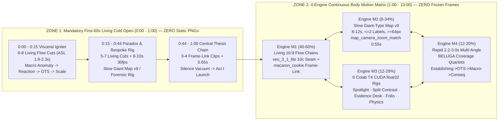

# V12 Anti-Slideshow Long Cinema Engine & 10 Distinct Documentary Architectures (`L01..L10`)

> **Thread:** `2C` (`@style-grammar-long`) · **Channel:** `su_ke_lai` (`@SuKeLaiVN` — *Sử Kể Lại*)  
> **Machine-Readable Contract:** `07_10_long_distinct_documentary_architectures.json`  
> **Precedence & Safety Locks:** `AGENTS.md` > `.agents/rules/gpu-headless-chrome.md` > `PLAYBOOK.md` (`ERR-20261122-01` Zero-Box / Zero-Smoke / 2-Frame Continuous Chain, `ERR-20261109-01` Zero `vf_zoompan` 15Hz Jitter, `ERR-20261109-02` `W-w-36:H-h-36` Watermark, `ERR-20261108-03` `VietNarrator_su_ke_lai` `-11.0 LUFS / <= -1.0 dBTP`).

---

## 1. Root-Cause Autopsy: Why All 10 V10 Longs (`L01..L10`) Failed in the First 15 Seconds

Visual inspection of the 4 user-uploaded defect screenshots, `sys/fx_warehouse/history_styles_10x10.py` (`build_long_style_blueprint`), `sys/tools/produce_vn_dual_mode.py`, and real global competitor frame grids (`Fern`, `Epic History TV`, `The Operations Room`, `SandRhoman History`, `LEMMiNO`, `IMPERIAL`) isolates **four fatal architectural flaws**:

| # | Defect | Exact Code Origin | Why Viewers Bounced in `< 15s` | V12 Architectural Cure |
|---|---|---|---|---|
| **1** | **Static PNG Slideshow Opening** | `history_styles_10x10.py:2348-2383` (`[6.0s, 6.0s, 6.0s]` Cold Open beats) + `produce_vn_dual_mode.py` static Lanczos (`0px` motion) | Viewers saw only `2.5` frozen AI paintings across `0–15s` (`L02..L10` had near-zero Flow video clips). Felt immediately like an automated PowerPoint slideshow. | **Mandatory First-60s Living Cold Open**: `12–18` native `16:9` living Flow `.mp4` clips cut into `18–25` multi-angle shots (`1.9s–2.5s` ASL in `0–15s`) + `1–2` `8.0–10.0s` 30fps bespoke breakdowns/maps. **`0` static held PNGs in `0–60s`!** |
| **2** | **Cheap AI-Edit Dark Pills & `VS` Plaques** | `render_single_pass.py:321-346` (`render_prestige_dateline_png`), `L512-599` (`render_v7_stat_versus_png`), `hud_widgets.py` | Dark semi-transparent rectangles with gold left stripes (*"NỬA ĐÊM 06/08/1442 \| 48 GIỜ BƯNG BÍT TIN DỮ"*) and arcade red `VS` badges slapped statically onto frozen images. | **100% Abolition of Boxed HUDs**: Replace all pills/plaques with either **Giant 1–3 Word Boxless Cinema Type (`>=66–96px`, `#FFF5D6`)** in open negative space, or **6 Bespoke 30fps CUDA Documentary Cutaway Rigs**. |
| **3** | **Fast, Cluttered Micro-Text Maps** | `tactical_battle_map_v8.py:1466, 2044, 2181-2459` (`3.4–4.8s` duration, `14–21px` fonts, 7+ labels, side/bottom bars) | Map maneuvers finished before viewers could orient, buried under tiny unreadable labels, side elevation meters, bottom progress bars, and wrong preset fallbacks. | **`tactical_battle_map_v9` Slow Giant-Type Standard**: `8.0s–12.0s` 3-phase choreography, `>=64–84px` (`5.9%–7.8%` H) fonts, `1–3` words/label, max `2` simultaneous labels, `0` side/bottom gauges. |
| **4** | **Cookie-Cutter `L01..L10` Homogeneity** | `history_styles_10x10.py:2328-2735` (identical `75s` intro + `6` chapters × `3` chains + 5-slot portrait rotation) | A palace murder mystery (`L02`), a logistics war-room (`L03`), a primary-letter archive (`L06`), and a weapon physics lab (`L10`) were edited with the exact same rhythm and camera angles. | **10 Structurally Distinct Documentary Engines**: Each `L01..L10` owns a unique chaptering topology, ASL pacing curve, lens/shot-coverage distribution, Cold Open blueprint, and signature 30fps CUDA rig. |

---

## 2. Ground-Up V12 Anti-Slideshow Long Cinema Engine Architecture

### 2.1 Zone 1 — Mandatory First-60s Living Cold Open (`0.0s – 60.0s`)
- **Hard Gate (`GATE_L12_01`)**: `static_png_count_0_60s == 0`. Every single frame in `0.0s–60.0s` is either a **native `16:9` living Google Flow `.mp4` clip** (`12–18` clips per Cold Open, sliced into `18–25` multi-angle cuts) or a **deterministic 30fps bespoke animated diagram/map (`8.0s–10.0s`)**.
- **`0.0s – 15.0s` (The 15-Second Anti-Bounce Igniter)**:
  1. **`0.0s – 2.0s` (Macro Tactile Anomaly — Zero Face!)**: Drop mid-action onto a visceral physical detail (`100mm` iron spike shearing wet oak planks, beeswax candle snuffed beside a jade cup, burning arrow hitting wooden gatepost) synced to `+6.0 dB` sub-impact at `t=0.04s`.
  2. **`2.0s – 4.2s` (85mm Reaction Micro-Acting)**: Eyes widening in Caravaggio torchlight or trembling hands gripping sword hilt (lips strictly closed).
  3. **`4.2s – 6.6s` (50mm OTS Spatial Threat)**: Over-the-shoulder view revealing the impossible scale of the opposing force or palace conspiracy.
  4. **`6.6s – 9.0s` (Kinetic Action Consequence)**: Immediate physical impact in clear-air 35mm depth.
  5. **`9.0s – 11.8s` (Visual Paradox Contrast Cut)**: Counter-drifting split-screen or abrupt spatial shift contrasting expectation vs historical reality.
  6. **`11.8s – 15.0s` (Wide Scale Reveal + Giant Boxless Hook Type)**: `2–3` uppercase words (`>=84px`, `#FFF5D6` ivory-gold, ROI optical shadow, zero box) anchored in open sky/shadow negative space.
- **`15.0s – 44.0s` (Escalation & Bespoke 30fps Visual Breakdown)**: `5–7` living cuts escalating the stakes, transitioning cleanly via `map_camera_zoom_match` (`0.55s`, zero smoke!) or tabletop camera dive into an **`8.0s–10.0s` 30fps Bespoke Breakdown** (`tactical_battle_map_v9`, Architectural Crime-Scene Floorplan, Darkroom Manuscript Spotlight, or Weapon Cross-Section).
- **`44.0s – 60.0s` (Central Unanswered Question & Vacuum Launch)**: `3–4` `macaron_cookie` Frame-Link clips building continuous momentum to the episode's central investigation question, dropping BGM `-26 dB` for a `0.65s` silence vacuum at `t=58.8s` before launching Chapter/Act I at `t=60.0s`.

### 2.2 Zone 2 — How the Body (`1m00s – 13m00s`) Eliminates Slideshows Without Violating `ERR-20261109-01`
- **Why V10 froze**: `ERR-20261109-01` banned FFmpeg's C filter `libavfilter/vf_zoompan.c` because `vw = (int)(iw/zoom)` integer truncation causes a nauseating `0.5px` 15Hz micro-jitter on slow pans, and holding static Lanczos frames for `5–6s` turned the video into a frozen slideshow.
- **How V12 achieves 100% silky motion with `0.000px` jitter**:
  1. **Engine M1 — Native `16:9` Living Flow Chains (`40%–60%` of body)**: `26–38` body clips per episode (`veo_3_1_lite` `10c` Seam Mode on angle/cast jumps + `macaron_cookie` Omni 1.2 Flash Frame-Link on `2–5` beat same-location chains, clamped to `0.00–6.50s` clear-air window, bridged by `0.0s` intra-clip cut, `seam_chain_bridge` `0.28s`, or `-0.22s` J-cut).
  2. **Engine M2 — `tactical_battle_map_v9` Slow Giant-Type Cartography (`8%–34%` of body)**: `8.0s–12.0s` per sequence (`0–2.5s` bare shaded terrain + 1 giant landmark -> `2.5–6.0s` bold faction block + `<=2` labels of `1–3` words at `>=64px` -> `6.0–10.5s` slow cubic maneuver arrow + `0.55s` `map_camera_zoom_match` dive into ground-level 35mm). Regional East Sea maps explicitly anchor **`HOÀNG SA` & `TRƯỜNG SA`**.
  3. **Engine M3 — 6 Bespoke 30fps Colab T4 CUDA Documentary Rigs (`12%–28%` of body)**: Rendered on Tesla T4 GPU using `torch.float32` `F.grid_sample(..., mode="bilinear", align_corners=True)` (**true floating-point sub-pixel interpolation = `0.000px` integer jitter!**):
     - `RIG_A_PROGRESSIVE_SPOTLIGHT`: Dims outer `75%` of frame to `36%` luma while tracking a feathered spotlight cone + `1.00 -> 1.07x` sub-pixel push onto a tactical chokepoint or clue.
     - `RIG_B_SPLIT_SCREEN_CONTRAST`: Replaces cheesy `[VS]` plaques with a `2px` antique-gold razor split (`50/50` vertical or `18°` diagonal), counter-drifting `float32` motion on both sides, and Giant `72px` boxless labels in negative space.
     - `RIG_C_EVIDENCE_TABLETOP_BOARD`: Overhead dark-slate camera glide across physical clues, suspect portraits, wax seals, and route pins, crossing out falsified hypotheses live (`L02`, `L07`).
     - `RIG_D_PRIMARY_FOLIO_SPOTLIGHT`: Vox/Voices-of-the-Past darkroom glide across *ĐVSKTT* / *Quân Trung Từ Mệnh Tập* / *Minh Thực Lục* folios with warm progressive line highlighter + `4.5–5.5s` 100%-opacity boxless serif translation (`ERR-20261122-01` Rule C).
     - `RIG_E_WEAPON_PHYSICS_CROSS_SECTION`: 30fps technical vector schematic animating `15°–75°` stake leverage, wet-straw ballistic absorption, or *Ngụ binh ư nông* mobilization ratios (`L10`, `L08`).
     - `RIG_F_SYNCHRONIZED_CANH_GIO_CLOCK`: Boxless dual-clock (`CANH TƯ · 02:15 | T - 03 GIỜ 45 PHÚT`) + 3-panel simultaneous theater status split (`L05`, `L08`).
  4. **Engine M4 — Rapid `2.2s–3.2s` Multi-Angle BELUGA Coverage Quartets (`12%–20%` of body)**: No single 0-credit `BELUGA` frame is EVER held for `5–8s`! Every non-Flow beat (`6.5–9.5s`) is split into a **4-shot Filmmaker Quartet (`2.2s–3.0s`/shot)**:
     $$\text{1. Wide Establishing (24mm)} \rightarrow \text{2. Medium OTS Blocking (50mm)} \rightarrow \text{3. Extreme Macro Tactile Insert (100mm, Zero Face!)} \rightarrow \text{4. Consequence / Micro-Reaction (85mm)}$$
     animated on T4 CUDA with `float32` `grid_sample` + 2-plane depth parallax (`parallax_amp=0.018`) + live `kodak_35mm_grain`.

---

## 3. Structural Comparison Matrix: 10 Distinct Long Documentary Formats (`L01..L10`)

| Code | Documentary Format (`8m50s–12m20s`) | World Filmmaking Twins | Chaptering & Narrative Spine | Screen Mix (`Flow` / `Map v9` / `CUDA Rig` / `Multi-Angle`) | Body `ASL` & `WPM` | Primary Signature 30fps CUDA Rig |
|---|---|---|---|---|---:|---|
| **`L01`** | **IMAX Combined-Arms Campaign Docudrama** | Epic History TV · Netflix *Rise of Empires* | `60s` Cold Open + `7` Escalating Operational Acts *(In-Scene Full-Brightness Titles, `0` card pause)* | `56% / 16% / 12% / 16%` | `3.1s` · `152` | `RIG_A` Chokepoint Spotlight + `4` Theatre Maps |
| **`L02`** | **Cold-Case Forensic Crime-Scene & Suspect Board** | LEMMiNO · Fern · IMPERIAL | `60s` Crime Scene + Incident Timeline + `3` Suspect Hypothesis Rooms *(returns to Board to cross out)* + Verdict | `48% / 8% / 26% / 18%` | `3.2s` · `144` | `RIG_C` Overhead Evidence & Suspect Elimination Board |
| **`L03`** | **Operations-Room Top-Down War Map & Logistics** | The Operations Room · HistoryMarche | **Map-First Spine**: `8` Slow `10–12s` Giant Maps as primary stage, diving into 35mm ground-truth windows | `42% / 32% / 12% / 14%` | `3.4s` · `154` | `RIG_A` Target Zoom-Box + Supply Attrition Split |
| **`L04`** | **Long-Take Civilizational Rise, Ruin & Time-Morph** | Fall of Civilizations · BBC Civilisations | Present-Day Ruin Cold Open + `5` Monumental Movements + `3` Graphic-Free Breathing Vistas | `60% / 10% / 16% / 14%` | `3.9s` · `136` | Ruin-to-Glory Frame-Link Morph + `RIG_D` Royal Edict |
| **`L05`** | **Synchronized `T-Minus` Tick-Clock Action Thriller** | Real Time History · Nolan *Dunkirk* | Flash-Forward `T-00:00:10` + `8` Hard-Cut `T-Minus` Checkpoints cross-cutting `3` simultaneous fronts | `54% / 18% / 14% / 14%` | `2.7s` · `158` | `RIG_F` Dual `Canh-Giờ` Clock + 3-Front Split |
| **`L06`** | **Archive Desk & Dual-Side Verbatim Letters** | Voices of the Past · Johnny Harris · Vox | `6` Rashomon Epistolary Duels pairing Đại Việt letters directly against secret enemy court memorials | `46% / 8% / 28% / 18%` | `3.4s` · `142` | `RIG_D` Darkroom Primary Folio Progressive Highlighter |
| **`L07`** | **HBO Psychological Crucible & 1v1 Mind Duel** | HBO Docudrama · MagnatesMedia · Biographics | Darkest-Hour Cold Open -> Formative Wound -> Rise -> Moral Dilemma Fork -> Masterstroke -> Verdict | `56% / 8% / 18% / 18%` | `3.2s` · `148` | `RIG_B` Bipolar 1v1 Diptych + Decision-Tree Fork |
| **`L08`** | **Ground-Level 24-Hour Living World Walk-Through** | Invicta (*24h Rome*) · toldinstone · *1917* | `6` Diurnal `Canh-Giờ` Watches (`04:30` to `04:30`) tracking `3` ordinary lives at eye level (`28mm`) | `58% / 8% / 14% / 20%` | `3.3s` · `144` | Isometric 3-Ring Citadel Map + Ancient Coin/Ration Rig |
| **`L09`** | **3D Topographic Layer-Stacking Geopolitics** | RealLifeLore · CaspianReport · Johnny Harris | `6` Cumulative Geographic Layers across `1,000` years *(Karst -> Tide -> Monsoon -> Biển Đông/HS-TS)* | `40% / 34% / 14% / 12%` | `3.4s` · `152` | Progressive GIS Layer-Stack + Cross-Century Pin Overlay |
| **`L10`** | **Macro Metallurgy, Weapon Physics & Economics** | SandRhoman · Perun · Cleo Abram | `6` Stress-Test Modules *(Problem -> Material -> Foundry -> 30fps Physics -> Ngụ Binh Math -> Combat)* | `46% / 10% / 24% / 20%` | `3.0s` · `154` | `RIG_E` 30fps Weapon/Rampart Vector Cross-Section |

---

## 4. Deep Filmmaking Blueprints for Each Format (`L01..L10`)

### `L01` — IMAX Combined-Arms Campaign Docudrama (`L01_EPIC_CAMPAIGN_CHRONICLE`)
- **Staging & Lenses:** `2.39:1` anamorphic framing (`1920x852` active, pure cinema-black bars, `0` bar text). Sweeping `24mm` river/mountain vistas $\rightarrow$ `50mm` OTS field headquarters $\rightarrow$ `85mm` mud-and-iron infantry collision $\rightarrow$ `100mm` bowstring/oar/stake macro impacts. Accelerates from `3.2s` chains in Acts I–II to `1.9s` single-beat shock cuts in Acts V–VI.
- **First-60s Cold Open (`16` Flow clips + `9.0s` Map = `22` cuts, `0` PNGs):** Opens at `0.0s` as burning reed rafts slam into multi-decked warships (`2.0s`) $\rightarrow$ `85mm` commander eyes in torch glare $\rightarrow$ `100mm` ironwood stake ripping oak planks $\rightarrow$ giant boxless `10 VẠN ĐẠI QUÂN` in open sky; dives at `19.0s` via `map_camera_zoom_match` into a `9.0s` Giant-Type Như Nguyệt Funnel Map before a 4-clip Frame-Link rampart walk.
- **Flagship Episode:** *Phòng Tuyến Như Nguyệt 1077: Đòn Bẻ Gãy 10 Vạn Tống* (`CHIẾN LŨY NHƯ NGUYỆT`).

### `L02` — Cold-Case Forensic Crime-Scene & Suspect Board (`L02_DARK_FORENSIC_INVESTIGATION`)
- **Staging & Lenses:** Zero wide battlefields! Claustrophobic `35mm` creeping palace corridor dollies, `85mm` half-shadowed witness OTS (`noir_candle_chiaroscuro`), and `100mm` forensic macros (snuffed beeswax candle, spilled tea on mat, cinnabar seal fibers, rain dripping off pavilion eaves).
- **Structural Spine:** Returns after each chapter to **`RIG_C_EVIDENCE_TABLETOP_BOARD`** to cross out disproven cover stories (Official Illness Claim $\rightarrow$ Harem Poisoning Theory $\rightarrow$ Court Faction Coup) and uses `RIG_B_SPLIT_SCREEN_CONTRAST` (`10 NGÀY TRU DI` vs `22 NĂM RỬA OAN` — zero red `VS` badge!).
- **First-60s Cold Open (`14` Flow clips + `10.0s` Architectural Floorplan Rig = `20` cuts, `0` PNGs):** Candle snuffed at midnight $\rightarrow$ hurried boots on wet brick $\rightarrow$ sealed imperial palanquin $\rightarrow$ `10.0s` 30fps Côn Sơn–Lệ Chi Viên Spatial & Timeline Feasibility Rig.
- **Flagship Episode:** *Án Lệ Chi Viên 1442: Giải Phẫu Hồ Sơ Đêm Định Mệnh* (`ÁN LỆ CHI VIÊN`).

### `L03` — Operations-Room Top-Down War Map & Logistics (`L03_GRAND_STRATEGY_WAR_ROOM`)
- **Staging & Lenses:** **Inverts the standard documentary hierarchy**: `tactical_battle_map_v9` (`32%` of runtime across `8` extended `10–12s` sequences) IS the main storytelling stage. Whenever unit blocks collide or supply lines are cut, a clean geometric target box zooms (`0.55s` `map_camera_zoom_match`) into `3–4` crisp clear-air `35mm` ground-truth shots (burning Vân Đồn grain junks, empty Mongol ration sacks, muddy pass bottlenecks) before pulling back to update the operational board.
- **First-60s Cold Open (`12` Flow clips + `2 × 8.5s` Giant Maps = `19` cuts, `0` PNGs):** Interleaves burning supply barges with Map #1 (`CẮT LƯƠNG VÂN ĐỒN`) and stake-driving squads with Map #2 (`BẪY TRIỀU BẠCH ĐẰNG`).
- **Flagship Episode:** *Sa Bàn Bạch Đằng 1288: Cắt Lương Phá 600 Thuyền Nguyên* (`SA BÀN BẠCH ĐẰNG`).

### `L04` — Long-Take Civilizational Rise, Ruin & Time-Morph (`L04_FALL_AND_RISE_DYNASTY_IMMERSION`)
- **Staging & Lenses:** `2.39:1` poetic cinema (`136 WPM`) built on unbroken `4.0s–5.4s` `macaron_cookie` Frame-Link lateral Steadicam glides (`50%` of Flow clips are Frame-Link!), `85mm` carved stone stele & celadon macros, and `3` completely text-free atmospheric breathing vistas.
- **First-60s Cold Open (`13` Flow clips + `8.5s` Basin Relief Morph = `18` cuts, `0` PNGs):** Monsoon rain on mossy stone dragon ruins today morphs seamlessly via `macaron_cookie` Frame-Link into gilded 11th-century Thăng Long palace eaves and Lý Công Uẩn's dragon barge emerging from Hoa Lư cliffs.
- **Flagship Episode:** *Chiếu Dời Đô 1010: Đêm Rời Hoa Lư Mở Cõi Ngàn Năm* (`THĂNG LONG 1010`).

### `L05` — Synchronized `T-Minus` Tick-Clock Action Thriller (`L05_REALTIME_COUNTDOWN_CHRONICLE`)
- **Staging & Lenses:** Fastest Long cadence (`158 WPM`, `2.7s` body ASL). Cross-cuts relentlessly across **3 simultaneous threads** (Tây Sơn strike columns / unaware Qing headquarters / physical clock: water-clock drip, incense burn, dropping river tide) while lighting tracks exact solar time from `02:00` indigo torchlight to `07:30` gunpowder dawn.
- **First-60s Cold Open (`18` Flow clips + `9.0s` Countdown Rewind Map = `25` cuts, `0` PNGs):** Starts at `T - 00:00:10` Canh Tư Mồng 5 Tết (`1.85s` rapid cuts: hissing fuse, wet-straw shield, charging war elephant), slams on a bronze gong, and optical-rewinds `120` hours to `ĐÊM 30 TẾT`.
- **Flagship Episode:** *120 Giờ Thần Tốc Tết 1789: Đếm Ngược Phá 29 Vạn Thanh* (`120 GIỜ TẾT 1789`).

### `L06` — Archive Desk & Dual-Side Verbatim Letters (`L06_EYEWITNESS_PRIMARY_LETTERS`)
- **Staging & Lenses:** Rashomon dual-archive structure contrasting warm `3000K` oil-lamp Đại Việt writing desks (`85mm` sable brush on *giấy dó*, inkstone, wax seal — `100%` closed mouths) against cold `5800K` besieged enemy ramparts and **`RIG_D_PRIMARY_FOLIO_SPOTLIGHT`** (`28%` rig share: 30fps camera gliding across woodblock/manuscript folios with warm progressive line highlights + `4.8s` boxless Vietnamese translation).
- **First-60s Cold Open (`14` Flow clips + `10.0s` Darkroom Folio Spotlight = `19` cuts, `0` PNGs):** Arrow-borne bamboo tube strikes Đông Quan gate $\rightarrow$ Vương Thông reads with trembling hands $\rightarrow$ `10.0s` Darkroom Spotlight on the surviving *Quân Trung Từ Mệnh Tập* ultimatum.
- **Flagship Episode:** *Thư Nguyễn Trãi Đánh Gục 10 Vạn Quân Minh Không Đổ Máu* (`BÚT CHIẾN ĐÔNG QUAN`).

### `L07` — HBO Psychological Crucible & 1v1 Mind Duel (`L07_BIOGRAPHY_OF_IRON_MINDS`)
- **Staging & Lenses:** `2.39:1` intimate `50mm/85mm` character study using bipolar color lighting (`3200K` crimson-amber torch vs `5600K` slate-cobalt rain) to externalize inner moral torment and 1v1 commander duels, supported by `RIG_B` Museum Diptychs and Decision-Tree Consequence Forks.
- **First-60s Cold Open (`15` Flow clips + `8.5s` Dilemma Fork Rig = `21` cuts, `0` PNGs):** 1407 Cao Vọng capture in rain $\rightarrow$ flashback cut to massive Tây Đô stone blocks & *Thông Bảo Hội Sao* paper currency $\rightarrow$ `8.5s` Dilemma Fork contrasting Radical Reform vs Lost Legitimacy.
- **Flagship Episode:** *Hồ Quý Ly 1400: Nhà Cải Cách Lớn Hay Bi Kịch Mất Nước?* (`HỒ QUÝ LY 1400`).

### `L08` — Ground-Level 24-Hour Living World Walk-Through (`L08_24_HOURS_IN_ANCIENT_DAI_VIET`)
- **Staging & Lenses:** Continuous `28mm–35mm` eye-level forward Steadicam walk-throughs across `6` `Canh-Giờ` watches following a boatman, a weapon-smith, and a palace guard, paired with `85mm` sensory macros (copper coins counted, molten bronze, Chu Đậu glaze, steaming rations, night *mõ tre* clapper) and Isometric 3-Ring Citadel cutaways.
- **First-60s Cold Open (`15` Flow clips + `9.0s` Isometric Citadel Map = `20` cuts, `0` PNGs):** Morning drum booms $\rightarrow$ Đại Hưng ironwood gate unbolted $\rightarrow$ camera walks continuously into waking Giang Khẩu wharf $\rightarrow$ `9.0s` 30fps Isometric Thăng Long 61-Ward Cutaway.
- **Flagship Episode:** *24 Giờ Sống Giữa Kinh Thành Thăng Long Thời Nhà Trần* (`24 GIỜ THĂNG LONG`).

### `L09` — 3D Topographic Layer-Stacking Geopolitics (`L09_GEOPOLITICAL_CHESSBOARD`)
- **Staging & Lenses:** Macro-historical geographic determinism across `1,000` years (`34%` `tactical_battle_map_v9`). Stacks elevation, karst passes, river tidal shelves, monsoon mud ceilings, and Biển Đông sea lanes (**explicitly anchoring `HOÀNG SA` & `TRƯỜNG SA`**) one giant-type layer at a time, diving into `24mm` aerials and muddy ground bottlenecks showing Song, Yuan, Ming, and Qing armies hitting the exact same terrain traps.
- **First-60s Cold Open (`13` Flow clips + `2 × 8.5s` Layer-Stack Maps = `19` cuts, `0` PNGs):** Cavalry sinking in delta mud & hulls stranded on shoals $\rightarrow$ Progressive Karst Funnel Map (`ẢI CHI LĂNG`) $\rightarrow$ multi-dynasty ground cuts $\rightarrow$ Biển Đông & Red River Shield Map.
- **Flagship Episode:** *Vì Sao 5 Đế Chế Đều Gãy Gục Trước Địa Hình Đại Việt?* (`BÀN CỜ ĐẠI VIỆT`).

### `L10` — Macro Metallurgy, Weapon Physics & Economics (`L10_MILITARY_ENGINEERING_AUTOPSY`)
- **Staging & Lenses:** Over `30%` of all live shots are `85mm–100mm` extreme materiality macros (forged iron stake caps, *gỗ lim* fibers, breech-loading bronze *Thần Cơ* chambers, wet straw absorbing lead balls, stone citadel joinery), interleaved with **`RIG_E_WEAPON_PHYSICS_CROSS_SECTION`** (`10` 30fps animated vector schematics per episode) and *Ngụ binh ư nông* mobilization math.
- **First-60s Cold Open (`16` Flow clips + `9.5s` Physics Cross-Section Rig = `22` cuts, `0` PNGs):** Lead cannonball stopped dead by wet-straw shield $\rightarrow$ forge sparks on iron stake cap $\rightarrow$ `9.5s` 30fps Kinetic Energy & `15°` Stake Leverage Cross-Section $\rightarrow$ village paddy farmers mobilizing into 200,000 troops.
- **Flagship Episode:** *Súng Thần Cơ & Ngụ Binh: Công Nghệ Quân Sự Đại Việt* (`VŨ KHÍ ĐẠI VIỆT`).

---

## 5. Exact Per-Episode Flow Clip, 0c BELUGA & Host-IP Pacing Budget

### 5.1 Verified Ultra Credit Pool & Rate-Limit Law
- **4 Google AI Ultra Accounts (`paygate_tier=2`)**: `profile_22` (`thue2127`: `25,459c`) + `profile_en01` (`admin6104`: `25,050c`) + `profile_18` (`phuocnguyencoc4`: `24,849c`) + `profile_en03` (`tiktokbeeby`: `24,518c`) = **`99,876` Ultra credits** (`118,045` total ledger credits across pool) + **8 Colab Tesla T4 GPUs**.
- **Single-Wave Per-Episode Design (`<= 55` Clips/Rolling-Hour Rule)**: Google Flow enforces a host-IP sliding-hour ceiling of `~60` video clips/hr (`vp-flow-cdp` caps waves at **`<= 55` clips/rolling 60m** with `max 3` video Chrome workers and `flow_video_rpc_submit = 4.2s + 0.8s` jitter). Every V12 Long format (`L01..L10`) is budgeted at **`40–54` living `16:9` Flow clips**, meaning **1 complete Long episode generates in ONE uninterrupted `17.5–23.0` minute wave with ZERO mid-episode IP cooldown**, followed by a `15-minute` host-IP breather during which 0-credit `BELUGA` multi-angle frames (`ogiZ0b` batched 2–4 prompts, ~3.5m) + OmniVoice TTS + Colab T4 NVENC rendering (`8–9m`) run in parallel!

### 5.2 Per-Episode & 10-Episode Aggregate Budget Table

| Style | Runtime | Cold-Open Flow Clips (`0–60s`) | Body Flow Clips | Total Living `16:9` Clips (`<=55` Cap) | `veo_3_1_lite` (`10c` Seam) | `macaron_cookie` (`16c` Link) | Episode Credits | `BELUGA` `0c` Frames (`Key`+`Insert`) | `Map v9` (`8–12s`) | CUDA Rigs (`30fps`) | Flow Wave Time | Colab T4 Render |
|---|---:|---:|---:|---:|---:|---:|---:|---:|---:|---:|---:|---:|
| **`L01`** | `11m20s` | `16` | `38` | **`54`** | `34` | `20` | **`660c`** | `136` (`74+62`) | `4` | `6` | `23.0m` | `8.5m` |
| **`L02`** | `11m00s` | `14` | `30` | **`44`** | `30` | `14` | **`524c`** | `124` (`58+66`) | `2` | `10` | `19.0m` | `8.0m` |
| **`L03`** | `11m30s` | `12` | `28` | **`40`** | `28` | `12` | **`472c`** | `108` (`52+56`) | `8` | `6` | `17.5m` | `8.5m` |
| **`L04`** | `12m10s` | `13` | `35` | **`48`** | `24` | `24` | **`624c`** | `118` (`72+46`) | `3` | `6` | `21.0m` | `9.0m` |
| **`L05`** | `10m40s` | `18` | `34` | **`52`** | `38` | `14` | **`604c`** | `134` (`66+68`) | `4` | `8` | `22.0m` | `8.0m` |
| **`L06`** | `10m50s` | `14` | `30` | **`44`** | `28` | `16` | **`536c`** | `122` (`60+62`) | `2` | `10` | `19.0m` | `8.0m` |
| **`L07`** | `11m10s` | `15` | `33` | **`48`** | `30` | `18` | **`588c`** | `126` (`66+60`) | `2` | `7` | `20.5m` | `8.5m` |
| **`L08`** | `11m00s` | `15` | `33` | **`48`** | `28` | `20` | **`600c`** | `130` (`68+62`) | `2` | `6` | `21.0m` | `8.5m` |
| **`L09`** | `11m20s` | `13` | `27` | **`40`** | `28` | `12` | **`472c`** | `112` (`52+60`) | `8` | `7` | `17.5m` | `8.5m` |
| **`L10`** | `11m40s` | `16` | `32` | **`48`** | `34` | `14` | **`564c`** | `130` (`62+68`) | `2` | `10` | `20.5m` | `8.5m` |
| **TOTAL** | **`112m40s`** | **`146`** | **`320`** | **`466`** | **`302`** | **`164`** | **`5,644c`** | **`1,240` (`0c`)** | **`37`** | **`76`** | **`9` waves** | **Parallel 8×T4** |

> [!IMPORTANT]
> **Ultra Budget Efficiency:** Producing all **10 V12 Masterpiece Long Documentaries (`466` living `16:9` cinema clips + `1,240` multi-angle BELUGA frames)** consumes only **`5,644` credits (`5.65%` of the `99,876` Ultra-4 pool)**, leaving **`94,232` Ultra credits** untouched for Shorts, retakes, and upcoming waves!

---

## 6. Hard V12 Long Auto-Fail QA Gates (`0/100` on Violation)

1. **`GATE_L12_01` (Zero Static First-60s):** `static_png_count_0_60s == 0`, `living_flow_clips_0_60s >= 12`, `max_shot_dur_0_15s <= 2.8s`, `max_shot_dur_15_60s <= 3.5s`.
2. **`GATE_L12_02` (Zero Frozen Body Slides):** Zero frozen frames (`>=0.5s` at `0px` velocity), `max_single_beluga_shot_sec <= 3.2s` (must cut across 4-shot coverage quartet), and `vf_zoompan` strictly banned (`CUDA float32 grid_sample` only).
3. **`GATE_L12_03` (Zero Box & Zero `VS` Plaque):** `0` dark rectangular pills, `0` `1px` borders, `0` left vertical stripes, `0` red `VS` badges, `0` smoke/mist transitions (`river_mist_map_dive`, `dust_smoke_cloud`).
4. **`GATE_L12_04` (Slow Giant-Type Map v9):** Duration `8.0s–12.0s`, font height `>= 5.5%` (`>=60px` on `1080p`), `<= 3` words/label, `<= 2` simultaneous labels, campaign-verified coordinates + `HOÀNG SA & TRƯỜNG SA` on regional maps.
5. **`GATE_L12_05` (Structural Filmmaking Divergence):** Each `L01..L10` episode must execute its assigned chapter topology, screen-share mix, and signature CUDA rig, with `>= 2` Class-3 Extreme Macro Tactile Inserts (zero face) per chapter.
6. **`GATE_L12_06` (Colab T4 NVENC, Drift & Calibrated Audio):** `h264_nvenc`, `fps=30,settb=1/30` **before** `trim=end_frame` (`av_drift <= 0.05s`), `VietNarrator_su_ke_lai` `-11.0 LUFS` / `<= -1.0 dBTP` (`encode_calibrated_m4a` + `-c:v copy` remux), bottom-right logo at `W-w-36:H-h-36` (`NCC >= 0.98`), and `>= 7` embedded `FFMETADATA1` chapters.
