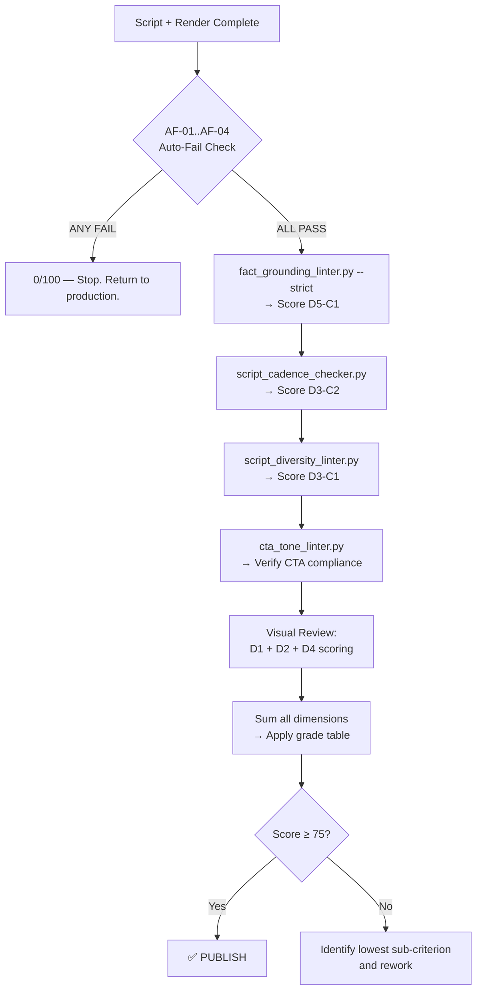

# 08 — Vietnamese Analytical Commentary Framework & V12 Masterpiece Evaluation Rubric

**Thread 2D · Sử Kể Lại (`su_ke_lai`) · V12 Cinema Research**
*Owner: vn-commentary-master · Created: 2026-11-25*

---

> [!IMPORTANT]
> User directive: *"video càng khó làm càng hay — nội dung giá trị cao đặc biệt, hình ảnh nâng tầm chất lượng, video phân tích chuyển cảnh, diễn đạt, đưa ra ý kiến, miêu tả gì đó tất cả do bạn quyết định đánh giá, thang chấm điểm đánh giá dựa theo kênh mẫu — video mục tiêu là tiếng việt và phù hợp với người việt."*

---

## A. Vietnamese Analytical & Opinionated Storytelling Framework

### Core Philosophy

> **Mỗi câu nói phải làm được ÍT NHẤT MỘT trong ba việc:**
> 1. **Giải phẫu cơ chế ẩn** — tại sao điều đó xảy ra, không chỉ điều gì xảy ra
> 2. **Đưa ra phán xét lịch sử sắc bén** có căn cứ sử liệu, không né tránh
> 3. **Khoan sâu vào giác quan vi mô** của con người trong khoảnh khắc đó

Câu chỉ kể lại sự kiện là câu chết — Wikipedia đã làm việc đó rồi.

---

### 7 Sentence Modes (Khung 7 Chế Độ Câu)

#### M1 — Giải Phẫu Cơ Chế Ẩn (*Hidden Mechanics Dissection*)

**Dùng khi:** cần giải thích tại sao một chiến thuật/vũ khí/quyết định có thể hoạt động theo nguyên lý vật lý/chiến thuật/tâm lý mà biên niên sử không ghi thẳng.

**Cấu trúc:** `[Hành động X]` → `[Cơ chế Y làm cho X có thể xảy ra]` → `[Hệ quả Z với toàn trận]`

**Ví dụ:**
> *Mộc bài rơm ướt không phải khiên mộc bình thường — lớp rơm ngâm nước hấp thụ sức nổ của đạn thần công rồi phân tán nhiệt sang hai bên, khiến 20 người đẩy một tấm còn nguyên vẹn tiến tới tận chân đồn.*

**Linter gates:** Câu ≤ 25 âm tiết; không dùng *"bí mật nằm ở"*, *"ít ai biết rằng"*; fact phải có trong `fact_vault.json`.

---

#### M2 — Phán Xét Chiến Lược Sắc Bén (*Sharp Strategic Verdict*)

**Dùng khi:** đưa ra kết luận opinionated có thể gây tranh cãi, dựa trên dữ liệu.

**Cấu trúc:** `[Nhân vật/quyết định] [động từ phán xét mạnh]` vì `[lý do chiến lược cụ thể]`, **không phải** vì `[lý do thông thường/sai lầm]`.

**Ví dụ:**
> *Ô Mã Nhi thua không phải vì thiếu dũng cảm — ông ta thua vì giáo lý thủy chiến Mông Cổ không tính đến thủy triều lên-xuống hai lần mỗi ngày trên sông cửa đồng bằng.*

**Linter gates:** Không dùng *"đánh giá công bằng thì"*, *"nói đi cũng phải nói lại"*, *"có một sự thật mất lòng"*.

---

#### M3 — Zoom Vi Giác Quan (*Sensory Micro-Detail Zoom*)

**Dùng khi:** đưa người xem VÀO khoảnh khắc bằng chi tiết giác quan — mùi, âm thanh, nhiệt độ, trọng lượng, kết cấu. Không dùng tính từ chung chung.

**Cấu trúc:** Tả `[1 chi tiết giác quan rất cụ thể]` trong `[thời điểm/không gian cụ thể]`.

**Ví dụ:**
> *Lúc 3 giờ sáng, nước triều đã kéo cọc lim xuống ngang mặt sông — không ai nhìn thấy, nhưng ai chạm vào cũng nghe tiếng gỗ rít lên dưới làn nước đen.*

**Linter gates:** Không dùng "hùng tráng", "bi thương", "oai phong". Câu ≤ 20 âm tiết.

---

#### M4 — Phản Vấn Sắc Bén (*Sharp Counter-Question*)

**Dùng khi:** hook retention reset — đặt câu hỏi mà câu trả lời ngay sau đó lật ngược kỳ vọng.

**Cấu trúc:** `Nhưng [câu hỏi logic thông thường ≤ 16 syl, zero [pause:...]?` `[Câu trả lời đảo ngược + lý do vật lý/chiến thuật].`

**Ví dụ:**
> *Nhưng tại sao 5 vạn quân Xiêm không chia đôi hạm đội đánh bọc hậu? Vì thuyền chiến Xiêm tải nặng cần nước triều lên mới ra được vịnh — và Nguyễn Huệ biết điều đó trước khi khai trận.*

**Linter gates:** Câu hỏi ≤ 16 âm tiết. Zero `[pause:...]` ở B00 (opening hook).

---

#### M5 — Cầu Nối Hiện Đại Việt Nam (*Vietnam Micro-Bridge*)

**Dùng khi:** giúp người xem cảm nhận được đơn vị lịch sử theo cái họ biết trong cuộc sống hàng ngày.

**Cấu trúc:** `[Số liệu lịch sử]` — tương đương `[analog Việt Nam hiện đại quen thuộc]`.

**Ví dụ:**
> *Ba vạn quân Tây Sơn hành quân từ Phú Xuân ra Thăng Long trong 5 ngày — tức 600 km, bằng đúng khoảng cách Hà Nội đi Đà Nẵng ngày nay, không có đường trải nhựa.*

**Linter gates:** Không dùng USD, feet, inches. Dùng km, kg, giờ đi xe — cái người Việt dùng mỗi ngày.

---

#### M6 — Phán Quyết Lịch Sử Đáng Nhớ (*Memorable Historical Verdict*)

**Dùng khi:** câu kết chương hoặc câu cuối video. Ngắn, sắc, mang tính phán xét thế hệ.

**Cấu trúc:** `[Nhân vật/sự kiện] [động từ mạnh, thể hiện irony/tragedy/triumph]` — `[1 cụm mang tính kết luận vĩnh cửu ≤ 5 từ]`.

**Ví dụ:**
> *Thoát Hoan thoát thân trong ống đồng vì sợ tên độc — và chính cái sợ đó cứu Đại Việt khỏi một cuộc chiến thứ tư.*

**Linter gates:** ≤ 20 âm tiết. Zero "like/share/subscribe/đăng ký/nhấn chuông". Chỉ dùng ở cuối chương hoặc cuối video.

---

#### M7 — Miêu Tả Phim Ngôn Ngữ (*Cinematic Description Language*)

**Dùng khi:** dẫn dắt người xem như một đạo diễn — dùng ngôn ngữ của người kể phim, không phải sách giáo khoa.

**Cấu trúc:** `Góc [loại góc máy]` bắt `[hành động cụ thể]` — `[ánh sáng/thời điểm]` — `[cảm xúc/ý nghĩa]`.

**Ví dụ:**
> *Góc rộng từ trên cao: 300 thuyền chiến Xiêm giống tấm thảm đỏ từ từ trôi vào hẻm núi — và hẻm núi đó đang đóng lại từ cả hai phía.*

**Linter gates:** Không có "hùng tráng", "bi tráng". Dùng danh từ hình ảnh cụ thể.

---

### Mode Rotation Rule

| Quy tắc | Chi tiết |
|---|---|
| **Tối thiểu 4 modes / 10 beats** | Mỗi chương phải dùng ≥ 4 trong 7 modes |
| **Không lặp 2 beats liên tiếp** | Không dùng cùng mode cho beat kề nhau |
| **M6 chỉ ở cuối chương / cuối video** | Không dùng M6 ở giữa chương |
| **M4 bắt buộc tại mỗi Retention Reset** | Mỗi 60–90s PHẢI có ≥ 1 M4 → M1 cặp đôi |

---

### Retention Reset 3-Bước (Mỗi 60–90 Giây)

```
[Bước 1 — WHY_NOT, M4]  "Nhưng tại sao X không làm Y?"  (≤ 16 âm tiết, zero [pause:...])
       ↓
[Bước 2 — CONSTRAINT, M1]  "Vì cơ chế vật lý/chiến thuật Z không cho phép Y."
       ↓
[Bước 3 — SOLUTION, M1/M7]  "Thay vào đó, giải pháp A đảo ngược toàn bộ kỳ vọng."
```

**Ví dụ chuẩn (Trận Ngọc Hồi 1789):**
- *WHY_NOT:* "Nhưng tại sao Quang Trung không chờ đại bác về đủ rồi mới đánh?"
- *CONSTRAINT:* "Quân Thanh có 2 tháng lương — đủ chờ đến mùa hè, khi nhiệt độ Thăng Long giết chết quân miền Nam."
- *SOLUTION:* "Nên Tết chính là deadline sinh tử — và ăn Tết trước 3 ngày là mệnh lệnh chiến thuật, không phải nghi lễ."

---

### 4 Linter Compliance Matrix

| Linter | Yêu cầu chính | Gate |
|---|---|---|
| `fact_grounding_linter.py --strict` | Mọi số liệu phải có trong `verified_facts`; 0 `REPORT_ONLY_LEAKAGE` | `0 errors` |
| `script_cadence_checker.py` | Hook ≤ 24 syl; zero `[pause:...]` ở SC01; drift ≤ 0.5s; rate 3.2–4.5 syl/s | `0 FAIL` |
| `script_diversity_linter.py` | stddev câu ≥ 1.8; 0 `AI_CLICHE_PHRASE`; 0 `INTRA_VIDEO_REPETITION` | `status PASS` |
| `cta_tone_linter.py` | bridge ≤ 22 token; close ≤ 24 token; combined ≤ 38; 0 banned CTA | `0 errors` |

### Short-to-Long Channel Bridge (Final 15%)

```
Bridge (≤ 22 token):
  "Toàn bộ trận đánh này — từ chiến thuật cọc gỗ cho đến bài toán thủy triều —
   được phân tích chi tiết trong tập dài trên Sử Kể Lại."

Close (≤ 24 token):
  "Bạn nghĩ đâu là quyết định then chốt nhất?"

FORBIDDEN trong mọi trường hợp: like · share · subscribe · đăng ký · nhấn chuông · ủng hộ kênh
```

---

## B. V12 Masterpiece Evaluation Rubric (100 Điểm)

> [!CAUTION]
> **Auto-Fail Gates kiểm tra TRƯỚC khi tính điểm. Bất kỳ gate nào trigger → 0/100 FAIL.**

---

### Auto-Fail Gates (AF)

#### AF-01 — Dark Pill / Box / VS Overlay Gate → `0/100 FAIL`

Bất kỳ điều nào sau đây trong frame:
- Rectangular pill, gold-bordered box, VS badge
- Kahoot A/B quiz box, Street Fighter HP bar
- Opaque `#0C1017`/`#10151E` CAD modal, pill badge `[SỬ LIỆU CHÍNH THỐNG]`
- `ImageDraw.rectangle`, `rounded_rectangle` behind text

*Căn cứ: V7 Law A, V8 Rule A, V9.1 §3.2*

---

#### AF-02 — Map Text / Label / Animation Speed Gate → `0/100 FAIL`

Vi phạm bất kỳ điều nào:
- Map label text height **< 5%** frame height
- Map label **> 3 từ**
- Map animation / maneuver hold **< 6 giây**

*Căn cứ: V6.0 Law 4, V7 Law C (5.8s–8.0s), V9.1 §4.1*

---

#### AF-03 — Static Image Hold Gate (60 Giây Đầu Long) → `0/100 FAIL`

Bất kỳ static PNG/BELUGA frame nào **giữ > 3.5 giây** trong 60 giây đầu (beats 0–18) của Long 16:9 mà không có camera motion thực sự trong clip.

*Căn cứ: V9.1 §2 — 100% native 16:9 moving Flow .mp4*

---

#### AF-04 — Missing Macro Tactile Inserts / Angle Diversity → `0/100 FAIL`

Bất kỳ chương nào (10 beats):
- Có **0 macro tactile insert** (slot 3 Tight Action Macro hoặc slot 5 Low-Angle Hero từ 5-shot rotation)
- Có **3 beats liên tiếp cùng góc/scale camera**

*Căn cứ: visual.md §4 — 5-Shot Camera Rotation Matrix*

---

### Scoring Dimensions

#### D1 — Nội Dung Phân Tích & Độ Sâu Lịch Sử (**30 điểm**)

| Tiêu chí | Điểm tối đa |
|---|---|
| **D1-C1** Mật độ Hidden Mechanics (M1) | 10 |
| **D1-C2** Phán Xét Opinionated (M2 + M6) | 10 |
| **D1-C3** Retention Reset Quality (3-bước chuẩn) | 10 |

```
D1-C1 (M1 density):
  10pt: ≥ 30% beats dùng M1 Giải Phẫu Cơ Chế Ẩn, fact-vault grounded
   7pt: 20–29% beats
   4pt: 10–19% beats
   0pt: < 10% hoặc fail fact_grounding_linter

D1-C2 (Opinionated Verdict):
  10pt: ≥ 2 phán quyết lịch sử sắc bén có thesis per episode, dẫn chứng sử liệu
   7pt: 1 phán quyết + ≥ 2 M6 memorable verdicts
   4pt: Có nhận định nhưng thiếu thesis mạnh
   0pt: Chỉ kể sự kiện

D1-C3 (Retention Reset):
  10pt: ≥ 3 resets trong episode, mỗi cái WHY_NOT (≤16syl) + CONSTRAINT + SOLUTION đảo ngược
   7pt: 2 resets đạt chuẩn
   4pt: 1 reset hoặc quá chung chung
   0pt: Zero retention reset chuẩn
```

---

#### D2 — Chuyển Cảnh & Nhịp Phim (**20 điểm**)

| Tiêu chí | Điểm tối đa |
|---|---|
| **D2-C1** Transition Type Diversity & Appropriateness | 10 |
| **D2-C2** Shot Duration Arc (5-Act Pacing) | 10 |

```
D2-C1 (Transition diversity):
  10pt: ≥ 4 loại transition khác nhau; đúng ngữ cảnh; 0 smoke/fog/mist; 0 whip-slide
   7pt: 3 loại, không có smoke
   4pt: 2 loại hoặc ≤ 1 smoke sai ngữ cảnh
   0pt: Uniform crossfade hoặc smoke/VS/whip-slide

D2-C2 (5-Act pacing arc):
  10pt: Hook 3.2–4.2s → Setup 4.5–6.0s → Suspense 3.5–4.5s → Climax 2.8–3.8s → Aftermath 5.5–7.0s
   7pt: 3/5 acts đúng range, zero micro-cuts < 2.8s
   4pt: ASL trung bình OK nhưng arc mờ
   0pt: Flat hoặc nhiều micro-cuts < 2.8s
```

---

#### D3 — Diễn Đạt Tiếng Việt & Giọng Kể (**20 điểm**)

| Tiêu chí | Điểm tối đa |
|---|---|
| **D3-C1** Lexical Diversity & Anti-Cliché | 8 |
| **D3-C2** Cadence & Vocal Profile | 7 |
| **D3-C3** Sensory Micro-Detail Density (M3) | 5 |

```
D3-C1 (Diversity):
   8pt: stddev câu ≥ 2.0; 0 AI_CLICHE_PHRASE; 0 INTRA_VIDEO_REPETITION; ≥ 4 modes/10 beats
   5pt: stddev ≥ 1.8; ≤ 2 cliché flag
   3pt: stddev 1.5–1.8; ≤ 4 cliché
   0pt: script_diversity_linter FAIL

D3-C2 (Cadence):
   7pt: 0 DEAD_AIR; 0 DRIFT > 0.5s; 0 OPENING_SCENE_PAUSE_FORBIDDEN; hook ≤ 24 syl; 6-mode rotation đúng vị trí
   5pt: ≤ 2 drift warning, hook ≤ 24 syl
   3pt: Hook OK nhưng có drift
   0pt: cadence_checker FAIL

D3-C3 (M3 density):
   5pt: ≥ 15% beats dùng M3 với ≥ 1 chi tiết giác quan rất cụ thể
   3pt: 8–14% beats
   1pt: 1–7% beats
   0pt: Zero M3
```

---

#### D4 — Hình Ảnh & Chất Lượng Thị Giác (**20 điểm**)

| Tiêu chí | Điểm tối đa |
|---|---|
| **D4-C1** Zero-Box Typography Purity | 8 |
| **D4-C2** Camera Rotation & Tactile Insert Coverage | 7 |
| **D4-C3** Color Grade & Film Grain Coherence | 5 |

```
D4-C1 (Zero-Box):
   8pt: 0 rectangle/pill/VS; keywords chỉ ở 20–25% beats; 100% opacity 85–90% display window
   5pt: 1–2 minor overlay sai (không phải AF-01)
   2pt: 3–5 minor overlays
   0pt: AF-01 → 0/100 FAIL

D4-C2 (Camera rotation):
   7pt: 5-shot rotation đủ; ≥ 2 macro tactile per chapter; zero 3 same angle; zoom=1.0,dx=0.0
   5pt: 4-shot; ≥ 1 macro per chapter
   3pt: 3-shot; ít macro
   0pt: AF-04 → 0/100 FAIL

D4-C3 (Color/grain):
   5pt: Unified Kodak Vision3 500T LUT + 1.5–2.5% film grain across BOTH Flow clips và GIS maps/parchment; gamma ≤ 0.85; luma jump ≤ 45
   3pt: LUT áp dụng nhưng grain không khớp
   1pt: Áp dụng thủ công, không nhất quán
   0pt: No LUT / no grain
```

---

#### D5 — Giá Trị Học Thuật & Nguồn Sử Liệu (**10 điểm**)

| Tiêu chí | Điểm tối đa |
|---|---|
| **D5-C1** Fact Vault Depth & Zero Leakage | 7 |
| **D5-C2** Primary Chronicle Authority Display | 3 |

```
D5-C1 (Fact vault):
   7pt: ≥ 24 verified facts (Long) / ≥ 12 (Short); 0 REPORT_ONLY_LEAKAGE; 0 UNGROUNDED_NUMBERS; ≥ 10 GIS anchors; ≥ 30 pronunciation entries
   5pt: ≥ 12 verified, 0 leakage nhưng strict có số chưa grounded
   3pt: ≥ 8 verified, ≤ 2 leakage
   0pt: fact_grounding_linter FAIL

D5-C2 (Chronicle display):
   3pt: ≥ 1 aged Dó-paper plate (≤ 68%×44%, cinnabar seal, watercolor underline) OR margin provenance caption (≤ 6% height)
   2pt: Có display nhưng thiếu cinnabar seal / watercolor underline
   1pt: Có trích dẫn nhưng dạng navy modal / neon pill
   0pt: Zero provenance
```

---

### Grade Table

| Điểm | Hạng | Hành động |
|---|---|---|
| **95–100** | 🏆 V12 MASTERPIECE | Publish ngay. Nominate pinned playlist "Kiệt Tác Sử Kể Lại" |
| **88–94** | ✨ PRESTIGE | Publish. Flag 1–2 cải thiện cho episode tiếp |
| **75–87** | ✅ SOLID | Publish. Mandatory post-mortem sub-criterion thấp nhất |
| **60–74** | ⚠️ PASSABLE | Conditional publish — fix top 2 gap trước |
| **40–59** | 🔄 REWORK | KHÔNG publish. Rework D3 narration + D4 visuals |
| **0–39** | ❌ REJECT / FAIL | Return to production — AF gate likely triggered |

---

### Evaluation Workflow



---

## C. Reference Channel Benchmarks

| Kênh | D1 | D2 | D3 | D4 | D5 | **Total** | Điểm mạnh đặc trưng |
|---|---|---|---|---|---|---|---|
| **CLD Studio** (VN #1, 1.28M views) | 26 | 18 | 17 | 17 | 9 | **87** | 85–90% unobstructed; bronze hairlines; unified LUT |
| **BATTLECRY** (139k/d) | 28 | 15 | 16 | 14 | 7 | **80** | War-Room 60/40 split; force matrix; opinionated thesis |
| **CD Media - Quân Sự** (42k/d) | 22 | 16 | 15 | 15 | 7 | **75** | < 10m tight explainer; 5-stage Satellite Roadmap |
| **Yarnhub** (global #1, 915k/d) | 20 | 19 | 14 | 18 | 7 | **78** | Zero same angle; perfect shot variety; macro inserts |
| **Hồn Thiêng Sử Việt** (pure AI, 9.5k/d) | 10 | 15 | 12 | 16 | 5 | **58** | Strong cinema camera; long ASL 6.43s |

> [!NOTE]
> Hồn Thiêng Sử Việt đạt điểm D4 tốt (pure cinema) nhưng thấp D1 (zero analytical annotation) → capped velocity 6x–14x below annotated channels. V12 phải có cả hai.

> [!CAUTION]
> BATTLECRY dùng sniper crosshair metaphor → AF-01 violation trong V12 framework. Học thông điệp opinionated của họ, không học overlay của họ.

---

## D. Pre-Publish Quality Checklist (10 bước)

| # | Kiểm tra | Tool |
|---|---|---|
| QC-01 | **AF-01**: Scan final render — zero rectangle/pill/VS/Kahoot | `historical_visual_qc.py` + visual inspection |
| QC-02 | **AF-02**: Map label ≥ 5% height, ≤ 3 từ, map hold ≥ 6s | `ffprobe` + visual |
| QC-03 | **AF-03**: First 60s — zero static frame > 3.5s | `verify_frames` + `ffprobe` |
| QC-04 | **AF-04**: Mỗi chapter ≥ 2 macro inserts, no 3 same angle | `visual_manifest.json` audit |
| QC-05 | `fact_grounding_linter.py --strict` → PASS | `sys/tools/fact_grounding_linter.py` |
| QC-06 | `script_cadence_checker.py` → PASS, hook ≤ 24 syl | `sys/tools/script_cadence_checker.py` |
| QC-07 | `script_diversity_linter.py` → PASS, stddev ≥ 1.8 | `sys/tools/script_diversity_linter.py` |
| QC-08 | `cta_tone_linter.py` → PASS, 0 banned CTA | `sys/tools/cta_tone_linter.py` |
| QC-09 | Audio: -11.0 LUFS (±0.7), ≤ -1.0 dBTP, 48000Hz | `ffmpeg -af ebur128=peak=true` |
| QC-10 | Score tất cả 5 dimensions → tổng ≥ 75 trước publish | Manual evaluation theo rubric này |

---

*Companion JSON: [`08_vn_analytical_commentary_and_rubric.json`](file:///home/hongphuoc6104/Desktop/vp-agent-core/sys/channels/su_ke_lai/v12_cinema_research/08_vn_analytical_commentary_and_rubric.json)*
